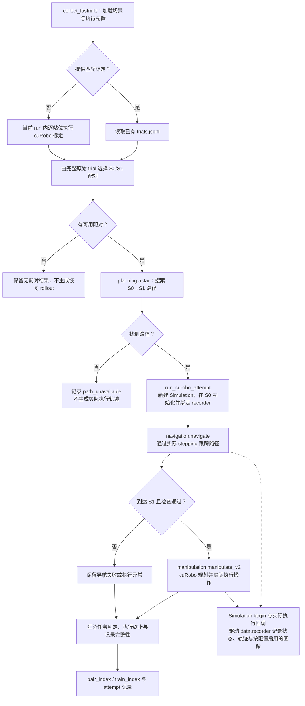

# 从 workflow 找到算法和执行

源码分为六个领域目录：**workflow 负责串流程，领域模块负责算法，runtime 负责实际运动，data 负责记录与结果。**
下面的代码树和流程图用于定位当前实现，不代表真实任务已经端到端验证。

| 目录 | 职责与主要入口 |
|---|---|
| `scenes/` | 场景/资产加载、任务发现、采样初始化、障碍物放置与场景物理检查；`dataset.py`，以及 `loading/`、`tasks/`、`stations/`、`augmentation/` |
| `runtime/` | 实际 stepping、机器人动作、构建事务、任务判定；`simulation.py`，以及 `control/`、`construction/`、`execution/`、`outcomes/` |
| `planning/` | cuRobo V2、碰撞/FOV、A* 和规划结果执行边界 |
| `policies/` | MolmoBot / π0.5 配置、服务与客户端 |
| `data/` | 根层 `recorder.py`；`rendering/` 图像视频、`evaluation/` 统计与选择、`visualization/` 图表、`export/` 模型导出 |
| `workflows/` | 场景构建、采集与 benchmark 的短编排 |

## 代码树：从入口找到实现

只列主要目录和阅读入口，省略 `__init__.py` 及辅助文件。路径相对于仓库根目录。

```text
src/lastmile_dataflow/
├── cli.py                         # 五个命令的参数与分发
├── config.py                      # 共用配置
├── utils/                         # 共用基础工具
│   ├── io.py                      # 读写与 run 创建
│   └── logging_config.py          # 统一日志格式与终端颜色
├── workflows/                     # 短编排，不放核心算法
│   ├── scene_datasets.py          # build_scenes：发现、资格检查、构建
│   ├── obstacle_augmentation.py   # 增强准备，由 scene_datasets 调用
│   ├── collection.py              # evaluate_stations / collect_lastmile
│   ├── station_calibration.py     # 全 run 标定调度：CPU 准备 / GPU 规划 / CPU trial
│   └── lastmilebench.py           # build / evaluate
├── scenes/                        # 场景、任务与候选站位
│   ├── dataset.py                 # 场景库读取与站位选择
│   ├── loading/                   # 场景与资产加载
│   ├── tasks/                     # discovery.py / eligibility.py
│   ├── stations/
│   │   ├── sampling.py            # sample_stations：初始化与可见性检查
│   │   └── initialization.py      # 站位初始化
│   └── augmentation/
│       ├── builder.py             # build_variant：实际障碍物增强
│       └── checks.py              # 增强场景物理检查
├── planning/                      # 规划，不直接替代真实执行
│   ├── curobo_v2.py               # cuRobo V2 规划与 planner 复用
│   ├── astar.py                   # S0→S1 路径搜索
│   ├── collision_world_v2.py      # 碰撞世界
│   ├── head_fov.py                # 头部视野约束
│   ├── pool.py                    # 每 GPU 一个常驻规划进程
│   └── remote.py                  # CPU 侧规划 RPC 客户端
├── policies/                      # MolmoBot / π0.5 策略
│   ├── molmobot_config.py         # 策略配置
│   ├── molmobot.py                # 客户端
│   ├── molmobot_service.py        # 推理服务
│   ├── multitask/                 # MolmoBot 模型与推理实现
│   └── pi05/                      # 共用 JAX 核心、服务、观测与 RBY 数据配置
├── runtime/                       # 仿真、实际动作与判定
│   ├── simulation.py              # Simulation：生命周期与 stepping
│   ├── execution_config.py        # 执行配置与 profile
│   ├── control/                  # 动作协议与机器人适配
│   ├── construction/             # 构建会话、事务与快照准备
│   ├── execution/
│   │   ├── curobo.py             # run_curobo_attempt
│   │   ├── vla.py                # 两策略共用 run_vla_attempt
│   │   ├── context.py            # 连续执行上下文
│   │   ├── navigation.py         # 路径跟踪与到达检查
│   │   ├── manipulation.py       # cuRobo 操作执行
│   │   ├── preparation.py        # prepare_station：站位共享准备
│   │   └── workers.py            # CPU 准备/执行进程入口
│   └── outcomes/                 # 接触、健康与任务结果判定
└── data/                          # 实际执行证据与结果处理
    ├── recorder.py               # AttemptRecorder：轨迹、状态与图像
    ├── evaluation/               # 原始 trial 统计、S0/S1 选择、评测汇总
    ├── rendering/                # 图像与视频
    ├── visualization/            # 成败热图与导航图
    └── export/                   # lastmile_dataset 物化/batch 读取、MolmoBot 与 LeRobot/π0.5 导出
```

## 四个 workflow

- `scene_datasets`：发现/资格检查，调用 `scenes.stations.sampling.sample_stations`，pick 构建调用增强器，open 保存场景。
- `obstacle_augmentation`：准备资产和基线，调用 `scenes.augmentation.builder.build_variant`。真实放置算法不再塞在 workflow。
- `collection`：`evaluate_stations()` 单独跑逐点 rollout 与热图；`collect_lastmile()` 用匹配标定或在当前 run 标定一次，先落盘全量 S0×S1 计划和已有成功标定示教，再执行连续导航与操作。两个入口共享 run 准备、场景循环和真实执行器，没有 continuous/calibration_only Python 模式开关。
- `lastmilebench`：由完整标定选择困难 S0，保存 native 场景并独立执行策略。设备/profile 工具来自 `runtime.execution_config`，不依赖采集 workflow。

`sample_stations` 只做初始化几何检查（`static_only=True`）或再加头部可见性，不执行规划或任务 rollout；
`evaluate_stations` 才产生真实 rollout，两者不混用。
cuRobo 和 VLA 共用 `Simulation`、接触/任务判定及 `data.recorder`；原生 motor 和 position 的实际语义仍由各自适配器处理。

cuRobo 标定可按站位使用 spawn worker：每 worker 独立载入未开始的场景基线，每个 trial 仍经 `run_curobo_attempt` 新建仿真。父进程分配编号、汇总唯一的 `trials.jsonl`；共享故障通过进程事件停止新增试验。`StationPlannerCache` 每站位最多保留每臂一个闭爪前 planner，相同初态时重绑仿真、FOV 和日志，并为新 seed 重建原生种子管理器；闭爪后继续重建。`ContactSampler` 缓存静态名称与分类，每物理步读取一次接触力，供任务 monitor 和接触统计共用，详细遥测只在需要时生成。

`config.py` 和 `cli.py` 是包根的共用配置和薄入口；`utils/io.py` 管理读写，`utils/logging_config.py` 统一日志配置。CLI 仅五个核心命令，build-scenes 在内部调用发现/资格检查/构建；不保留旧 workflow 文件、旧命令别名或 Shell 包装。

## 总流程：五个命令如何连接四个 workflow

实线表示命令分发或主要处理步骤，虚线表示产物供后续命令读取；不是完整的 Python 导入依赖图。
`obstacle_augmentation` 是内部编排，没有独立 CLI 命令。图中场景库、标定结果和 benchmark 都是磁盘产物。


热图用于展示；S0/S1 配对和困难 S0 选择读取原始 trial，而不是平滑后的颜色。
benchmark 按来源计划使用完整站位的原始计数，不重新标定；构建不依赖策略或 native 场景转换。`data/evaluation/recovery.py` 负责共享区域和诊断，路径搜索复用 `planning/astar.py`。策略需要的 native 控制适配在评测初始化阶段进行；隐藏 oracle 不发送到策略进程。

## build-scenes：发现 → 资格检查 → 构建

三个阶段顺序执行；发现与资格检查的产物只写临时目录（结束时删除），构建写入 `output_dir`。
下一阶段通过文件显式读取上一阶段结果，不共享内存状态。
发现阶段用少量静态站位快速筛选，资格检查才做完整候选站位检查；两者都只判断几何与初始化，不代表实测成功率。

```text
build-scenes (cli.py)
  |
  +-- workflows/scene_datasets.build_scenes(config, output_dir, run_id)
        |
        |  workers 必须在 1..12；output_dir 不存在则创建
        |  temporary = mkdtemp(scene-build-*)，发现/资格结果只放这里
        |
        +-- [1] discover_scene_dataset   -> temporary/discovery.json
        |        房屋级并行（ProcessPoolExecutor, spawn）；配方开启
        |        local_task_models 时按目标切局部模型
        |
        +-- [2] qualify_scene_discovery  -> temporary/qualified.json
        |        顺序逐房屋，消费 discovery 的 candidates
        |
        +-- [3] build_scene_dataset      -> output_dir/scene_datasets/<dataset_id>/
        |        单元级并行；先查配方一致性与目标配额
        |
        +-- finally: rmtree(temporary)
        +-- 回写 summary.json：wall_elapsed_s / phase_wall_s
```

### 发现与资格检查：逐目标决策

```text
[1] 发现：每个房屋 _discover_house
  |
  +-- 基线：SceneSource.procthor 或 recipe.input_snapshots 缓存基线
  |     （缓存 source/robot 与当前配方不一致 -> ValueError）
  |
  +-- discover_tasks -> _filter_tasks
  |     operation 在配方启用范围 -> categories -> pick_target_types
  |     -> selectors（只限制 pick）
  |
  +-- 每个目标 _probe_target（clone_preparation 独立探测，不改房屋基线）
  |     |
  |     +-- pick 且无合格支撑面              -> 排除
  |     +-- Case1 支撑类型不在白名单         -> 排除
  |     +-- sample_stations(static_only=True,
  |     |     stop_after_valid=min_prefilter_points)
  |     |     有效点 < 下限 -> 排除；否则记录 checked_stations
  |     |     （提前停止的下界，不是全量候选数）
  |     |
  |     +-- 合格目标进入 eligible 池，记录 input_snapshot
  |           （local_task_models 时先在该目标的局部模型上探测并 freeze）
  |
  +-- spatial_select：显式偏好 -> 房间/支撑面多样性 -> 最大最小 XY 距离
  +-- 未入选的合格目标记 eligible_not_selected_by_spatial_coverage
  |
  -> discovery.json：selected / candidates / houses / exclusions

[2] 资格检查：每个房屋 _select_qualified
  |
  +-- spatial_select 选一批 -> 逐目标 from_snapshot 独立仿真 _qualify_target
  |     |
  |     +-- sample_stations 全量静态采样（复用 checked_stations）
  |     +-- valid < min_final_points
  |     |     -> 未通过，从候选池剔除后重新补选
  |     +-- Case1 pick：station_regions + approach_points
  |     |     0.85 m 内无近地面点 -> 未通过 no_measured_near_ground_points
  |     +-- 已检查目标进 cache，补选不重复采样
  |
  +-- 补选直到数量满足或池空；不合格原因并入 exclusions
  -> qualified.json：覆盖 selected，追加 qualification 证据
```

### 构建：open 直接保存，pick 走有界增强

```text
[3] build_scene_dataset
  |
  +-- discovery.recipe 必须等于当前配方，否则 ValueError
  +-- allow_partial_targets=False（默认）-> _check_target_quotas
  |     每房屋 pick/open 数量不足 -> ValueError
  +-- create_run(.../scene_datasets/<dataset_id>) -> config.json
  +-- jobs = selected x cases x variants
  |     Case3 只配 open 目标；Case1/Case2 配 pick 目标，各 variants_per_case 份
  |
  +-- 每个工作单元 _build_unit（workers 并行）
        |
        +-- Case3/open ------------------------> _save_open_scene
        |     sample_stations 全量 -> select_stations(压缩到 max_final_stations)
        |       |-- 少于 min_final_points -> rejected(too_few_stations)
        |       +-- record_station_visibility -> freeze(scene-files/<scene_id>)
        |
        +-- Case1/Case2/pick ------------------> augment_obstacles
              -> build_variant（见下图），结果经 emit 收集
  |
  +-- 逐结果 append scenes.jsonl（接受与拒绝同表）
  +-- summary.json（accepted/rejected/sources/excluded_targets）-> 场景预览
```

```text
augment_obstacles + build_variant（一个目标、一个变体）
  |
  +-- 基线：input_snapshot 优先，否则 SceneSource；target = 目标实例
  +-- park_robot(anchor) + settle_scene   <- 先停机器人，再让物体静置
  +-- sample_stations(static_only) + support_regions
  |     无支撑面或有效站位不足 -> rejected(invalid_baseline)
  +-- station_regions（地面点与站位网格）；Case1 追加 approach_points
  +-- environment_pool -> ThorLibrary.retrieve -> asset_geometry
  +-- surface_points（Case1 只保留 near_target_m 内的台面点）
  |
  +-- ObstacleEditSession：每个变体独立 seed，不累加前一个变体
        |
        +-- mkdir(path, exist_ok=False)；count = rng(obstacle_count 区间)
        +-- case_assets 抽资产（类别或台面面积不足 -> rejected）
        |
        +-- loop candidate_index < max_candidates:
              |-- 超 variant_timeout_s -> rejected(variant_timeout)
              |-- 地面资产随机点 + 随机 yaw；台面资产走
              |   sample_surface_point（间距/占位约束）
              |-- sample_placement -> session.candidate(placements + 提案)
              |     粗碰撞不通过 -> session.reject()，下一个候选
              |-- 未放满 count -> 继续追加
              +-- 放满 count -> physical_trials += 1
                    |-- session.settle + matched_control（同场景无编辑对照）
                    |-- validate_augmented_scene：碰撞/支撑/源场景影响/
                    |   Case 构造/静置与求解健康
                    |     不通过 -> 清空 placements、session.reject()；
                    |     物理试验预算耗尽 -> rejected
                    |-- sample_stations(frozen_stations=基线站位)
                    |   -> select_stations；< min_final_points -> rejected
                    |-- 回填 settled_pose；可选 record_station_visibility
                    |-- freeze(scene) 与 freeze(before-scene)；可选 before/after 渲染
                    +-- accepted
        |
        +-- 候选用尽 -> rejected(candidate_budget_exhausted)
        +-- 每个变体结束都 session.reject()（超时也一样），只释放临时候选，
            已 freeze 的场景不受影响
```

## 标定：逐站位 rollout → 原始 trial → S0/S1 门槛

`evaluate-stations` 的主体是标定：逐站位 trial、原始记录与热图；`collect-lastmile` 先做同样的标定再用于配对。
三条实现路径（复用已有标定、全 run 调度器、逐场景串行/站位并行）共享同一份 `trials.jsonl`
格式；后两条路径由父进程唯一写入。

```text
evaluate-stations / collect-lastmile
  |
  +-- evaluate_stations(...)              collect_lastmile(...)（仅 cuRobo）
  |             |                                  |
  +-------------+----------- _run_dataset ---------+
                            |
                            +-- _prepare_run
                            |     数据集 config.json 的 geometry 键覆盖执行配置
                            |     load_scenes；逐场景 robot_config
                            |       + execution_profile + check_profile
                            |     --calibration：profiles 与 calibration_execution
                            |       必须匹配，匹配则直接读 trials.jsonl（prior）
                            |     create_run -> config.json
                            |       （dataset/config/profiles/resources/seed/calibration）
                            |
                            +-- 标定（prior 为空时）
                            |     shared_station_preparation=True 且 cuRobo
                            |       -> calibrate_stations（全 run 调度器，见下）
                            |     否则 _station_trials（逐场景）
                            |       station_workers=1  -> _station_records 串行
                            |       station_workers>1  -> _parallel_station_records
                            |         每 worker 常驻一个已载入场景的 Simulation
                            |         父进程唯一追加 trials.jsonl
                            |
                            +-- collect-lastmile：_plan_collection
                            |     pair_index.jsonl   全部 S0 x S1，status=not_executed
                            |     train_index.jsonl  已有 S1 直采成功示教
                            |
                            +-- 逐场景 process_scene
                            |     evaluate-stations -> _evaluate_scene（只标定）
                            |     collect-lastmile  -> _collect_scene（热图后走 A*）
                            |
                            +-- finally：summary.json
                                  status=completed 仅当全部场景处理且无共享故障
```

### 全 run 调度器：calibrate_stations

```text
calibrate_stations（父进程 = 唯一 trials.jsonl 写入者）
  |
  |  stations()：按场景与站位展开 TrialIdentity 和 TrialBudget
  |    每站位 trials_per_station 次（max_trials 可截断），
  |    seed = config.seed + index*tps + trial
  |
  +-- CPU 准备池（preparation_workers，CUDA_VISIBLE_DEVICES=''）
  |     prepare_job -> SnapshotCache 取基线 -> prepare_station
  |       ready   -> 生成 PlanningRequest(stage='preclose' 批量抓取规划)
  |       失败    -> preparation.json；shared 故障 -> stop
  |
  +-- GPU 规划池（PlanningPool：每卡一个常驻进程，pose 请求优先派发）
  |     preclose 批量：grasp_batch -> 每 trial 一条 PlanningResponse
  |       success    -> ready
  |       非 success -> 交准备池 record_unexecuted（只记录，不跑物理）
  |     pose 单次：CPU worker 运行中发来的分阶段规划，按 query_id 回投
  |
  +-- CPU 执行进程（cpu_workers，各自独立 MjData）
  |     execution_worker -> PlanningClient(绑定批量响应) -> run_curobo_attempt
  |     结果回 results 队列 -> save() -> append trials.jsonl
  |
  +-- 有界开窗
  |     buffered = active + ready + recordings + preparations + batches
  |     仅当 preparations < preparation_workers 且
  |       buffered + trials_per_station <= capacity 才取下一组
  |
  +-- 共享故障（failure_scope=shared / infrastructure_error / worker 退出）
  |     stop.set() -> 停止新增试验，未执行项补记 infrastructure_error
  |
  +-- finally：join 进程、关闭队列、恢复 CUDA_VISIBLE_DEVICES
  +-- 返回 trials + summary（planned/recorded/preparation_failures/peaks/gpu_active_s）
```

真正执行的 trial 都从 `run_curobo_attempt` 进入；split 模式下规划未成功的 trial
由 `record_unexecuted` 只写记录，不跑物理。

```text
run_curobo_attempt
  |
  +-- isolated_episode：建立 episode 作用域并统一关闭资源
  |   （attempt_id 由调用方分配）
  +-- clone_sim(baseline) -> place_frozen_station 或 prepared.state.initialize
  +-- AttemptRecorder 绑定仿真 -> initial_state.json
  +-- 有 path -> navigate（折线跟踪与到达检查）
  |   无 path 且未用 prepared -> 先 initial_settle，然后直接操作
  +-- manipulate_v2：cuRobo 规划并实际执行
  |   带 path 时失败按 operation_retries 重试，标定不重试
  +-- recorder.finish -> execution_termination / task_outcome /
                          recording_complete / replay_complete
```

### 标定结果如何变成 S0/S1

```text
trials.jsonl（一行一次 trial）
  |
  +-- station_calibration
  |     evaluable 状态：success / failure / planning_no_solution / timeout
  |     同一个站位重复 trial 编号 -> ValueError
  |     complete = 每个站位有效 trial 数 == trials_per_station
  |
  +-- eligible_stations
  |     complete=False -> 返回空（不用于困难配对）
  |     只看 geometry=='valid' 站位：rate = successes / trials
  |       S0: rate <= lastmile_low      S1: rate >= lastmile_high
  |
  +-- generate_pairs：S0 x S1 全组合，不在这步按路径或距离过滤
  |
  +-- 热图 aggregate -> figures/<scene_id>：只展示，不参与选择
  |
  -> collect-lastmile 在这里接 A* 与连续 attempt（见下节）
```

## 连续采集：先标定，再在同一次 attempt 中导航和操作

S0 是低成功率起点，S1 是候选高成功率操作站位。`collect_lastmile()` 当前只支持 cuRobo，
不会在连续采集中切换到 MolmoBot。每个 S0/S1 配对新建独立 attempt；进入实际 stepping 后不重置或传送。



虚线表示执行过程中同步记录，不是执行完再补造轨迹。导航到达、操作成功、执行终止和记录完整性分别报告，
不能用命令退出码或文件存在替代任务成功判定。

## 实际执行与记录入口

- cuRobo：`runtime.execution.curobo.run_curobo_attempt()`。
- MolmoBot / π0.5：`runtime.execution.vla.run_vla_attempt()`。
- 连续上下文与共用导航：`runtime.execution.context`、`runtime.execution.navigation`。
- 两个 attempt 入口显式接收 `root=...`、`attempt_id=...`；其他在用调用方已同步，不保留旧模块转发。

实际轨迹、初始状态与 PNG 由 `Simulation.begin()` / 实际执行回调触发 recorder；执行器在下发前设置 phase，不再组装一份 recorder 不使用的 before/after 状态。
场景采样仍可用构建期 runtime 能力，但不依赖 workflow；目录分组没有引入新的协议层或注册中心。

## 独立物化

`collect-lastmile --materialize-from` 直接调用 `data.export.lastmile_dataset.materialize_lastmile`，不载入仿真、资产或 GPU 后端。它按 train_index 复制唯一成功轨迹和必要观测，保留 pair 全集及来源，以内部相对路径交付。`load_training_batch` 读取原始 20D 动作窗口；不替代模型专用格式转换。

π0.5 控制与数据准备细节见 [π0.5 运行指南](../reports/pi05/docs/01-running.md)。Panda 路线 B 经 FK 和反馈跟踪产生 RoboCasa 动作，与模型共用 `runtime/control/panda_robocasa.py`；RBY-1 使用 position 动作。

## Panda 标定双池

`workflows/station_calibration.py` 调度全 run 的有界准备、GPU 查询与 CPU trial 队列，父进程唯一写原始 trial。`planning/pool.py` 的 spawn 进程拥有 CUDA、solver 和规划视图；`planning/remote.py` 在 CPU 侧将实测状态转为后续请求。

`runtime/execution/workers.py` 创建独立 MjData，并继续调用原 `run_curobo_attempt`、`ContinuousContext`、跟踪器和任务判定。`protocol.py` 传递数值状态、身份及累计活跃预算；`SnapshotCache` 仅在进程内保留少量只读模型。`data/rendering/replay.py` 使用独立 MjData 逐帧 mj_forward 回放，不参与任务成败。
