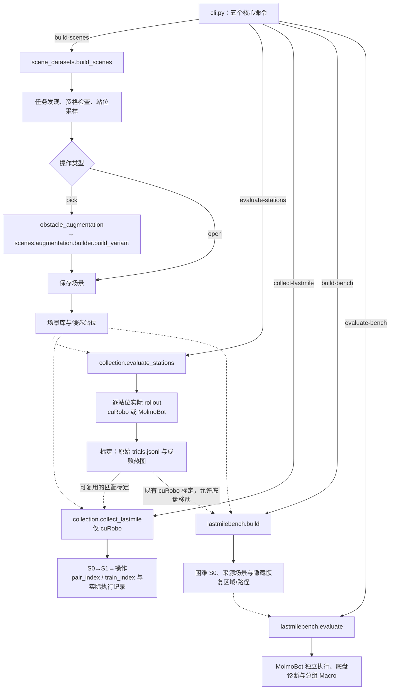
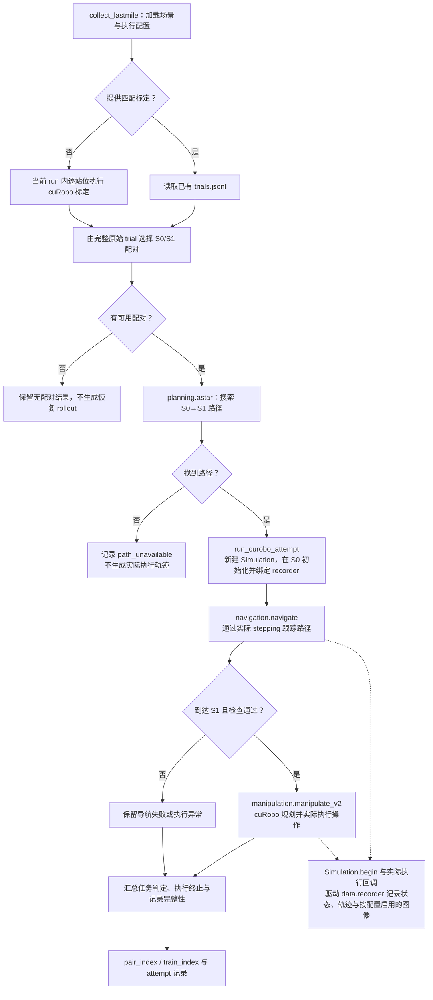

# 从 workflow 找到算法和执行

源码分为六个领域目录：**workflow 负责串流程，领域模块负责算法，runtime 负责实际运动，data 负责记录与结果。**
下面的代码树和流程图用于定位当前实现，不代表真实任务已经端到端验证。

| 目录 | 职责与主要入口 |
|---|---|
| `scenes/` | 场景/资产加载、任务发现、采样初始化、障碍物放置与场景物理检查；`dataset.py`，以及 `loading/`、`tasks/`、`stations/`、`augmentation/` |
| `runtime/` | 实际 stepping、机器人动作、构建事务、任务判定；`simulation.py`，以及 `control/`、`construction/`、`execution/`、`outcomes/` |
| `planning/` | cuRobo V2、碰撞/FOV、A* 和规划结果执行边界 |
| `policies/` | MolmoBot 配置、服务与客户端 |
| `data/` | 根层 `recorder.py`；`rendering/` 图像视频、`evaluation/` 统计与选择、`visualization/` 图表、`export/` 模型导出 |
| `workflows/` | 场景构建、采集与 benchmark 的短编排 |

## 代码树：从入口找到实现

只列主要目录和阅读入口，省略 `__init__.py` 及辅助文件。路径相对于仓库根目录。

```text
src/lastmile_dataflow/
├── cli.py                         # 五个命令的参数与分发
├── config.py                      # 共用配置
├── utils/                         # 共用基础工具
│   ├── io.py                      # 读写与 run 创建
│   └── logging_config.py          # 统一日志格式与终端颜色
├── workflows/                     # 短编排，不放核心算法
│   ├── scene_datasets.py          # build_scenes：发现、资格检查、构建
│   ├── obstacle_augmentation.py   # 增强准备，由 scene_datasets 调用
│   ├── collection.py             # evaluate_stations / collect_lastmile
│   └── lastmilebench.py           # build / evaluate
├── scenes/                        # 场景、任务与候选站位
│   ├── dataset.py                 # 场景库读取与站位选择
│   ├── loading/                   # 场景与资产加载
│   ├── tasks/                     # discovery.py / eligibility.py
│   ├── stations/
│   │   ├── sampling.py            # sample_stations：初始化与可见性检查
│   │   └── initialization.py      # 站位初始化
│   └── augmentation/
│       ├── builder.py             # build_variant：实际障碍物增强
│       └── checks.py              # 增强场景物理检查
├── planning/                      # 规划，不直接替代真实执行
│   ├── curobo_v2.py               # cuRobo V2 规划
│   ├── astar.py                   # S0→S1 路径搜索
│   ├── collision_world_v2.py      # 碰撞世界
│   └── head_fov.py                # 头部视野约束
├── policies/                      # MolmoBot 策略
│   ├── molmobot_config.py         # 策略配置
│   ├── molmobot.py                # 客户端
│   ├── molmobot_service.py        # 推理服务
│   └── multitask/                 # 模型与推理实现
├── runtime/                       # 仿真、实际动作与判定
│   ├── simulation.py             # Simulation：生命周期与 stepping
│   ├── execution_config.py       # 执行配置与 profile
│   ├── control/                  # 动作协议与机器人适配
│   ├── construction/             # 构建会话、事务与快照准备
│   ├── execution/
│   │   ├── curobo.py             # run_curobo_attempt
│   │   ├── molmobot.py           # run_vla_attempt
│   │   ├── context.py            # 连续执行上下文
│   │   ├── navigation.py         # 路径跟踪与到达检查
│   │   └── manipulation.py       # cuRobo 操作执行
│   └── outcomes/                 # 接触、健康与任务结果判定
└── data/                          # 实际执行证据与结果处理
    ├── recorder.py               # AttemptRecorder：轨迹、状态与图像
    ├── evaluation/               # 原始 trial 统计、S0/S1 选择、评测汇总
    ├── rendering/                # 图像与视频
    ├── visualization/            # 成败热图与导航图
    └── export/                   # lastmile_dataset 物化/batch 读取、MolmoBot 导出
```

## 四个 workflow

- `scene_datasets`：发现/资格检查，调用 `scenes.stations.sampling.sample_stations`，pick 构建调用增强器，open 保存场景。
- `obstacle_augmentation`：准备资产和基线，调用 `scenes.augmentation.builder.build_variant`。真实放置算法不再塞在 workflow。
- `collection`：`evaluate_stations()` 单独跑逐点 rollout 与热图；`collect_lastmile()` 用匹配标定或在当前 run 标定一次，先落盘全量 S0×S1 计划和已有成功标定示教，再执行连续导航与操作。两个入口共享 run 准备、场景循环和真实执行器，没有 continuous/calibration_only Python 模式开关。
- `lastmilebench`：由完整标定选择困难 S0，保存 native 场景并独立执行策略。设备/profile 工具来自 `runtime.execution_config`，不依赖采集 workflow。

`sample_stations` 只检查候选点的初始化与可见性；`evaluate_stations` 才执行规划/策略 rollout，两者不混用。
cuRobo 和 VLA 共用 `Simulation`、接触/任务判定及 `data.recorder`；原生 motor 和 position 的实际语义仍由各自适配器处理。

`config.py` 和 `cli.py` 是包根的共用配置和薄入口；`utils/io.py` 管理读写，`utils/logging_config.py` 统一日志配置。CLI 仅五个核心命令，build-scenes 在内部调用发现/资格检查/构建；不保留旧 workflow 文件、旧命令别名或 Shell 包装。

## 总流程：五个命令如何连接四个 workflow

实线表示命令分发或主要处理步骤，虚线表示产物供后续命令读取；不是完整的 Python 导入依赖图。
`obstacle_augmentation` 是内部编排，没有独立 CLI 命令。图中场景库、标定结果和 benchmark 都是磁盘产物。



热图用于展示；S0/S1 配对和困难 S0 选择读取原始 trial，而不是平滑后的颜色。
benchmark 按来源计划使用完整站位的原始计数，不重新标定；构建不依赖策略或 native 场景转换。`data/evaluation/recovery.py` 负责共享区域和诊断，路径搜索复用 `planning/astar.py`。策略需要的 native 控制适配在评测初始化阶段进行；隐藏 oracle 不发送到策略进程。

## 连续采集：先标定，再在同一次 attempt 中导航和操作

S0 是低成功率起点，S1 是候选高成功率操作站位。`collect_lastmile()` 当前只支持 cuRobo，
不会在连续采集中切换到 MolmoBot。每个 S0/S1 配对新建独立 attempt；进入实际 stepping 后不重置或传送。



虚线表示执行过程中同步记录，不是执行完再补造轨迹。导航到达、操作成功、执行终止和记录完整性分别报告，
不能用命令退出码或文件存在替代任务成功判定。

## 实际执行与记录入口

- cuRobo：`runtime.execution.curobo.run_curobo_attempt()`。
- MolmoBot：`runtime.execution.molmobot.run_vla_attempt()`。
- 连续上下文与共用导航：`runtime.execution.context`、`runtime.execution.navigation`。
- 两个 attempt 入口显式接收 `root=...`、`attempt_id=...`；其他在用调用方已同步，不保留旧模块转发。

实际轨迹、初始状态与 PNG 由 `Simulation.begin()` / 实际执行回调触发 recorder；执行器在下发前设置 phase，不再组装一份 recorder 不使用的 before/after 状态。
场景采样仍可用构建期 runtime 能力，但不依赖 workflow；目录分组没有引入新的协议层或注册中心。

## 独立物化

`collect-lastmile --materialize-from` 直接调用 `data.export.lastmile_dataset.materialize_lastmile`，不载入仿真、资产或 GPU 后端。它按 train_index 复制唯一成功轨迹和必要观测，保留 pair 全集及来源，以内部相对路径交付。`load_training_batch` 读取原始 20D 动作窗口；不替代模型专用格式转换。
