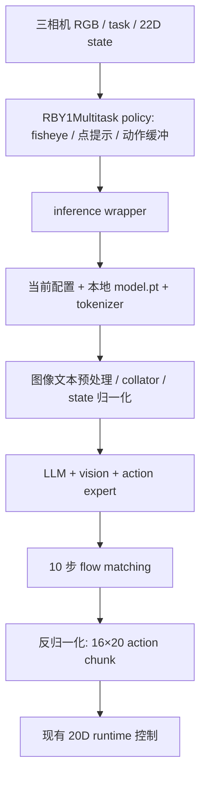

# MolmoBot multitask 最小推理迁移调研

> 后续执行：方案 B 已迁移，并按用户要求统一为 `.venv`；真实推理对比与服务验证见 [实施记录](2026-10-14-molmobot-multitask-implementation.md)。下文是迁移前调研结论。

**可以从 `MolmoBot/MolmoBot/` 迁移推理代码，不需要整个仓库或完整 eval 依赖。** 推荐迁移“当前 RBY1Multitask 权重真正使用的推理闭包”，保留原模型计算、参数名和预处理；不重写模型，不复制训练/通用评测工程。

但不能只复制 `inference_wrapper.py`，也不能只从依赖列表删几个包。当前模型通过通用训练工具和配置入口间接带入了大量无关依赖，必须一起解除这些调用。

## 调研范围与实际结果

只读检查了用户指向的 `MolmoBot/MolmoBot/olmo/`、本仓库现有服务桥接，以及本机已有 RBY1Multitask 的 `config.yaml`；未读取大型 model.pt、未加载权重或执行推理，也未迁移模型代码。

本地 wrapper、isolated multitask policy 和 model.py 与本轮获取的官方源码内容相同，不存在这三个入口必须依赖本机专用 fork 的证据。

前一轮约 153 个上游基础依赖已在停止请求前自然安装完成，状态应修正为“基础包已安装，但模型未验证”：

- isolated wrapper/policy 顶层导入通过，未导入 MolmoSpaces。
- checkpoint / model-config 惰性导入实际报 `ModuleNotFoundError: torchmetrics`。
- policy 环境 pip check 还提示 decord 平台不支持。decord 属于视频路径，不是当前三相机单次观测的必需输入。

这说明“导入 wrapper 成功”不能作为“multitask 可运行”的验收，也说明直接安装上游基础包既装了冗余包，又未覆盖所有惰性推理导入。

## 当前权重决定要保留什么

本机现有配置：

| 内容 | 实际值与意义 |
|---|---|
| model_name | `molmoact`；这是当前权重真实字段，不能当作无用历史别名直接删掉 |
| 输入状态 / 输出动作 | 22D state，16×20 action chunk；保留相同组顺序和物理单位 |
| 视觉与文本 | SigLIP 视觉 + Qwen3 风格 LLM，不是仅调用 transformers 的现成语言模型即可替代 |
| 注意力 / 并行 | LLM 和 ViT 均为 SDPA，cp_enabled=false；此配置不要求单独安装 flash-attn 或迁入多卡 CP 路径 |
| 动作生成 | action expert + 10 步 flow matching；不能用简单动作头替代 |
| 归一化 | 配置内已含 state min/max 和 action quantiles；必须原样消费，不能省略或换统计量 |
| 权重文件 | 当前目录有 config.yaml / model.pt；单机未分片加载可直接保留现有 torch.load + strict load_state_dict 逻辑 |
| tokenizer | 配置指向 Qwen/Qwen3-4B-Instruct-2507；本地权重目录没有 tokenizer 文件，仍要单独准备对应 tokenizer |

不能因为父类叫 `VideoOlmo` 就把它整体删除：`MolmoBot` 继承其多模态组装、LLM/视觉调用和 image-token 逻辑。可以删视频读取/训练分支，不能删模型实际继承的计算。

## 最小真实调用链

这是源码调用关系，不是已运行的 forward 或机器人成功证据。

源码阅读入口：`olmo/eval/real_robot_molmobot_rby1_multitask.py`、`real_robot_molmobot_rby1_door.py`、`olmo/models/molmobot/inference_wrapper.py`、`molmobot.py`、`olmo/data/robot_processing.py`、`image_warping_utils.py`。

头部 fisheye 使用 Torch/Numpy 变换，不需要因此额外安装 OpenCV。相机顺序、裁剪/resize、图像特殊 token、点坐标变换、state/action 缩放和夹爪模式都属于模型语义，不能在“轻量化”时省略。

## 哪些可迁移，哪些不要

| 部分 | 处理 |
|---|---|
| isolated RBY1 multitask / door policy | 保留实际 obs/action、buffer、点提示；去掉无关任务入口 |
| inference wrapper | 保留当前 checkpoint 的完整加载与 forward；只接本地完整权重，不引入远端/分片训练 checkpoint 管理 |
| LLM / vision / action expert | 迁移当前权重用到的计算与配置；保持 state_dict 参数名，不擅自重构架构 |
| preprocessor / collator / tokenizer / normalizer | 保留推理路径，删除训练样本构造、视频文件读取、数据保存与随机训练增强路径 |
| model-config 通用入口 | 直接支持当前 multitask 配置，不遍历所有模型类型或引入其他任务家族 |
| train.checkpointer / 通用 io / util | 提取必要的本地文件读取、权重加载、张量工具；不搬整个训练/云存储框架 |
| TorchMetrics、训练损失、优化器、FSDP/CP/Ulysses | 当前单卡推理不执行；解除顶层导入后删除，不用假模块掩盖问题 |
| Pi0、SPOC、DROID/Franka 专用入口、排行榜/模拟评测框架 | 不迁移；multitask 实际依赖的共用算子除外 |
| notebook、视频解码、datasets/pyarrow/pandas、云存储 SDK | 推理 API 只收内存 RGB/state、权重只读本地时，不应作为该后端的直接依赖 |

例如：`train/checkpointer.py` 已有未初始化 distributed 时的普通 torch.load 分支；无需迁入分片保存/优化器恢复。`models/model.py` 为 metrics 字段顶层导入 torchmetrics，当前却不做评测统计；可以把推理输出类型与训练 metrics 分离。

图像预处理还通过 `data.dataset` 和通用 io 导入了 dataset 路径常量、远端文件工具。只删 pyproject 的 datasets/boto3 不会解除这种导入，必须同步裁剪代码。

## 依赖可以不下载全，但分两种方案

**方案 A：仅保留现有源码，快速跑通。** 不装完整 eval；补齐实际惰性导入缺少的运行依赖。改动少，但会继续受通用训练/io 入口牵连，不能保证环境轻。

**方案 B：迁移最小推理闭包，推荐。** 不安装整个 molmobot 包的基础依赖列表，项目自己声明推理依赖。直接依赖候选是：

- Torch / torchvision、Numpy / Pillow、einops：模型与实际图像变换。
- transformers / tokenizers：当前 tokenizer 和图像预处理接口。
- OmegaConf / PyYAML：当前权重配置读取；首版保留，不同时重写配置系统。
- pydantic：原 policy 配置若保留其接口就保留。
- Hugging Face 工具用于模型/tokenizer 获取，可随 tokenizer 依赖或单独下载环境提供；本地 model.pt 不意味着 tokenizer 已离线就绪。

requests 等 transitive 依赖由上述包安装；不承诺“总共只有几个包”。safetensors 若仅保留本地 model.pt 路径，可以移除对应未用加载入口；不能先删依赖却保留顶层 import。

不把 Torch 自身需要的 CUDA 运行库视为可以直接删掉的冗余。flash-attn、视频解码、训练/评测 SDK 则不因仓库其他能力而强制安装。

## 建议迁移步骤

1. **先建立真实基线：** 选当前本地完整权重和对应 tokenizer，原源码成功加载，并对固定三相机/state 做一次真实 action chunk。必要时只补这条路径的缺失依赖，不装完整 eval。
2. **只迁入推理闭包：** 放到 `policies/multitask/` 一层模型子包；按 policy、inference/config、模型组装、LLM、vision、action expert、预处理分文件。不按每个旧目录再分包，也不塞成一个巨型文件。
3. **先解除耦合再删：** 本地权重加载代替训练 checkpointer；推理输出代替训练 metrics 类型；内存图像代替 dataset/video/云文件入口。先保持模型参数名与实际运算不变。
4. **再缩依赖：** 在新独立策略环境只安装推理候选依赖；不要 pip install 整个上游包再期待它不拉 notebook/cloud 依赖。
5. **少量实测验收：** 用同一权重、seed、输入比较预处理结果和 action chunk；pick/open 夹爪模式与点提示分别覆盖实际差异。然后接回现有 service/client，不新增另一套 rollout/runtime。

迁移需保留上游 `MolmoBot/LICENSE` 和来源说明；本地许可为 Apache 2.0。不增加来源追踪/封存协议。

## 结论与未验证项

**建议迁移推理代码，但首轮不要重写神经网络。** 真正的收益是去掉训练、云 IO、dataset/video、通用评测依赖，而不是删掉 LLM/视觉层。

本轮没有迁移代码、安装新依赖、加载权重或真实 forward。候选依赖还不是经过权重加载验证的最终列表；已有 tokenizer 是否缓存、完整权重与当前源码是否严格匹配，仍需在步骤 1 实测。CUDA 卡在运行前重新按利用率和显存选择，不把此前 CUDA 6 写成默认。
