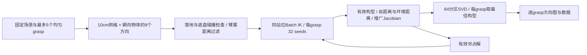

# SE(2) 底盘可达质量图：直接重构与 val103 / Cup_30 构建方案

- 状态：draft
- 日期：2026-11-05
- 替代：无；本方案落实最新主动采样需求
- 关联：[../requirement/01-base-irm.md](../requirement/01-base-irm.md)；实现后的结果写入 `../delivery/01-val103-cup30.md`

本方案用于下一阶段实施，不代表代码已修改或真实构图已完成。继续使用 `/data1/wenyifan/lmdf/LastMileDataFlow/.worktrees/base-map`，不新建 Git 分支，不保留旧/新两套站位图构建模式。用户已确认 `evaluate-stations` 改为只构建 IK 质量图；质量图以后取代逐点成败图，作为采集选站位的依据（S0/S1 定义保留，规则另定）；物理执行留在采集链路。

## 1. 最终行为及首版范围

输入固定场景、Panda-Omron 本体和 Cup_30 grasp 候选；输出离散 `(x,y,yaw)` 的最佳扩展可操作度、对应构型、IK 有效率和可视化。

主流程：



- 位置固定为 **10 cm** 网格，不做 5 cm 或自适应加密。
- 以底盘指向物体中心的方向为零偏角，采样 **−60° 至 +60°，步长 15°，共 9 个**；不是完整 360°。
- 底盘 z、roll、pitch 及升降固定；只优化 Panda 七关节手臂。
- 每 `(站位, grasp)` 32 seeds，返回全部候选；最终分数取有效构型的最高 Extended Manipulability。
- collision penalty 直接缩放平移三行，保留用户确认的旋转项限制；完整 6×7 Jacobian 参与 64 分区 SVD。
- IK 有效率单独记录，不参与分数、颜色、站位采样或排序。
- 5 个 grasp 各出一张图，首版不跨 grasp 合成综合质量。
- 目标杯子只做硬碰撞检查（手指接触按现有规则豁免），不进距离惩罚；支撑桌面默认也不进距离惩罚，由参数 `penalize_support_surface` 开启。
- 不构建 RD/IRD、Reach List、Occupation List，不进行轨迹规划、闭爪或抬升。

## 2. 已核实的工程与输入事实

| 核查项 | 实际观察及实施含义 |
|---|---|
| 当前工作区 | 源码无已跟踪修改；`reports/base-map/` 是既有未跟踪资料，保留论文和当前文档 |
| 现有构图 | `collection._station_summary` 将物理 trials 聚合后调用 `heatmap.export_heatmap`，后者做高斯成功率插值；需要替换 |
| 当前采样 | `disk_samples` 可复用；`sample_stations/initialize_station` 会检查初始整机姿态，不能直接作为本任务的底盘粗筛 |
| 当前 IK | `V2Planner.diagnostic_ik` 使用原生 `solve_pose`，已有完整 seed 覆盖统计，但没有把多构型作为公共结果返回 |
| 当前环境 | `V2Planner` 的 batch 为 `multi_env=False`，同一 batch 共用环境；不能直接混入不同底盘系的站位 |
| 本地依赖 | 主仓库 `.venv` 的包元数据为 nvidia-curobo 0.8.0、MuJoCo 3.5.0；尚未运行本任务 GPU 求解 |
| 数据根 | 存在 `/data1/wenyifan/lmdf/molmospaces_data`；旧配置中的 `/data1/wenyifan/molmospaces_data` 当前不存在 |
| 场景 | `assets/scenes/procthor-10k-val/val_103.xml` 及配套 metadata 已找到 |
| 目标 | metadata 中 `asset_id=Cup_30`、`object_id=Cup\|surface\|2\|28` 可唯一定位到实例 |
| grasps | `assets/grasps/droid/Cup_30/Cup_30_grasps_filtered.npz`，`transforms` 为 `(1000,4,4)` |
| 原生接口 | 本地 cuRobo 源码支持 `solve_pose(seed_config=..., return_seeds=...)` 和 `SceneCollision.update_obstacle_pose` |

这些是文件与源码检查结果，不构成 FK、碰撞或端到端运行通过。当前 worktree 尚无自己的 `.venv`，实施时按仓库安装方式准备环境，不能无说明地借用指向其他源码的 editable 环境。

## 3. 直接重构范围与删除清单

### 3.1 命令职责

保留五个公开 CLI 命令。重写 `evaluate-stations` 的执行主链，保留 `--recipe` / `--dataset` 输入形式及 `--config --run-id --output-dir --gpu` 等必要参数，不新增 `--base-map`、`--legacy-map` 或第六个命令。

- `--recipe`：读取未增强的源场景、明确目标和机器人配置，直接构图；不先调用会选少量站位或进行物理试跑的场景构建过程。
- `--dataset`：读取已有场景快照与任务，重新生成全量 10 cm × 9 朝向站位；不继承旧 `max_final_stations=20` 的稀疏站位作为地图全集，不改写输入数据集。
- `--samples` 保留用于选择输入场景。首版真实交付限于 Panda-Omron、Cup_30 pick；不宣称其他本体/Open 已验收。
- 从 `evaluate-stations` 删除物理试验次数、连续采集 worker、录制物理 rollout 等已无意义的参数与默认行为；仍被 `collect-lastmile` 使用的参数留在该命令。
- 历史 rollout 回放仍使用现有渲染函数/显式 smoke 工具，不将旧物理标定留作新构图的模式分支；同步修改原 `--replay-from` 的运行说明。

### 3.2 文件职责与改动

| 文件（相对仓库根目录） | 实施内容 |
|---|---|
| `src/lastmile_dataflow/cli.py` | 拆开站位图与物理采集的参数解析和分发；`evaluate-stations` 只调用新构图主流程 |
| `src/lastmile_dataflow/config.py` | 增加小型 `BaseMapConfig` 及显式字段解析，避免继承整套物理执行配置 |
| `src/lastmile_dataflow/workflows/collection.py` | 重写 `evaluate_stations/evaluate_recipe` 的调用关系，移除 `_evaluate_scene` 的旧独立物理标定路径；采集所需 trial/统计流程继续服务采集 |
| `src/lastmile_dataflow/workflows/station_calibration.py` | 放置新的 `build_station_map` 薄编排；已有被采集调用的物理调度/诊断函数不因文件同名误删 |
| `src/lastmile_dataflow/scenes/stations/sampling.py` | 复用位置格点函数，提取共享朝向生成，增加底盘固定几何过滤；地图完整保留 ix/iy/heading 索引 |
| `src/lastmile_dataflow/planning/curobo/planner.py` | 增加多候选 IK 返回及固定本体的站位更新；复用现有模型、求解器和接触语义；旧 diagnostic 调用共享核心 |
| `src/lastmile_dataflow/planning/curobo/collision_world.py` | 固定场景几何只导出一次；站位变化更新障碍物 pose，避免重复上传/构建 mesh |
| `src/lastmile_dataflow/planning/manipulability.py`（新增） | Jacobian、最近点距离梯度、方向惩罚、批量 SVD；这是唯一新增的核心算法模块 |
| `src/lastmile_dataflow/data/evaluation/statistics.py` | 增加 seed 统计和质量最大值聚合；物理成功率统计仍归物理记录，不混用字段 |
| `src/lastmile_dataflow/data/visualization/heatmap.py` | 直接替换高斯成功率图为离散质量图、九方向面板、grasp 对照及交互查看页 |
| `tests/` 中相应领域 | 修改受影响测试，添加实际数学/数据语义检查；删除只断言旧高斯图行为的测试 |

不另建平行采样包、执行器、规划池或重复报告索引。配置与结果只使用必要的顶层 dataclass，例如 `BaseMapConfig`、`IKBatchResult`；大量 seed 数据使用有固定维度的数组。

明确删除：`gaussian_map` 及其旧图导出实现；只为旧成功率图服务的 sigma/support-distance 参数和图测试；旧 evaluate-stations 独有且重构后无调用的物理编排。`yaw_variants`、`robot_contacts`、物理 `aggregate`、诊断 IK 等还有其他业务调用的公共能力，改为复用或保留其实际职责，不保留空兼容壳。

新图使用 `quality/ik_valid_rate` 字段，不生成伪 `success_rate` 或 `trials.jsonl`；新输出带明确 `kind=base-quality-map-v1`，在数据入口区分即可，不引入通用 schema 框架。

用户已选定：质量图取代逐点成败图，作为 `collect-lastmile` 选站位的依据；S0/S1 的定义保留，选取规则改为基于质量图，新规则另行确定。现状是 `collect-lastmile`（`collection.py` 读取标定目录的 `trials.jsonl`）和 `build-bench`（`lastmilebench.py` 读取 `trials.jsonl`）都依赖旧成败记录。本轮先交付质量图；新 S0/S1 规则确定并实现之前，这两个命令遇到质量图输入时明确报错说明原因，不把质量当成功率读入，也不为旧成败图保留第二套构建模式。这段时间主链的“逐点成败图 → S0→S1”环节暂不可用，README 与运行手册如实注明；collision-handling 的 Cup_30 20 站位物理基准同样暂停。

## 4. 场景准备、grasp 和固定参数

### 4.1 固定输入

使用上表已找到的原始 val103 XML、metadata 和 Cup_30 实例。新配置采用正确数据根；机器人模型相对于同一数据根解析，直接通过 `robot_config(...)` 构造配置，避免先解析到旧的不存在路径再覆盖。

场景通过 `SceneSource`、`Simulation.from_source` 装载。只做 `mj_forward` 和必要的状态赋值，不通过 settling 或物理 stepping 移动物体。保存开始时物体位姿和可重载的必要场景状态；本任务全部站位使用这一状态。

首版固定升降 **0.20 m**、夹爪开度 **0.08 m**，采用现有 `panda_omron_fixed_pick.json` 的场景约定；底盘 z 由模型的落地基准实测，不把模型 base_site 高度随意写成零。首个参考站位使用该配置中的 `[6.55,2.0988,0]` 仅用于准备本体和 FK 对齐，不限制搜索范围。

### 4.2 grasp 选取

读入全部 1,000 个已有候选，使用现有 `grasp_candidates` 的合法位姿检查，关闭 bbox fallback；本轮已有资产，不额外生成候选。先应用已存在的 TCP roll `π/2` 和沿接近轴 offset `0.01 m`，再在物体系对实际 TCP 目标做最远点选样。

距离采用需求公式，首版 `s_p=0.05 m`、`s_R=π/2`；首点取原始最小 row，随后确定性最远点采样，平局按来源/row。保留最多 5 个，保存来源编号、原始 grasp、最终 TCP 位姿；不调用 IK 预筛选。

### 4.3 首版参数表

| 参数 | 首版值/规则 | 来源 |
|---|---|---|
| XY 间距 | 0.10 m | 用户确定 |
| 相对朝向 | `[-60,-45,-30,-15,0,15,30,45,60]` 度 | 用户确定 |
| grasp 数 | 最多 5 | 用户确定 |
| IK seeds / 返回数 | 32 / 32 | 用户确定多解与预算 |
| Warm Start 上限 | 8；其余至少 24 个默认初值 | 本方案选择 |
| 随机 seed | 42，按站位/目标序号确定性派生 | 本方案选择 |
| IK 目标误差 | 位置 0.005 m、旋转 0.05 rad | 本地 cuRobo 0.8.0 默认 |
| 主 IK 提前结束 | `exit_early=False` | 多解公平比较，不因已有一解跳过其余优化 |
| LM 预求解 | 保留，`seed_solver_num_seeds=32` | 原生默认；属于同一查询的前处理 |
| IK 速度窗口 | 不设置 dt，使用全关节区间 | 静态可达性不受单控制周期限制 |
| 不同构型判别 | 最大关节差 >0.001 rad 视为不同组 | 用于报告解多样性，不改变 seed 分母 |
| Jacobian 特征长度 | 0.9410662914823394 m | 现有工作臂展，仅作尺度归一化 |
| 碰撞势 | `α=20 m⁻¹, β=1`，距离数值单位米 | 首版固定实验参数，不宣称论文给定最优值 |
| 距离评分查询上限 | 0.50 m；更远项取缩放 1 | 明确的远场近似，见评分小节 |
| 目标物体 | 只做硬碰撞检查（手指接触按现有规则豁免），不进距离惩罚 | 用户确定 |
| 支撑桌面 | `penalize_support_surface=false`；为 true 时按普通环境物体进入惩罚 | 用户确定，默认关闭 |
| 求解进程 | 首版单 GPU、一个持久进程 | 最小实现；GPU 运行前按资源选择 |
| CUDA Graph | 关闭 | 沿用现有约定 |

所有生效参数写入一次有效配置；不在不同 grasp、朝向或查询间自动调参。

## 5. 地面范围和九方向生成

物体中心取局部碰撞包围盒中心经物体位姿转换后的世界坐标，记为 pO。网格锚定 pO.xy，坐标为 `pO.xy + 0.1*(ix,iy)`。每个位置：

$$
\phi=\operatorname{atan2}(y_O-y,x_O-x),\qquad
\theta_m=\operatorname{wrap}(\phi+m\pi/12),\quad m=-4,\ldots,4.
$$

保存 m 和绝对 yaw；不同位置相同 m 的绝对 yaw 通常不同。中心重合点不定义朝向，记录状态并跳过。

范围按机器人最大几何伸展上界推导。当前 URDF 从第一臂关节原点到 TCP 的各固定平移长度之和为 **1.082762332715346 m**，作为保守 Rmax；肩部相对底盘 XY 偏移为 **0.21 m**。以每个已选 grasp 的 TCP XY 为圆心、`Rmax+0.21` 为半径取并集外包范围，向外对齐到 0.1 m 网格。距离粗筛进一步使用实际三维肩枢轴到 TCP 距离，包含固定升降和目标高度。Rmax 用代码从模型求值，报告中的数字只说明本次检查结果，不在算法中硬编码。

执行顺序固定：iy 升序、每行 ix 蛇形遍历，单点按偏角从 0 向两侧展开。站位 ID 由整数格点/角度序号产生，遍历顺序与稳定编号分开，保证 seed 不随过滤数量变化。

几何步骤：先检查地面支撑，再检查底盘、车轮及不随手臂运动的固定结构与环境；只检查这些部件，不能用当前任意手臂姿态的碰撞否定站位。物体和家具保持原位，底盘支撑接触按现有语义豁免。桌面 XY 投影不能充当整块禁行区，需用实际 3D 几何。每个 grasp 单独做肩枢轴到 TCP 距离过滤，全部 grasp 都超界才跳过整个站位。

## 6. Batch IK 与复用的具体方案

### 6.1 同站位 batch

首版一次处理一个站位，对其通过距离检查的 Kb 个 grasp 做 batch，每 lane 一个目标，goalset=1，每 lane 32 seeds。输出目标维度为 `(Kb,32,7)`，并带 `(Kb,32)` 状态与残差。最多 5×32=160 个候选，不把 5 个 grasp 放进同一个 goalset 后只返回一个获胜 grasp。

`solve_pose(..., seed_config=..., return_seeds=32)` 请求全部结果，复用 `ik_probe_evidence` 核对实际优化 seed 数及返回 seed 索引。原生 cuRobo 会按内部 cost 重排结果，所以后续按 seed index 对齐；不能把排序第一个当最高可操作度。

固定容量产生的原生 padding lane 只作内部填充，输出切回实际 lane 数，统计排除 padding；不对被距离过滤的原始 grasp 发起真实目标查询。初始化和随机种子绑定须兼容实际 padding 规则，不能直接套用当前按调用方 lane 数创建 streams 的逻辑。

LM 预求解和主优化均设置 32，最终有效率分母为最终 32 个优化候选，不把两阶段计为 64 个独立 seeds。Warm Start 的初始序号与 LM 后优化 seed 序号可能不同，不虚构两者的一一映射。关闭主 IK 的提前结束，仅对本构图调用生效；不改变采集规划器的默认行为。

### 6.2 不随站位重建网格

以参考底盘系 F 导出覆盖整个搜索范围的静态环境和目标几何。覆盖范围包括所有候选站位的机器人占用包络，不能沿用只围绕参考站位的局部裁剪而漏掉边缘站位障碍。保留现有 environment/target 分离与手指接触 mask。

对站位 b：

$$
{}^BT_G=({}^WT_B)^{-1}{}^WT_G,\qquad
{}^BT_F=({}^WT_B)^{-1}{}^WT_F.
$$

mesh 顶点始终存于 F 系；切换站位时，仅通过原生 `update_obstacle_pose` 更新其在 B 系的 pose。cuboid 同样用固定原始 pose 左乘变换。同步更新主环境 checker 和 target-only checker，不只改目标位姿。

机器人在其局部底盘系下的本体、关节限位、升降和夹爪不变，复用求解器分配与机器人运动学。给现有 V2Planner 增加明确的固定模型站位绑定方法，更新 base、base_target、reference_yaw 和各 checker pose；不要每站调用会重建网格的通用 `rebind_resources`。现有 ik_only 仅跳过 warmup，并不意味着完全不创建 TrajOpt 对象；首版接受一次性初始化，不为此进行无关的大规模 planner 重构。

### 6.3 热启动与多解

从已完成的相邻位置中选择同 grasp 的有效构型：优先 XY 距离不超过 0.15 m 且绝对 yaw 差不超过 30°；同位置其他已完成朝向也可提供初值。根据真实 yaw 距离比较，不能认为偏角序号相同就代表同一个世界方向。

按邻点距离优先、已得质量次序取最多 8 个不同初值，再用原生默认采样补到 32；没有邻点时全部使用默认初值。只保存局部邻近点需要的解缓存。当前站位必须重新求解，绝不直接复制邻点结果。单进程顺序保证依赖明确，首版不引入跨 GPU 热启动同步。

保存并检查返回的每个 seed，正常无解、一次求解只找到一解和多解都如实记录。为严格保证“返回解中的最大质量”，对所有有效数值构型评分；仅完全相同的 q 可共用计算，0.001 rad 聚类只用于不同解数量及热启动去重，不能提前丢弃微小差异却质量更好的构型。

## 7. 有效构型和扩展可操作度实现

完整公式以需求第 5 节为准，以下明确数据来源与实现顺序：

1. 将候选 q 写入独立的 MuJoCo MjData，固定底盘及升降，`mj_forward`；不进入物理 stepping。读取实际 TCP 位姿，按同一 5 mm/0.05 rad 标准核对目标。
2. 在机器人碰撞几何上确认无非法自碰撞与环境碰撞；合法手指目标接触、车轮/底盘支撑和结构性豁免单独处理。非豁免几何对 d≤0 则不进入距离势评分，不把接触构型伪装成低分可行解。
3. `mj_jacSite` 得到 TCP 世界系 Jacobian，抽取七关节的 **dof 索引**，不是 qpos 索引。将平移和角速度行旋转到基座轴下，再左乘固定尺度 Wx。
4. 环境惩罚集合排除目标物体的全部几何，并默认排除支撑桌面（初始状态下与目标物体接触的支撑物体，开关见参数表）；二者仍参与第 2 步的硬碰撞检查。对需要评分的几何对用 `mj_geomDistance(...,fromto)` 取距离及最近点；用 `mj_jac` 在各侧最近点求点 Jacobian。自距离包含两侧，静态环境一侧为零。MuJoCo 使用其碰撞表示（包括 mesh 的凸碰撞近似），不称为渲染网格的精确表面距离。
5. 计算双边限位势梯度、碰撞势梯度；按需求构造 L 和 C。几何对角色固定，自碰撞对采用稳定顺序，避免 v 的符号在查询间交换。
6. 多碰撞对按逐元素最强惩罚合并；同时用全部自距离和环境距离项。只对平移行施加直接 collision 缩放，完整矩阵仍为 6×7。
7. 预先生成 64 个 Γ，数组广播得到 `(Nvalid,64,6,7)`，分小块调用批量 `svdvals`；保存每构型的分数及全局最小/最大奇异值。

评分查询采用半径 0.50 m 的距离上限和几何包围体预筛以控制 CPU 工作量；超出上限的惩罚设为 1，这是公式的远场截断近似，不是精确全场势函数。它不影响硬碰撞检查。固定 α=20、β=1 后，在首轮小样本核对 0.50 m 与更宽查询范围的分数差异并记录一次；若影响质量排序，扩大范围后固定配置，不能悄悄改评分定义。

cuRobo 的球体碰撞近似与 MuJoCo 碰撞几何存在差异。保存 `solver_success` 和最终 `valid` 两个状态；后者须通过终态检查，主图只使用后者。统计两者差异，不因速度把 MuJoCo 否决构型算作有效，也不把这些差异当成物理抓取成功/失败。

本轮不新增每一个异常组合的校验；有实际 FK 或碰撞不一致时按代表样本定位。核心必要核对是位姿方向、dof 顺序、梯度符号以及真实多解最大值。

## 8. 数值、统计与文件布局

令 q 集合为最终有效候选：

$$
Q_g(b)=\max_q\widetilde c_{ext}(q,b,\mathcal E),\qquad
H_g(x,y)=\operatorname{mean}_{m\in\mathcal M_g(x,y)}Q_g(x,y,\theta_m).
$$

$\mathcal M_g(x,y)$ 为该位置有有效构型的朝向（用户 2026-11-05 确认朝向聚合取平均，替代最大值；无解朝向不计入）。首版不跨 grasp 合成：每个 grasp 单独成图，不计算 $\max_g$ 或其他综合分。每个 `(b,g)` 保存 argmax 的 q 和 seed index。有效率为 `有效 seed 数 / 实际完整结果 seed 数`，正常分母 32，去重前计数；总体按计数相加求比，不平均不同分母的比率。距离/底盘筛除不进入 IK 分母；求解异常与正常未收敛分开。

状态最小集合：`no_heading`、`no_floor`、`base_collision`、`distance_filtered`、`ik_no_solution`、`valid`、`error`；未执行数据保持未评价。区分碰撞硬剔除、零质量有效解与未找到解。超出扇区和网格之外的区域不推断可达性。

实验单元按实际运行日期命名：

```text
outputs/experiments/val103-cup30-base-map-YYYYMMDD/
├── README.md                  # 用途、状态、代码版本、命令和报告引用
├── src/                       # 按既定规则从已固定代码导出的运行源码
├── inputs/                    # 有效配置、grasp、必要场景引用/快照
├── runs/full/
│   ├── candidates-0000.npz     # 分块原始结果，每块最多128个站位
│   ├── candidates-0001.npz
│   ├── map.npz                # 唯一汇总地图
│   └── summary.json           # 数量、原因、耗时、完成状态
├── analysis/                  # PNG、交互HTML及必要对照表
└── logs/                      # 单一运行日志
```

`views/` 按仓库规则仅作引用视图，不存放主要分析图。分块用文件而不是每个站位一个目录；不生成逐文件指纹、重复索引或大规模诊断 JSON。

候选块使用数值数组：`station_index, xy, heading_offset, yaw, grasp_index, seed_index, q, solver_success, valid, pose_error, quality` 及每查询耗时/初值数量。至少保留全部有效 q 及其分数；失败结果可用 NaN q 配状态，不要求保存优化器全轨迹。原始块与 map 分别用于核对多解和展示聚合，不另做第三套索引。

`map.npz` 包含 `(Ny,Nx,9,K)` 的查询状态、质量、有效率、有效 seed/不同解数量、获胜 seed，以及 `(Ny,Nx,K)` 的逐 grasp 位置质量 $H_g$，不保存跨 grasp 综合分；坐标、偏角和有效性掩码同时保存。边界格外和无解分数为 NaN，有效零分为 0。

中断时保留已完成块，summary 标为 incomplete；首版不做通用续跑协议。未完成部分不填为失败，不产生“完整交付”结论。

## 9. 可视化交付

出图与计算解耦（用户 2026-11-05 要求）：`evaluate-stations --recipe/--dataset` 只计算并保存数组；`evaluate-stations --plot-from <run>` 只读数组出图，不需要 GPU，计算模块不导入出图代码。

- `base-quality-g{k}.png`（每个 grasp 一张）：场景/物体、米制坐标、10 cm 离散底图 $H_g$（有效朝向质量平均值），不平滑插值。
- `heading-quality-g{k}.png`（每个 grasp 一张）：所有有效朝向画在同一张图上，每个朝向一支从站位出发的箭头，颜色为该朝向质量，同一位置的箭头拼成扇形。
- 不出跨 grasp 综合图；各 grasp 图使用同一色标，可直接并排比较。
- `grasp-poses.png`：Cup_30 周围选中 TCP/夹爪位姿及来源编号。
- `base-quality.html`：单文件离线查看页，使用内嵌数据与轻量 canvas/SVG；缩放后显示全部九个方向，可切换 grasp，点击查看绝对 yaw、q、质量与独立 IK 有效率。不引入服务端或新的前端工程。
- 高、中、低质量的少量实际终态渲染拼图，用已有渲染能力，不生成虚构轨迹视频。

采用蓝→红连续色标（jet），所有质量图统一用 `[0, 本次全部有效构型质量最大值]`，保留原始数值刻度及该范围。红色表示本次结果中相对高质量，不宣称理论满分。几何筛除用灰色/纹理，未求解和无解有不同标记，有效低质量仍显示蓝色。无有效构型时输出空图与原因，不制造梯度。

## 10. 实施顺序与验收

| 阶段 | 工作及可检查结果 | 完成标准 |
|---|---|---|
| P0 接口与删除 | 改 evaluate-stations 调用，整理配置，删除旧高斯图；同步 CLI/文档 | 新命令只走 IK 质量图，采集物理统计不被误改 |
| P1 场景和采样 | 原始场景装载、grasp FPS、10 cm×9朝向、底盘/距离筛除 | 目标不动；9个朝向包含±60°；有效参数和候选预览可读 |
| P2 多解 IK | 同站位 batch、32 seeds、环境pose更新、Warm Start | 真实GPU小样本返回全部候选；FK与环境参考系正确；统计完整 |
| P3 评分 | 最近点Jacobian、势函数、64分区SVD、多解最大值 | 少量解析/数值梯度核对和真实构型检查；质量不混入有效率 |
| P4 全图与展示 | 单GPU完整遍历、原始块、map、PNG及HTML | 全部候选有终态状态或筛除原因；地图与获胜q一致 |
| P5 交付整理 | 删除失效调用/测试/配置，更新运行说明及执行报告 | 给出实际耗时、数量、限制和可打开图；无真实成功率冒充 |

必要测试围绕真实风险：九方向角度及跨±π；同站位不同 grasp/seed 结果对齐；Warm Start 不增加预算；坐标变换后的环境更新；限位/距离导数；主评分取全部有效解最大值；过滤不进入有效率分母；零分/无解/未评价不同。重写已有 `tests/data/test_maps.py`，删除仅验证旧高斯插值的测试，不保留过时接口回归。

真实验收先取目标前方及两侧少数格点，验证 32 seeds、多候选、FK、碰撞和评分，再启动全图。加入一组邻近站位的相同预算冷启动/热启动小对照，记录耗时及解数，既不假定加速也不要求两种初始化得到相同有限样本最优值。相关局部测试通过后跑一次全套 unittest；不因文档变化反复跑测试。

对于 N 个地面格点、K 个 grasp，过滤前最多 `9*N*K` 个查询、`32*9*N*K` 个最终优化 seeds；K=5 时每 XY 点 45 个查询、1,440 seeds。预计时间用 P2/P3 实测的环境更新、IK、距离评分、SVD 和 I/O 分项乘剩余量估算，不在本方案中承诺运行时长。距离评分可能成为瓶颈，首版先用已去除不必要查询的单进程实现，出现实际瓶颈再针对性处理。

## 11. 配置、命令与文档更新

拟新增两份必要配置：

- `configs/scene_datasets/panda_omron_val103_cup30_base_map.json`：正确 data_root、源 XML/metadata、asset_id/object_id、机器人模型与固定姿态；不包含 scene augmentation 或最多20站位筛选。
- `configs/execution/panda_omron_base_map.json`：本方案参数表对应的静态构图字段，经 BaseMapConfig 解析，不继承 rollout 预算。

拟实现后的命令（当前还不能据此宣称可运行）：

```bash
.venv/bin/lastmile-dataflow evaluate-stations \
  --recipe configs/scene_datasets/panda_omron_val103_cup30_base_map.json \
  --config configs/execution/panda_omron_base_map.json \
  --gpu <运行前选择的空闲GPU编号> \
  --output-dir outputs/experiments/val103-cup30-base-map-YYYYMMDD/runs \
  --run-id full
```

正式运行前固定实现代码，按仓库规则提交并记录版本，从导出的源码或固定工作区启动；用户现有资料不被覆盖，运行目录不移动。所需资产和配置中的绝对数据根写入有效配置。

同步更新 README、运行手册、架构/数据格式说明、configs 与 tests 入口，明确 evaluate-stations 的新职责和输出语义。历史实验报告不改写。长期文档按仓库现有入口更新，不新建重复用户指南；实现后的结果报告写入 `reports/base-map/delivery/01-val103-cup30.md`。

## 12. 本轮方案编制结果与边界

已完成工作区及调用关系检查，读取本地 cuRobo 0.8.0 的多 seed、提前结束、padding、环境 pose 更新接口，定位真实资产和 1,000 个 grasp，计算当前 URDF 的保守臂展上界。根据用户两次采样调整和直接重构要求确定完整实施路线；用户进一步确认 evaluate-stations 专门构建 IK 质量图。

本方案从 Codex 会话的草稿 `/tmp/base-map-implementation-plan.md` 落入本目录；需求文档已同步为同一口径：统一 10 cm、朝向物体 ±60° 共 9 个朝向、`evaluate-stations` 只构建 IK 质量图。

2026-11-05 用户追加确认：质量图取代成败图作为采集选站位依据（S0/S1 定义保留、规则另定）；目标杯子不进距离惩罚，支撑桌面默认不进、作为参数；5 个 grasp 分别出图、不合成。另查明机械臂在底盘前进方向中线上（`base_pivot → omron_base` 偏移 +x 0.21 m，无侧向偏移），“朝向物体 ±60°”不会因侧装而系统性漏掉站位。

本轮只交付需求修订和本方案，没有修改源码、删除现有业务代码、创建新分支、运行 GPU 求解或生成真实站位图。评分参数与碰撞几何近似均已显式说明；剩余工作按 P0–P5 执行，不把接口存在或资产可读当作实际构建通过。
