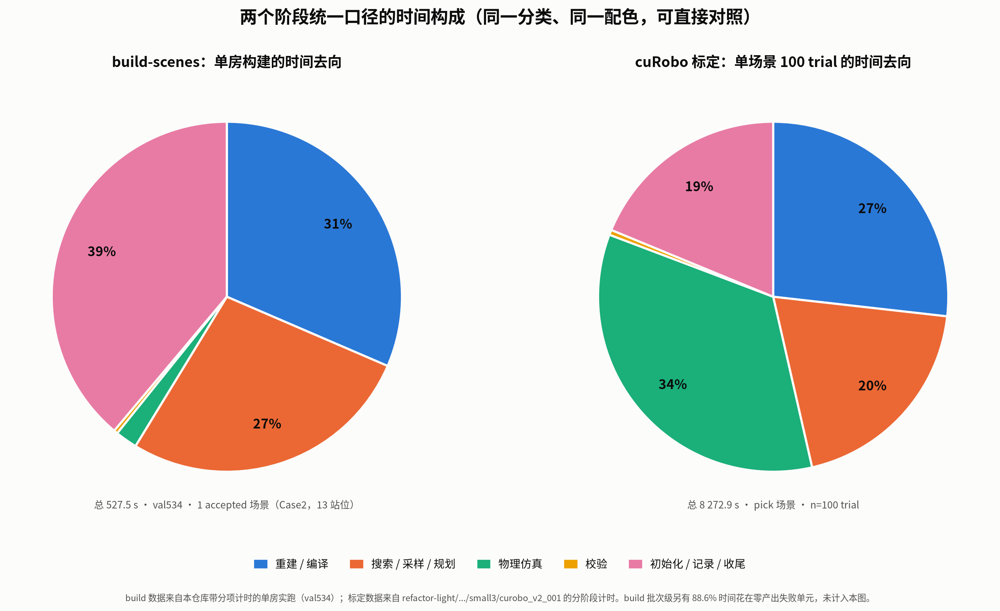

# scene-datasets 与 cuRobo 标定耗时分析

状态：active
日期：2026-10-20
替代：无
关联：[运行手册](../../docs/运行手册.md)、[场景配方](../../configs/scene_datasets/README.md)、[执行配置](../../configs/execution/README.md)

## 0. 一句话结论

两个阶段的慢**不是同一个原因**，而且都不是"算法本身算得慢"：

- **build-scenes 慢在"发现阶段逐候选穷举 + 失败变体烧满预算"**：每探测一个候选目标要克隆 161 次仿真做站位几何检查（90–215 s）；增强构造的随机搜索在失败时会把 `max_candidates=2400 / max_physical_trials=12 / 1800 s` 全部耗尽而不产出样本。实测一个 22 样本批次里 **88.6% 的单元时间花在产出为 0 的单元上**。
- **cuRobo 标定慢在"每个 trial 重建一次规划器 + 逐 tick 物理证据记录"**：单场景 100 次 trial，每次都要重新构造碰撞世界、SDF/球拟合和 `MotionPlanner`——`planner_setup` 单项就占实测分阶段时间的 **33%**；最大头是物理步进与逐 tick monitor/trace（**42%**）。规划成功与否反而只占很小一部分。

## 1. 实测数据（不是名义预算）



两张饼使用**同一套五分类、同一配色**，因此同一颜色在两边含义相同，可直接对照。左图是一次带分项计时的单房实跑（val534）；右图是单场景 100 trial 的标定。build 的批次级浪费（88.6%）不在这张图里，单独见 §1.5。

### 1.1 scene-datasets 构建

| 项 | 实测值 | 来源 |
|---|---|---|
| 单候选目标发现探测 | **90–215 s/候选** | 本次实跑：val1 间隔 94/91/93 s；val4 间隔 214/211/219/219/199/188 s |
| 单房发现阶段 | **48.8 s（2 候选）– 1509.6 s** | 本次实跑 8 房 |
| 单样本构造 | 中位 **170 s** / 均值 **275 s** / 最大 **1303 s** | 22 样本封存批次 `timing.json` |
| 22 样本批次墙钟 | **13.6 h**（2 路并行），单元累计 **23.7 GPU·h** | 同上 |
| 失败单元消耗 | **75 753 s（21 GPU·h）产出 0 样本 = 88.6%** | 同上，10 个单元中 3 个失败 |
| 单房完整构建 | **116–2104 s** | 本次实跑（4 路并行共用单卡） |

### 1.2 cuRobo 标定

| 口径 | 单 trial | 单场景（100 trial） | 来源 |
|---|---|---|---|
| 本次 open 场景实跑 | **17.7 s** | 3985 s ≈ 1.11 h | `outputs/station_evaluations/eval_ds/curobo_v2_001/summary.json` |
| 规模化 cuRobo（42 run / 3659 trial） | **66.8 s** | 中位 3600 s / 均值 5817 s | `scale-validation/data/runs.json` |
| 单场景精确实测（pick） | **82.7 s** | 8273 s ≈ 2.30 h | `refactor-light/.../small3/curobo_v2_001` |
| 最差实测（64/100 timeout） | **246 s** | 24 625 s ≈ 6.84 h | 归档 `lastmile-v0-case1-full` |

### 1.3 单次 trial 的分阶段拆解（n=100，pick 场景）

| 阶段 | 出现次数 | 中位 | 合计 | 占已计时间 |
|---|---:|---:|---:|---:|
| `simulation_and_physics_evidence` | 36/100 | 78.7 s | **2840.2 s** | **42.3%** |
| `planner_setup` | 100/100 | 16.4 s | **2216.0 s** | **33.0%** |
| `grasp_planning` | 100/100 | 15.5 s | 1496.8 s | 22.3% |
| `motion_planning` | 24/100 | 4.3 s | 127.9 s | 1.9% |
| `task_validation` | 21/100 | 0.4 s | 38.6 s | 0.6% |
| 已计合计 | — | — | **6720.3 s** | 100% |
| 未计（初始化/收尾/recorder） | — | — | 1552.6 s | 另计 |

运行总额 8272.9 s，分阶段只解释 81.2%，其余在初始化与 recorder finalize。

### 1.4 场景类型直接决定标定成本

同一套 cuRobo 配置下，**open 场景 17.7 s/trial，pick 场景 66.8–82.7 s/trial，差 4–5 倍**。但这不是"open 更简单"的算法结论，主要因为本次 open 场景 224/225 是 `planning_no_solution`（快速失败），而 pick 场景有相当比例真正进入执行（`success` 中位 113 s）。

**推论**：标定总时长不能只用场景数估算，必须同时看"预计能进入执行的 trial 比例"。一个成功率高的场景比一个全失败的场景慢得多。

### 1.5 统一口径对照

为了跨阶段比较，把两边的阶段名映射到同一套五分类。build 侧此前只有总耗时，本次用 monkey-patch 对 `build_variant` 做了无侵入分项计时（不改源码），在一个真实单房上测得。

| 统一分类 | build-scenes（val534，527.5 s） | cuRobo 标定（单场景，8 272.9 s） | 各自对应的原始阶段 |
|---|---:|---:|---|
| 重建 / 编译 | 165.8 s（**31.4%**） | 2 216.0 s（**26.8%**） | build=`session.candidate` 重编译 MuJoCo 模型；标定=`V2Planner` 构造 |
| 搜索 / 采样 / 规划 | 143.6 s（27.2%） | 1 624.7 s（19.6%） | build=放置提案 + 窄相碰撞 + 161 点站位重采样；标定=`grasp_planning`+`motion_planning` |
| 物理仿真 | 10.7 s（2.0%） | 2 840.2 s（**34.3%**） | build=静置 + 等时对照；标定=`simulation_and_physics_evidence` |
| 校验 | 1.9 s（0.4%） | 38.6 s（0.5%） | build=`validate_augmented_scene`；标定=`task_validation` |
| 初始化 / 记录 / 收尾 | 204.8 s（38.8%） | 1 552.6 s（18.8%） | 两侧均为未计入分项的其余时间 |
| **合计** | **527.5 s** | **8 272.9 s** | — |

**最重要的可比结论**：两个阶段的第一大共同项都是"重建 / 编译"，分别占 **31.4%** 和 **26.8%**。这不是巧合，而是同一个结构性问题的两种表现：

- build：每提出一个放置方案，`ObstacleEditSession.candidate()` 就重新编译一次带新物体的 MuJoCo 模型（本次 93 次调用 / 165.8 s）
- 标定：每次 trial，`V2Planner.__init__` 就重建一次碰撞世界、球拟合和 `MotionPlanner`（100 次调用 / 2 216 s）

**其余差异来自工作性质**：标定的物理仿真占 34.3%（真正在跑控制循环），build 只占 2.0%（只在物体放齐后静置 2 次）；build 的未计入部分占 38.8%（发现、资格检查、基线加载、保存），标定只占 18.8%。

**口径限制**：build 侧是单房实跑（1 accepted 场景，Case1 因 `too_few_stations` 被拒），不是批次均值；`record_views=False`，渲染不在图内；分项来自函数级包装，不是插桩到语句级。

## 2. build-scenes 慢在哪里（代码级）

### 2.1 发现阶段：每个候选克隆 161 次仿真

`workflows/scene_datasets.py:253` 对每个通过配方筛选的候选调用 `_probe_target`（`:208`），后者调用 `sample_stations(..., static_only=True, stop_after_valid=5)`（`scenes/stations/sampling.py:130`）。

`radius_m=0.7928`、`spacing_m=0.1109` 生成 **161 个格点**（本次已核对）。对每个格点：

```
sampling.py:147  for station in stations:
sampling.py:148      probe = clone_preparation(sim)      # 整份 MuJoCo 状态深拷贝
sampling.py:151      row = initialize_station(...)
sampling.py:30       robot_contacts(...)                  # 遍历全部 contact
initialization.py:40 floor_support(...)                   # 对每个 floor geom 打射线，mesh 走 mj_rayMesh
```

即**每个候选目标最多 161 次完整仿真克隆 + contact 遍历 + 射线求交**。提前停止只在找满 5 个有效点时生效；**找不到 5 个有效点的候选必须跑满 161 次**，这正是耗时上界所在。

实测每候选 90–215 s，与"161 × 单次克隆+检查"的量级一致。

### 2.2 串行结构：一次 run = 一个进程 = 一张卡

`build_scenes`（`scene_datasets.py:597`）先发现、再资格检查、再逐房构建，**全部串行**；`gpu_ids[0]` 只取第一张卡。房与房之间没有并行。

本次实跑证明：把 8 个房拆成 8 个独立 run、4 路并行，8 房总墙钟约 **30–40 分钟**（单房 116–2104 s）。**但 `scene_datasets.py:604` 用秒级时间戳建临时目录 `scene-build-%Y%m%d-%H%M%S`，同秒启动必然 `FileExistsError`**——这是并行构建的直接阻碍，本次实跑最初 4 路全崩就是它。必须错峰或修这一行。

### 2.3 增强构造：有界随机搜索，失败也烧满预算

`scenes/augmentation/builder.py:35`：

```
for candidate_index in range(config.max_candidates):   # 2400
    ...
    if time.monotonic() > deadline:                     # variant_timeout_s = 1800
        return ... 'variant_timeout'
    ...
    sim = session.candidate(proposed, deadline=deadline)  # 物理检查
    settling = session.settle(deadline=deadline)
```

单个变体的成本上界是 **2400 次放置提案 × 每次物理检查 / 静置**，墙钟硬上限 1800 s。成功构造实测中位 170 s，但失败时会把整个预算烧完——22 样本批次里 3 个失败单元分别消耗 23 163 / 24 771 / 27 819 s（**超过单变体 1800 s 预算，因为一个单元含多个变体**），产出为 0。

这是 build-scenes 成本方差极大的根源：**"能不能放下"是随机搜索，不是确定算法**。

### 2.4 次要成本

- 每个样本保存 3 个视角渲染 + 完整场景快照，实测 **~465 MB/样本**（I/O 与磁盘）。
- 资格检查阶段再做一次完整 `sample_stations`（本次不含可见性渲染，但生产路径含）。
- 站位/目标是逐房重新加载的，没有跨房缓存。

## 3. cuRobo 标定慢在哪里（代码级）

### 3.1 每场景固定 100 次 trial

`workflows/collection.py:64-74`：`for station in stations: for trial in range(trials_per_station)`。默认 `max_final_stations=20` × `trials_per_station=5` = **100 次**。这是配置决定的乘数，不是算法。

### 3.2 每个 trial 克隆整份仿真

`runtime/execution/curobo.py:24`：

```
sim = clone_sim(baseline, target=task['target_body']); place_frozen_station(sim, station)
```

这是"begin 后不重置/不传送"实验语义的必然代价——每次独立试验必须新建 Simulation。

### 3.3 每个 trial 重建一次规划器（最大可优化项）

`runtime/execution/manipulation.py:62` 与 `:117` 在每次 attempt 内构造 `V2Planner`。`V2Planner.__init__`（`planning/curobo_v2.py:26-120`）做的是：

- `collision_world(...)` 构建整场景碰撞世界
- `SceneCollision` + 目标专用 checker
- mesh → 球拟合（`:327` `SphereFitType.VOXEL`）
- `MotionPlannerCfg.create(...)`，含 `num_ik_seeds=32`、`num_trajopt_seeds=4`
- `pad_target_query_range()` 逐碰撞体改写查询范围（`:357`）

实测 `planner_setup` **每个 trial 要 16.4 s（中位），且 `calls=2`**：一次用于闭爪前的 pre-grasp/approach，一次是在夹爪实际闭合后、按**实测状态**重建用于 lift/attach 的规划器（`manipulation.py:117`）。100 trial = **2216 s ≈ 37 分钟/场景**，占已计时间的 **33%**。

**同一个场景、同一个机器人、同一套碰撞世界，被重建了 100 次。** 但注意：只有**第一次**能跨 trial 复用——第二次依赖实测闭爪状态与 attach 后的目标几何，无法预先计算。

`planning/curobo_v2.py:117` 还显式设了 `use_cuda_graph=False`，所以连 CUDA graph 捕获摊销都没有。

### 3.4 物理步进 + 逐 tick 证据记录是最大头

`simulation_and_physics_evidence` 中位 **78.7 s**，只在 36% 的 trial 出现（即真正进入执行的 trial），合计占 **42.3%**。

`runtime/execution/curobo.py:30-32` 每次 attempt 绑定 `AttemptRecorder`；`ContinuousContext.tick()` 在控制循环内做 monitor/trace。历史报告明确记录该桶同时包含"物理推进"和"逐 tick 写入"，不能全部归为 MuJoCo 计算。

### 3.5 失败很快，但 timeout 尾巴很贵

goalset 求解实测 **中位 0.92 s、最大 1.45 s，100% 在 5 s 内返回 None**——`max_attempts=5` 的预算根本没被用上。所以：

- `planning_no_solution` 中位 **16 s**
- `success` 中位 **113 s**
- `timeout` 中位 **302 s**（顶满 `attempt_timeout_s=300`）

一个场景只要撞上几十次 timeout，单场景成本就从 1 h 拉到 6.8 h（实测 64/100 timeout 的案例）。

### 3.6 记录开销

`CollectionConfig.record_images` 默认 `True`。实测 100 trial 产出 **2.3 GB**，平均 23.6 MB/trial。这是磁盘与写入时间，不是 GPU 计算。

## 4. 两个阶段的成本结构对比

| 维度 | build-scenes | cuRobo 标定 |
|---|---|---|
| 主要成本 | 逐候选 161 次仿真克隆 + 随机搜索 | 100 次 trial × (规划器重建 + 物理步进) |
| **统一口径最大单项** | **重建/编译 31.4%** | **物理仿真 34.3%**，其次重建/编译 26.8% |
| 方差来源 | 候选数、放置能否成功 | trial 是否进入执行、是否 timeout |
| 浪费比例 | 实测 **88.6%** 单元时间产出 0 样本 | timeout 尾巴可占 60%+ |
| 能否并行 | 代码不支持（单进程单卡 + 临时目录冲突） | 单进程单卡，但多 run 天然可分片 |
| 可复用性 | 每个放置提案重编译一次模型，**无缓存** | 规划器每 trial 重建，**无复用** |

## 5. 可操作的降压手段（按收益排序）

0. **共同瓶颈：减少"重建 / 编译"**。统一口径下它是 build 的第一大项（31.4%）和标定的第二大项（26.8%）。build 侧每个放置提案都重编译一次 MuJoCo 模型（实测 93 次 / 165.8 s）；标定侧每次 trial 都重建规划器（100 次 / 2 216 s）。两侧都应优先做"同类对象复用"，而不是继续优化规划或采样算法。
1. **规划器复用（标定）**：把**闭爪前那次** `V2Planner` 构造从"每 attempt"提到"每站位"。按实测 `planner_setup` 22.2 s/trial、2 次调用计，每站位可省 4 次 ≈ **44 s**，20 站位合计 **≈ 15 分钟/场景**（约占已计时间 18%）。闭爪后那次重建依赖实测状态，**不可省**。实施前必须验证：`place_frozen_station` 只改机器人位姿、不改场景几何，且目标 SDF/attach 缓存不跨 trial 污染。
2. **模型编译复用（构建）**：`ObstacleEditSession._model()` 已有 4 个模型的 LRU 缓存（`session.py:62`），但**每个提案的物体组合不同**，缓存几乎不命中（本次 93 次编译）。若能按"已接受物体集合"增量更新或复用同一套模型骨架，可削掉 build 侧 31.4% 的大头。
3. **降 `trials_per_station`**：5 → 1 直接把 100 trial 降到 20，成本降 80%。代价是失去每站位成功率估计（benchmark 的低/高率需要它）。
4. **失败单元提前止损（构建）**：当前失败单元会烧满 `max_candidates`/`variant_timeout`。按"已消耗时间 / 已放置数量"做早停，可直接削掉 88.6% 的浪费。
5. **修 `scene_datasets.py:604`**：临时目录加 pid/uuid，构建才能安全并行。这是把 8 房从 30–40 分钟压到几分钟的前提。
6. **发现阶段并行**：本次全量扫描证明 24 路并行可行（纯 CPU、static_only 不渲染）。生产路径可以在房级别分片。
7. **降低站位候选开销**：161 格点对每个候选都做完整克隆。可按"距目标距离/朝向"先做几何剪枝，或缓存 `floor_support` 射线结果（与目标无关，只与 XY 有关）。
8. **标定记录开关**：仅需成功率时关闭 `record_images`，省磁盘与写入时间；需要轨迹证据时再开。

## 6. 关于"两趟式"规划缓存（第一趟存轨迹，第二趟 need_plan=False 重放）

外部方案（第一趟随机种子→规划→存 `_traj_data/episodeN.pkl`；第二趟关闭规划、重放轨迹并录帧）**不能直接搬到本管线**，原因有三条，全部可从代码确认：

1. **每站的 5 次 trial 是 5 个不同规划，不是同一条轨迹重放 5 次。** `collection.py:78` 的种子是 `config.seed + index * trials_per_station + trial`，而种子同时决定抓取候选排列（`manipulation.py:18` 的 `rng.permutation`）、左右臂（`seed % 2`）和规划器种子（`context.py:261`）。缓存一条计划重放 5 次会把"5 次独立试验"塌缩成 1 次试验，成功率统计失效。
2. **lift 段无法预先规划。** `manipulation.py:117` 是在夹爪**实际闭合之后**，按实测状态重建规划器再规划抬升；它依赖真实接触结果，第一趟拿不到。
3. **执行是闭环跟踪，不是开环关节回放。** `context.py:230` 的 `follow_points` 对每个路径点循环 `mobile_tick` 最多 120 次直到跟踪误差 ≤ 1.0，再做收敛检查。直接回放原始关节位置会绕开反馈，物理结果和记录语义都会变。

**可借鉴的部分**是"避免重复构造"这一层，但对象应是**规划器设置/碰撞世界**，而不是运动轨迹（见 §5 第 1 条）。

若目标是**同一 episode 的多次重复录制**（不同相机、深度、视频或数据增强），缓存 `(初始状态, seed, 计划)` 才有价值；此时第二趟仍应走同一套闭环跟踪与物理判定，不能改成开环播放。

## 7. 证据边界

- 所有时间数字来自本仓库真实运行产物，路径已在文中标出。
- `simulation_and_physics_evidence` 同时包含物理推进与逐 tick 写入，**不能全部归因于 MuJoCo**；这是历史报告已确认的口径限制。
- `planner_setup` 与 `grasp_planning` 的边界来自 `execution_diagnostics.json` 的 `timings` 字段，不是插桩到函数级。
- 规划器复用能省多少是**基于阶段计时的推算**，尚未实做验证；实施前需确认 `V2Planner` 对场景世界的假设（尤其 `refresh_world` 与目标 SDF 缓存）。
- build 侧分项来自 2026-10-20 的单房实跑（val534，527.5 s），通过 monkey-patch 包装 `ObstacleEditSession.candidate/settle`、`collision_pairs`、`validate_augmented_scene`、`sample_stations` 等函数测得；**单房样本，不是批次均值**，且 `record_views=False` 时渲染不计入。
- `session_close`（0.7 s）与零星的 `session_reject/active` 未单列，归入"初始化 / 记录 / 收尾"。
- 全量预筛统计见附录 A；截至本文写作仍有 64 房在补跑，统计基于已完成的 936 房。

## 附录 A. 全量预筛通过率（936/1000 房）

| 任务类型 | 候选 | 通过 | 通过率 |
|---|---:|---:|---:|
| pick | 2 994 | 1 233 | **41.2%** |
| open | 9 111 | 7 917 | **86.9%** |

**pick 淘汰原因**（合计 1 761）：

| 原因 | 次数 |
|---|---:|
| `fewer_than_minimum_static_geometry_points`（161 格点中有效 < 5） | 997 |
| `case1_support_not_countertop_or_table`（Case1 支撑面不在台面/桌类白名单） | 739 |
| `no_qualified_target_support_plane`（找不到合格支撑面） | 25 |

**open 淘汰原因**：`fewer_than_minimum_static_geometry_points` 1 194 次。

**房屋层面**：575 房至少有 1 个 pick 通过，817 房至少有 1 个 open 通过，566 房两者都有。

这组数字纠正了此前基于 8 房小样本得出的"pick 全灭"判断——**pick 的真实通过率是 41.2%**，失败主要来自站位几何（997）和 Case1 支撑面规则（739）两项，而不是某一项单独导致。
