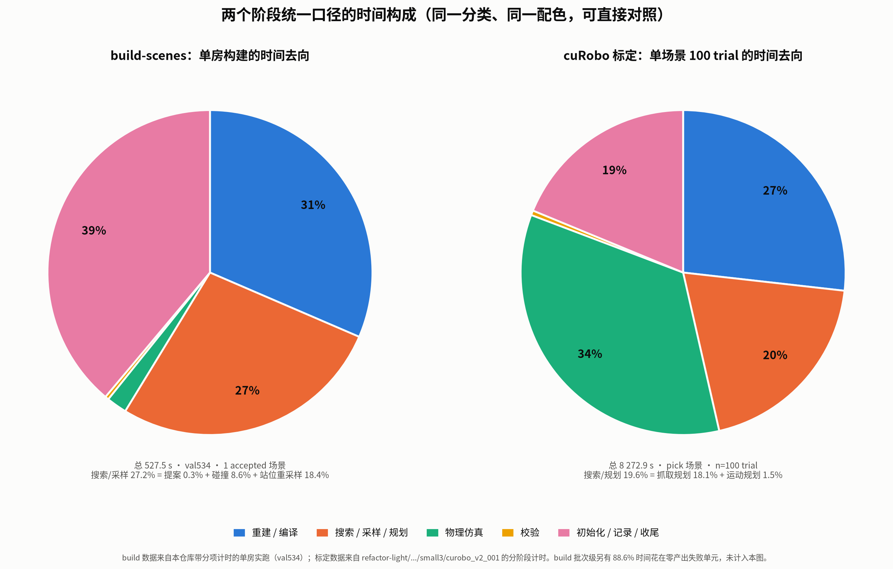

# scene-datasets 与 cuRobo 标定耗时分析

- 状态：archived
- 日期：2026-10-24
- 替代：[当前文档](../../../info/01-current-status.md)
- 关联：[运行手册](../../../../../docs/运行手册.md)、[场景配方](../../../../../configs/scene_datasets/README.md)、[执行配置](../../../../../configs/execution/README.md)、[复核报告](../delivery/2026-10-22-calibration-time-review.md)

**2026-10-24 归档：保留当时的设置、结论与未验证边界；当前实验以 PandaOmron、每站位 3 次为准。本文中的旧预算与待办不作为当前方案。**

2026-10-22 复核：下文保留历史样本和探索过程；计时、缓存与降频建议中的错误以[复核报告](../delivery/2026-10-22-calibration-time-review.md)及[更新方案](../plan/2026-10-22-time-optimization-plan.md)为准。目标已改为单场景 30 分钟，成功 rollout 保留训练图像。新 RBY 参考运行耗时 11,449.2 s，执行/证据/图像占 75.1%，不能只沿用旧样本占比。

2026-10-24 范围更新：用户当前关注 PandaOmron 的局部初始点位难度，不要求跨房间任务。[局部场景与 batch 分析](2026-10-24-local-scenes-and-batching.md)建议先减少整屋物理模型成本，再评估现有 worker 与原生 batched planner；以下整屋 RBY 时间仅保留为历史参考，尚无 Panda 局部模型的性能测量。

## 2026-10-23 E03 更新

遥测精简、cuRobo 站位并行与同站位闭爪前 planner 复用已经实现，详见 [E03 结果](../delivery/E03-telemetry-parallel-planner-reuse.md)。软件回归 249 项中 245 通过、4 跳过，原生 CPU 种子采样及实际 spawn 调度验证通过。简化 MuJoCo 场景中优化前后状态、任务事实、统计一致，局部 stepping 快约 1.51 倍；不是完整 RBY 性能结果。

2026-10-24 P2 状态复核：**部分完成**。已实现的闭爪前 planner 缓存会一并复用其静态资源；尚无跨站位/跨闭爪阶段的独立静态资源缓存，闭爪后仍重建，也没有完整 GPU 验收。不能将上述有限实现等同于 P2 整项完成，详见[方案 P2](../plan/2026-10-22-time-optimization-plan.md#p2-先复用静态资源再研究完整-planner)。

用户确认旧主仓库 outputs 已删除，真实场景/GPU planner 复用和并行耗时尚未验证。下面新增 E03 的预算情景，随后保留 E02 阶段的历史外推；均不能当作优化后实测。30 分钟目标尚未验收。

### E03 落地后的预算情景

**8 worker 可先按约 30–40 分钟/场景安排，4 worker 按约 45–65 分钟；默认仍是单 worker，约 155–175 分钟。** 口径为单场景 20×5 独立 trial、成功图像全部就绪，不含 build-scenes。假定每 worker 有独立可用 GPU 资源、CPU/磁盘无严重争用，且 CUDA/Warp 缓存已预热；首次编译/冷启动另留 5–10 分钟预算，这也不是时间上限。

以成功轨迹较多的 full-calibration-02 / RBY 为参考，历史总时间为 190.82 min。只对各自分项扣除收益：

| 分项 | 本次估算取值 | 性质 |
|---|---:|---|
| PNG 写入节省 | 约 11.24 min | 28,588 tick × 4 路 × E02 每张约 5.90 ms，跨样本外推 |
| planner 构造节省 | 约 5.42 min | 沿用复核的约 325 s 理论缓存收益，假定冻结初态命中复用 |
| 遥测精简节省 | 0–18.86 min | 对估算的非 PNG 执行项 125.71 min，人工设定 0–15% 敏感性情景；未实测此占比 |
| 新单 worker 时间 | **155.31–174.17 min** | 历史总时间减上述三项，其他分项/帧数/执行分支不变 |

遥测的 1.51 倍来自低物理成本的简化模型，不迁移到真实 RBY 整个执行项；PNG 的 2.75 倍也不作用于整个 rollout。若 planner 未命中复用，应补回对应构造成本；上表最多需补回约 5.42 min。

并行采用历史站位调度的墙钟/串行比作为近似长尾系数：4 worker 为 `50.4/190.82`，8 worker 为 `29.1/190.82`。在局部优化后的串行时间上应用该比值，再人为预留 10%–25% 并发拖慢和 1–3 min 启动/汇总开销：

```text
T_parallel ≈ T_serial_new × historical_station_schedule_ratio × (1 + contention) + overhead
```

| 执行方式 | 情景计算，缓存已预热 | 建议参考预算 |
|---|---:|---:|
| 默认 1 worker | 155–175 min | 约 2.6–3 h |
| 4 worker | 46–61 min | 约 45–65 min |
| 8 worker | 27–37 min | 约 30–40 min |

这些区间是明确假设下的预算情景，不是统计置信区间。原始逐 trial 数据已删除，无法重算优化后每站位的尾部和并发争用；固定墙钟 timeout 下，提速也可能改变实际物理步数和结果。未标定 open 场景、其他本体、显著不同成功率或超时比例不直接沿用此表。下一次真实运行应优先测同站位的单 worker / 2 worker 时间，再修正预算。

## 2026-10-23 E02 阶段：改动与耗时预估

**仅计已落地优化，仍应按单场景约 2.2–3 小时安排参考预算，尚无完整标定的新实测。30 分钟依赖后续执行优化与单场景并行，不能计入当前能力。** 此处估算仅含 20 站位 × 5 trial 的标定，不含 build-scenes。

本轮唯一运行链路性能改动是 `data/recorder.py` 将 RGB PNG 写入显式设为 `compress_level=1`；原来使用编码器默认级别 6。[E02](../delivery/E02-png-write-probe.md) 对四个真实场景的 12 张初始相机图像，预热后交错测量 10 轮，实际 `AttemptRecorder.observation()` 写入从 111.09 ms 降到 40.35 ms：快 2.75 倍、写入时间减少 63.68%、体积增加 20.47%，解码像素全部一致。

整体只能扣除 PNG 写入节省，不能把整场耗时除以 2.75：

```text
T_new = T_old - T_png_old × 63.68%
```

两轮历史标定没有单列实测 `T_png_old`，因此列出两种有不同假设的情景，不把它们当作统计置信区间：

| 100 trial 参考运行 | 历史墙钟 | 按 E02 单张绝对节省外推 | 按历史 PNG 成本与 E02 降幅外推，乐观情景 |
|---|---:|---:|---:|
| small3 / RBY，FOV 开 | 137.9 min | **134.4 min**，省 3.5 min | **117.8 min**，省 20.1 min |
| full-calibration-02 / RBY，FOV 关 | 190.8 min | **约 179.6 min**，省 11.2 min | **约 125.9 min**，省 64.9 min |

- 单张绝对节省：`(111.09 - 40.35) / 12 ≈ 5.90 ms/张`。small3 使用报告中的 35,496 张；新 RBY 假定四路相机，按 `28,588 tick × 4 ≈ 114,352 张` 近似，未计额外初始帧。若只录三路，新 RBY 对应约 182.4 min。
- 乐观情景：把历史微基准的 `214 ms/tick` PNG 写入时间套入各自 tick 数，再减少 63.68%。small3 为 `8,272.9 - 8,838 × 0.214 × 0.6368 ≈ 7,069 s`；新 RBY 为 `11,449.2 - 28,588 × 0.214 × 0.6368 ≈ 7,553 s`。
- 两种情景都混用了历史标定与本机小样本编码测量，只是敏感性估算。前者迁移绝对节省，后者同时迁移旧 PNG 成本及压缩收益比例；尤其不能认定新 RBY 原先每 tick 确实花了 214 ms 写 PNG。两者均假设其他阶段耗时、帧数和执行分支不变，不能推断换到本机后完整运行的实际墙钟。原先 timeout 的 trial 提速后可能推进更多物理步，耗时和结果也可能变化。

当前变化汇总：

| 项目 | 状态 |
|---|---|
| 在线 RGB PNG 压缩级别 1 | 已落地，文件更大、像素无损 |
| E01 状态渲染与内存编码探针 | 已完成；图像未全部逐像素一致，未接入离线渲染 |
| E02 实际写入探针脚本、结果报告、数据格式与计划更新 | 已完成 |
| 独立 `.venv` 与 CPU 软件测试依赖 | 已准备；完整 cuRobo GPU 规划依赖尚未恢复 |
| 异步编码、成功后生成视觉数据 | 未实施 |
| 接触扫描合并、跳过无用 trace 序列化 | 未实施 |
| 站位并行、planner 复用、CUDA graph | 未实施 |
| build-scenes 发现、重编译与失败搜索优化 | 未实施，不能扣除构建时间 |

PNG 改动的软件回归为 239 项，235 通过、4 项跳过。trial 数、任务判定采样频率、现场相机采集和动作时间约定沿用原逻辑。本次只核对工作区改动和计时资料、计算上述估算，没有重跑仿真或新增运行代码。下一次有代表性的真实执行分项计时后，再收窄整场时间预估。

## 0. 结论

- **build-scenes**（实测 val534，527.5 s）：慢在发现阶段逐候选克隆 161 次仿真（90–215 s/候选），以及增强构造的随机搜索在失败时烧满 `max_candidates=2400 / max_physical_trials=12 / variant_timeout_s=1800`。22 样本批次里 **88.6% 的单元时间产出为 0**。
- **cuRobo 标定**（实测 pick 场景，8 272.9 s）：重复构造规划器占 26.8%，物理步进、逐 tick 证据与同步图像合计占 34.3%。这组 goalset 中位 3.58 s；300 s 是软超时预算，实际可以超出。
- **端到端**：约 2.1–3.4 h/样本是跨来源估算；标定占 90–95% 仅适用于约 527.5 s 的构建参考，不适用于构建均值 3,886 s 的批次。
- **共同瓶颈**：统一口径下，"重建 / 编译"是 build 的第一大项（31.4%）和标定的第二大项（26.8%）——两边都在重复构造重型对象。

## 1. 端到端流程与耗时

### 1.1 命令交接

```text
build-scenes ──► outputs/scene_datasets/<run-id>/
                   ├─ config.json      # recipe + robot + geometry
                   ├─ scenes.jsonl     # accepted/rejected 场景与站位
                   └─ scene-files/<scene_id>/

evaluate-stations --dataset outputs/scene_datasets/<run-id>
                 ──► outputs/station_evaluations/<run-id>/<calibration-id>/
                       ├─ trials.jsonl
                       ├─ rollouts/<rollout_id>/
                       ├─ figures/<scene-id>/success_heatmap_stations.svg
                       └─ summary.json
```

`evaluate-stations` 用数据集 `config.json` 的 geometry 覆盖执行配置的 `radius_m / spacing_m / width / height / min_target_pixels / map_resolution_m / navigation_*`，并为每个场景生成 `execution_profile`。构建与标定的控制模式、相机、站位必须匹配，否则报配置不一致。

### 1.2 build-scenes（val534 实测：527.5 s，Case1+Case2，产出 1 accepted + 1 rejected）

```text
build-scenes                                          总 527.5 s
├─ 1. 发现 + 资格检查 + 加载/检索/保存/预览           204.8 s (38.8%)
│   ├─ 加载原始基线 Simulation.from_source
│   ├─ discover_tasks 枚举可交互物体
│   ├─ 配方筛选（pick 白名单 / targets）
│   ├─ 逐候选 _probe_target                            90–215 s/候选（8 房实测）
│   │   ├─ 支撑面 + Case1 支撑面类别检查
│   │   └─ sample_stations(static_only, 提前停在 5 个有效点)
│   │        161 个格点 × 每点一次仿真克隆
│   └─ 资格检查：完整 sample_stations（含可见性 ≥24 px）
│        + Case1 近地面点 + 覆盖选点（≤20 站位）
│
├─ 2. 变体构造（Case1/2: augment_obstacles）           322.7 s (61.2%)
│   ├─ 模型重编译 session.candidate                    165.8 s (93 次, 1.78 s/次)
│   ├─ 站位重采样 sample_stations ×161                 97.0 s (3 次, 32.3 s/次)
│   ├─ 窄相碰撞 collision_pairs                        45.2 s (93 次, 0.49 s/次)
│   ├─ 物理静置 + 等时对照                             10.7 s (2+2 次)
│   ├─ 场景校验 validate_augmented_scene               1.9 s (2 次)
│   ├─ 放置提案几何                                    1.4 s (186 次)
│   └─ 会话关闭                                        0.7 s
│
└─ （Case3/open 走 _save_open_scene：采样 + 选点 + freeze）
```

8 房批次的方差：发现 **48.8–1 509.6 s/房**，发现之后的构建 **1–594 s**，单房总计 **116–2 104 s**。方差来自候选数和放置搜索是否一次成功。

### 1.3 evaluate-stations（pick 场景实测：100 trial，8 272.9 s，82.7 s/trial）

逐步流程与 cuRobo 内部机制见[流程讲解](2026-10-24-evaluate-stations-curobo-flow.md)。

```text
evaluate-stations                                     总 8 272.9 s
├─ 1. _prepare_run（读数据集/profile/create_run）     未单列（小）
└─ 2. 逐场景（串行）
    ├─ 2.1 Simulation.from_snapshot                   计入未计
    └─ 2.2 逐站位 × trials_per_station
         └─ run_curobo_attempt
             ├─ clone_sim + place_frozen_station       计入未计
             ├─ candidate_pool（seed 决定抓取候选）    <0.1 s
             ├─ V2Planner（闭爪前，失败可换臂再建）    174 次
             ├─ planner.grasp（goalset→approach→
             │   pregrasp→grasp）                      8.6 s/次
             ├─ 执行段 A：begin + follow_points + 闭爪 20 ticks
             ├─ V2Planner（进入闭爪后才重建）           24 次
             ├─ 执行段 B：lift / hold
             │   → A+B 物理、证据与同步图像记录        2 840.2 s (34.3%)
             ├─ motion_planning                        5.33 s/次
             ├─ task_validation                        0.42 s/次
             └─ recorder finalize + 写盘               计入未计
    ├─ 2.3 _station_summary + 热图导出
    └─ 2.4 summary.json
```

| 阶段 | 总耗时 | 占比 | 调用次数 | 单次 |
|---|---:|---:|---:|---:|
| 物理步进 + 逐 tick 证据 + 同步图像 | **2 840.2 s** | 34.3% | 8 838 | 0.32 s |
| 规划器构造 `planner_setup`（174 闭爪前 + 24 闭爪后） | **2 216.0 s** | 26.8% | 198 | 11.19 s |
| 抓取规划 `grasp_planning` | 1 496.8 s | 18.1% | 174 | 8.60 s |
| 未计：克隆仿真/初始化/recorder/finalize | 1 552.6 s | 18.8% | 100 trial | ≈15.5 s/trial |
| 运动规划 `motion_planning` | 127.9 s | 1.5% | 24 | 5.33 s |
| 任务校验 `task_validation` | 38.6 s | 0.5% | 91 | 0.42 s |

逐 trial context 墙钟中位数：`planning_no_solution` 26.25 s，成功 129.27 s，timeout 304.19 s。进入执行的 trial 通常更慢；跨场景不能仅凭成功率作单因素归因。

> 与 §1.5 饼图的对应：`planner_setup` → 重建/编译；`grasp_planning` + `motion_planning` → **搜索/规划（1 496.8 + 127.9 = 1 624.7 s，19.6%）**；`simulation_and_physics_evidence` → 物理仿真；`task_validation` → 校验；"未计" → 初始化/记录/收尾。

### 1.4 端到端示意估算（构建与标定不是同一样本）

| 产出单位 | 构建 | 标定 | 合计 |
|---|---:|---:|---:|
| val534 构建 + val103 标定，跨场景拼接 | 527.5 s | 8 272.9 s | **8 800 s ≈ 2.44 h** |
| 22 样本批次均值（含 88.6% 失败浪费） | 3 886 s/样本 | 1.0–2.3 h/场景 | **≈ 2.1–3.4 h/样本** |

### 1.5 统一口径对照



| 统一分类 | build-scenes（val534，527.5 s） | cuRobo 标定（单场景，8 272.9 s） | 对应原始阶段 |
|---|---:|---:|---|
| 重建 / 编译 | 165.8 s（**31.4%**） | 2 216.0 s（**26.8%**） | build=`session.candidate`；标定=`V2Planner` 构造 |
| 搜索 / 采样 / 规划 | 143.6 s（27.2%） | 1 624.7 s（19.6%） | build=提案+碰撞+站位重采样；标定=`grasp`+`motion` |
| 物理仿真 | 10.7 s（2.0%） | 2 840.2 s（**34.3%**） | build=静置+对照；标定=`simulation_and_physics_evidence` |
| 校验 | 1.9 s（0.4%） | 38.6 s（0.5%） | 场景校验 / 任务校验 |
| 初始化 / 记录 / 收尾 | 204.8 s（38.8%） | 1 552.6 s（18.8%） | 未计入分项的其余时间 |

两张饼同分类同配色，可直接横向对照。图中"搜索/采样/规划"是聚合项：build 侧 = 提案 0.3% + 碰撞 8.6% + 站位重采样 18.4%，标定侧 = 抓取规划 18.1% + 运动规划 1.5%。build 批次级的 88.6% 失败浪费不在图内。

## 2. 为什么慢（代码级）

### 2.1 build-scenes

1. **发现阶段逐候选穷举**：`_probe_target` → `sample_stations(static_only=True)`（`sampling.py:130`）对 `radius_m=0.7928 / spacing_m=0.1109` 生成的 **161 个格点**逐个 `clone_preparation` + robot contact 遍历 + floor 射线求交（`sampling.py:147-174`）。找不到 5 个有效点的候选必须跑满 161 次。
2. **串行结构**：`build_scenes`（`scene_datasets.py:597`）按房串行，只用 `gpu_ids[0]`。并行构建还被 `scene_datasets.py:604` 的秒级临时目录名挡住——同秒启动必然 `FileExistsError`。
3. **失败烧满预算**：放置是有界随机搜索（`builder.py:35`），失败时跑满 2400 次提案 / 12 次物理验证 / 1800 s。实测失败单元消耗 23 163 / 24 771 / 27 819 s，产出为 0；22 样本批次中失败单元占 **88.6%** 的单元时间。

### 2.2 cuRobo 标定

1. **每场景固定 100 次 trial**（20 站位 × 5 次，`collection.py:64-74`），每次 `clone_sim` 新建仿真（`curobo.py:24`），这是"begin 后不重置"语义的必然代价。
2. **反复重建规划器**（`manipulation.py:62,117`）：small3 实际为闭爪前 174 次（失败换臂），闭爪后 24 次，共 198 次，平均 11.19 s。闭爪后必须更新实测锁定关节与附着状态，不能直接沿用旧状态；静态几何和部分 solver 资源能否复用应单独验证。
3. **物理步进 + 逐 tick 证据**是最大单项（34.3%）。微基准（val1-open 场景，179 body / 1 900 geom / 631 contact，12.5 substep/control tick）把它拆开：

   | 项 | 单次 | 每 control tick |
   |---|---:|---:|
   | `mj_step`（1 substep） | 17.05 ms | 213 ms |
   | `mj_forward`（每 substep 为证据刷新） | 14.35 ms | 179 ms |
   | `monitor.sample()`（遍历 631 contacts） | 3.13 ms | 39 ms |
   | `simulation_failure()` | 0.085 ms | 1 ms |
   | `sim.step` 不带 check | — | **226 ms** |
   | `sim.step` 带 check | — | **480 ms** |

   **在这个微基准中，证据闭包约占带检查时间的 53%**。它不是 small3 执行项的直接分解，后者还含同步图像。`record_physics=False` 没有文件写入，但 `canonical(row)` 和完整接触行仍会构造；`monitor.sample()` 还会再次扫描 contact，应先分开计时。
4. **timeout 尾巴**：`attempt_timeout_s=300`，撞上几十次就把单场景从 1 h 拉到 6.8 h（实测 64/100 timeout）。
5. **逐帧图像记录 + 无 CUDA graph**：`record_images=True` 默认开，每 control tick 渲染 4 路相机（head + 双腕 + 第三人称）并写 PNG。实测渲染 38 ms/tick、写 4 张 PNG **214 ms/tick**（单张 320×240 PNG 65.6 ms，原始字节写入仅约 9 ms，PNG 压缩占大头）。small3 run 共 8 838 tick → **35 496 张 / 2.2 GB**。该成本在 `_advance` 的 finally 内同步执行，因此计入 `simulation_and_physics_evidence`（34.3%）。另外 `use_cuda_graph=False`（`curobo_v2.py:117`）没有 kernel launch 摊销；`record_video` 默认关，需 `--record-video`。

### 2.3 碰撞体表示与速度影响

**当前既不是 Box 近似，也不是预计算 ESDF。**

| 对象 | 表示 | 位置 |
|---|---|---|
| 世界 | **三角网格**合并为单一 `SceneCfg.mesh`，运行时 mesh SDF 查询 | `collision_world_v2.py:12-53` |
| 机器人 | **球体近似**：24 links / **86 spheres** | `rby1m_holobase_spheres.yml` |
| 被抓取物 | **40 个 voxel 拟合球** | `curobo_v2.py:326` |
| 目标 checker | 独立 `SceneCollision`（约 9 geoms / 5 938 顶点） | `target_only=True` |

网格构造：`MESH` 原样；`BOX` 转精确 8 顶点盒；`SPHERE/ELLIPSOID/CYLINDER/CAPSULE` 曲面细分（icosphere subdiv=2 = 320 面）；排除 floor 与机器人；只保留与 `world_range≈2.59 m` 相交的 geom；所有 geom 合并成一棵 BVH。

**实测**（225 rollout）：世界网格 43–440 geoms、2 444–33 575 顶点；`planner_setup` 5.3–8.5 s/次，`corr(顶点数, planner_setup) ≈ 0.01`；进程内首次构造有 **413 s** Warp 冷启动。**网格规模不是构造阶段的主因**——它是固定开销。

碰撞查询成本在规划阶段：86 球 × mesh SDF；`num_ik_seeds=32` → 每 IK 种子集约 2 752 次距离查询。`grasp_planning` 中位 15.5 s（进入搜索时），`motion_planning` 4.3 s。mesh SDF 每次遍历 BVH，预计算 ESDF 可降为 O(1) 插值。

## 3. 改进优先级

1. **优先优化执行与记录**：当前成功轨迹用于视觉训练，先评估实测状态的成功后渲染，或保留现场 RGB、异步编码。完整耗时仍计入成功图像就绪。规划器复用不是单独达到 30 分钟的方案。
2. **保留逐物理步任务证据，减少重复扫描和序列化**：strict-pick-v3 的采样间隔上限为 4.1 ms，原先 50 ms/10 ms 降频建议不能沿用。小基准与同步图像的收益不可套入同一执行项后相加；不直接删除 `mj_forward`。
3. **失败单元早停**：按"已消耗时间 / 已放置数量"止损，削掉 build 侧 88.6% 的浪费。
4. **单场景内按站位并行**：保留原 index、seed 与 20×5 真实试验；按场景分片只改善批量吞吐。
5. **复用静态规划资源**：完整 planner 还需处理模型/FOV 绑定及 trial seed，不能只换 planner.sim。small3 理论构造计数 198 → 64，按全体均值粗估省约 1,500 s；新 RBY 对应仅约 325 s，均未实测。
6. **构建及进一步规划优化**：修秒级临时目录冲突，再按房分片；24 路发现扫描不能证明完整构建或标定线性扩展。CUDA graph 先处理自定义代价的 Python 状态分支和世界缓存，再评估；ESDF、减少碰撞球等近似暂缓。

## 4. 两趟式规划缓存是否适用

外部方案（第一趟存轨迹，第二趟 `need_plan=False` 重放）**不能直接搬**：

1. 每站 5 次 trial 是 5 个不同规划（`collection.py:78` 的 seed 决定抓取候选、手臂、规划器种子），重放一条轨迹会把独立试验塌缩成 1 次。
2. lift 段在夹爪实际闭合后按实测状态重建规划器（`manipulation.py:117`），第一趟拿不到。
3. 执行是闭环跟踪（`context.py:230` 每点最多 120 次迭代直到误差 ≤1.0），不是开环关节回放。

可借鉴的是"避免重复构造"，但不能用一条轨迹替代 5 次 trial。同一次真实试验若记录了渲染所需状态，可研究成功后仅生成图像，不重跑规划或物理；需要先验证图像一致性。

## 5. 口径与证据边界

- 时间数字均来自本仓库真实运行产物；build 分项来自 2026-10-20 对 val534 的 monkey-patch 计时（未改源码），单房样本，`record_views=False` 时渲染不计入。
- build 的"发现+资格+加载/检索/保存/预览"是总时间减去已测分项的余量，未单独细分。
- 标定分项来自 `rollouts/*/execution_diagnostics.json` 的 `timings`；`simulation_and_physics_evidence` 包含物理、证据及 finally 内同步图像采集/写入。历史图中的“物理仿真”也按这一范围理解，不能与 build 纯物理项直接对比。
- §1.3 表格以**场景总时间 8 272.9 s** 为分母。余量未进一步拆开，不能直接认定全是克隆或初始化。
- 规划器复用的收益是**基于阶段计时的推算**，实施前需验证 `place_frozen_station` 不改场景几何、目标 SDF 缓存不跨 trial 污染。

## 附录 A. 全量预筛通过率（996/1000 房）

| 任务类型 | 候选 | 通过 | 通过率 |
|---|---:|---:|---:|
| pick | 3 276 | 1 340 | **40.9%** |
| open | 10 208 | 8 834 | **86.5%** |

pick 淘汰原因：`fewer_than_minimum_static_geometry_points` 1 082、`case1_support_not_countertop_or_table` 825、`no_qualified_target_support_plane` 29。open 淘汰全部为 `fewer_than_minimum_static_geometry_points`（1 374）。

623 房至少有 1 个 pick 通过，877 房至少有 1 个 open 通过，614 房两者都有；剩余 4 房因 JSON 解析失败未计入。**这组数字纠正了此前基于 8 房得出的"pick 全灭"判断**——pick 真实通过率是 40.9%。
