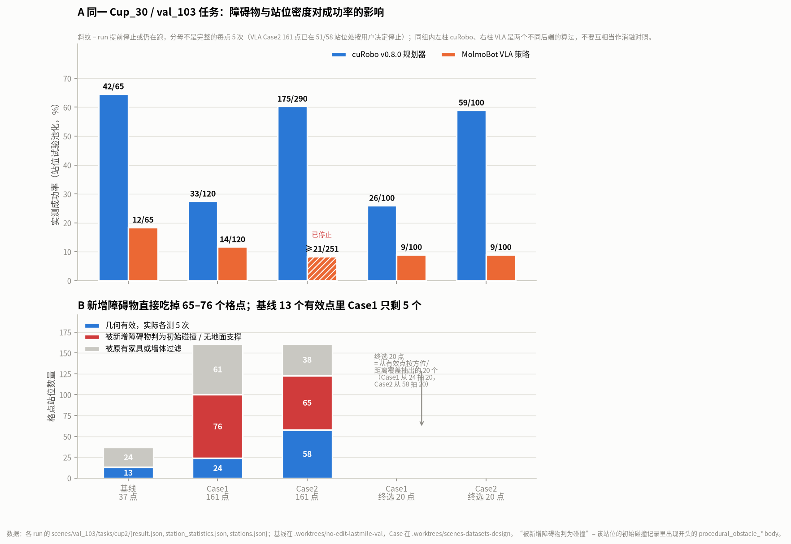
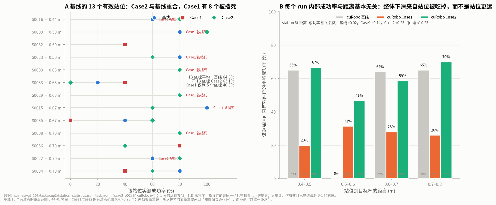
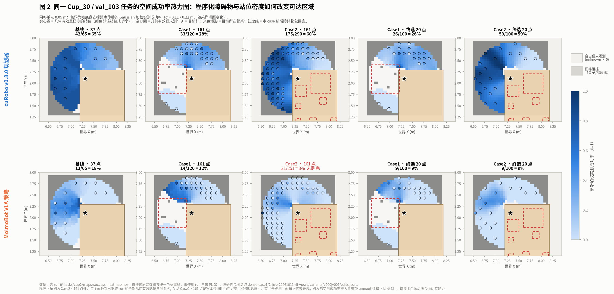
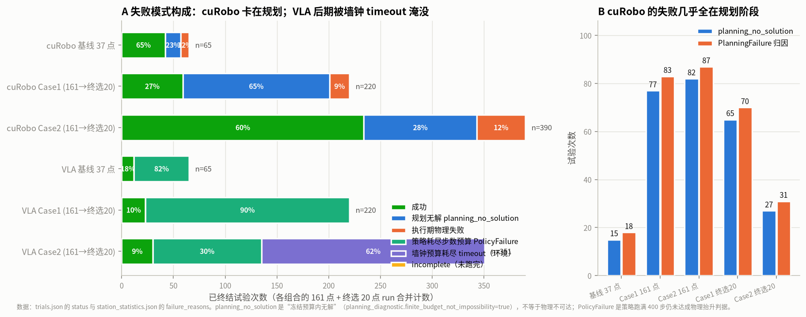
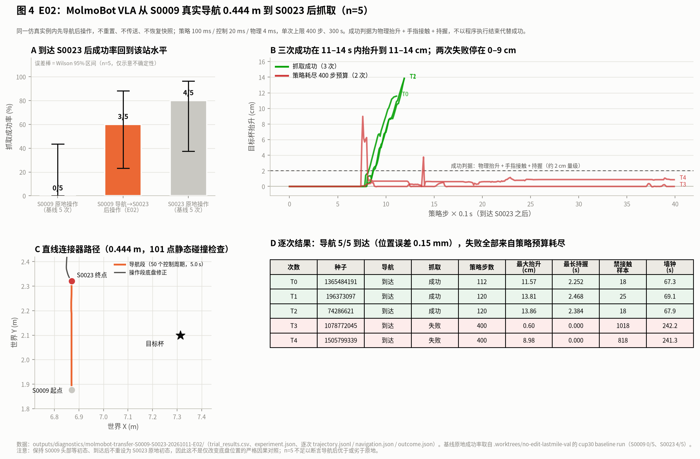

# 2026-10-12（10-13 更新）：程序化障碍物 Case1 / Case2 对抓取难度的影响（cuRobo vs MolmoBot VLA）

分析对象：同一任务 `val_103` / `Cup_30`（`pick-bf2b057e9916`，实例
`cup_ff2c6ab62ccb690220c97cdcfeb658c5_1_0_2`）下，**放置障碍物前**的密集站位基线与
**加入程序化障碍物后**的 Case1 / Case2 运行，以及一次 S0009→S0023 的导航后抓取实验。

**结论一句话**：在本目标上，障碍物增强不是通过“让抓取本身更难”起作用，而是通过
**把半数以上格点站位判为初始碰撞、换掉可用站位集合**；cuRobo 死在规划阶段，VLA 死在
**时间预算**——但 VLA 的预算耗尽里有很大一部分是**本机争用**造成的，不能算作障碍物效应。

> **本版（2026-10-13）相对首版的改动**：补上了首版缺失的两个 MolmoBot Case2 run。
> 它们此前中止是因为一个**预算/超时耦合缺陷**（见 §6），修复后重跑。
> 其中 161 点 run 在 **51/58 站位处按用户决定显式停止**（判定"已跑够、结论不会有大的变化"），
> 其成功率是部分值，标为 `≥` 并在全文标注覆盖范围。

- [数据目录](data/)（runs / stations / case_variants / e02_trials CSV、热图 npz、调色板校验）
- [绘图脚本](scripts/)（`collect_metrics.py` 采集，`fig1`–`fig5` 出图）
- 骨架报告：[稠密站位与 Case1/Case2](../2026-10-11-dense-cases/REPORT.md)（构造与媒体复核，不含任务验收）
- 平台报告：[cuRobo 半底盘采样](../../no_edit/curobo-v080-reach-halfbase-val103-cup30-cuda5-20261011.md)、
  [最终站位接入](../final-station-integration/REPORT.md)、[VLA 最终站位接入](../molmobot-final-stations/REPORT.md)

---

## 0. 实验矩阵与口径

| 后端 | 基线（放置前，37 点，spacing 0.222） | Case1（161 点，spacing 0.111） | Case2（161 点） | Case1/Case2 终选 20 点 |
|---|---|---|---|---|
| cuRobo v0.8.0 | `no-edit-v080-reach-halfbase-…-1707` | `no-edit-curobo-case1-v000-…-222405` | `no-edit-curobo-case2-v001-…-222602` | `no-edit-final20-case1-v000-…-225943` / `…case2-v001-…-225943` |
| MolmoBot VLA | `molmobot-val103-cup30-…-194653` | `no-edit-molmobot-case1-v000-…-224025` | `no-edit-molmobot-case2-v001-fix2-20261012-230054`（**51/58 站位后停止**） | `no-edit-molmobot-final20-case1-v000-…-232238` / `…case2-v001-fix3-20261012-232021` |

- 站位是一条以目标为圆心、半径 = **底盘外接圆 0.4435184160005256 m 的一半**的圆盘栅格
  （`disk_samples`，间距 0.2218 m / 0.1109 m，格点 37 / 161）。
- 每个几何有效站位跑 **5 次独立试验**（每次新建 Simulation）；`planning_no_solution` 是“冻结预算内无解”，
  **不等于**物理不可达。
- **三个成功率口径**，全文严格区分：
  - `成功率 = 成功 / 已终结试验`（含墙钟 `timeout`，是本报告的默认口径）；
  - `排除 timeout 的成功率 = 成功 / (已终结 − timeout)`，用于剔除环境干扰；
  - `未跑完` 的 run 只给部分值，标 `≥` 或直接标注覆盖率。
- 跨代对照只在**同一坐标**上做（基线 13 个有效坐标在 Case 里的复现情况），不做跨 run 的总体推断。
- 数据来源：各 run 的 `scenes/val_103/tasks/cup2/{result.json, station_statistics.json, stations.json, trials.json, maps/success_heatmap.npz}`；
  新增障碍物几何取 `dense-case1/2-five-20261011-r5-views/variants/v000|v001/edits.json`。

---

## 1. 结果总览

| Run | 格点 | 几何有效 | 已测站位 | 已终结试验 | 成功 | 成功率 | 排除 timeout | 墙钟 |
|---|---:|---:|---:|---:|---:|---:|---:|---:|
| cuRobo 基线 | 37 | 13 | 13 | 65 | 42 | **64.6%** | 64.6% | 1.59 h |
| cuRobo Case1（161 点） | 161 | 24 | 24 | 120 | 33 | **27.5%** | 27.5% | 1.55 h |
| cuRobo Case2（161 点） | 161 | 58 | 58 | 290 | 175 | **60.3%** | 60.3% | 8.11 h |
| cuRobo Case1 终选 20 | 20 | 20 | 20 | 100 | 26 | 26.0% | 26.0% | 1.28 h |
| cuRobo Case2 终选 20 | 20 | 20 | 20 | 100 | 59 | 59.0% | 59.0% | 2.76 h |
| VLA 基线 | 37 | 13 | 13 | 65 | 12 | **18.5%** | 18.5% | 3.51 h |
| VLA Case1（161 点） | 161 | 24 | 24 | 120 | 14 | **11.7%** | 11.7% | 5.59 h |
| VLA Case2（161 点，**已停止 51/58**） | 161 | 58 | 51 | 251 | 21 | **≥8.4%** | 20.6% | 18.5 h |
| VLA Case1 终选 20 | 20 | 20 | 20 | 100 | 9 | 9.0% | 9.0% | 4.74 h |
| VLA Case2 终选 20 | 20 | 20 | 20 | 100 | 9 | **9.0%** | 27.3% | 6.98 h |



**图 1A**（斜纹柱 = 该 run 的覆盖不完整，分母不是完整的每点 5 次）：cuRobo 在 Case2 上仍有 60.3%，
与基线 64.6% 基本持平；被砍掉一半以上的是 **Case1（27.5%）**。VLA 两档都比自身基线低
（18.5% → 11.7%，以及 Case2 的 9.0% / ≥8.4%）。**但 VLA 这两行不能与历史 run 直接并列**（见 §5）。
另注意：cuRobo 那一列完全没有 timeout，VLA 那一列则被 timeout 主导——这不是算法难度差，而是
**两后端的“失败面”不同**（规划器 vs 学习策略 + 墙钟预算）。

**图 1B** 给出机制：Case1 有 **76/161** 个格点、Case2 有 **65/161** 个格点是因为**新增障碍物**被判成
初始碰撞/无地面支撑（`stations.json` 的初始碰撞记录里出现 `procedural_obstacle_*` body）；
其余 61 / 38 个由原有家具或墙体造成。间距减半把候选点从 37 增到 161（4.4×），
增强后只剩 24 / 58 个可用——**近一半可用格点被新增障碍物直接吃掉。**

---

## 2. 不是“抓取更难”，而是“站位集合被换掉”



把基线的 13 个有效坐标逐个映射回 Case：

- **Case2（cuRobo）**：13/13 坐标仍然有效且可测，平均成功率 **63.1%**，与基线 64.6% 几乎相同；
  13 个坐标里只有 S0032/S0033 掉到 0/5、S0034 掉到 3/5。→ Case2 的 60.3% ≈ 基线 64.6%，
  **差值主要来自新加入的 45 个坐标**（它们贡献了 225 次试验），而不是原站位被削弱。
- **Case1**：只有 **5/13** 坐标还活着，其余 8 个被判为与新增椅子碰撞（碰撞对是
  `procedural_obstacle_0 ↔ robot_0/base`）。这 8 个恰好是**离目标 0.44–0.70 m 的最近一圈**
  （S0003、S0008、S0009、S0015、S0016、S0022、S0023、S0029），也就是基线里表现最好那一档。
  剩下 5 个全是较远点，样本仅 25 次。



图 2 把 10 个 run 的 `success_heatmap.npz` 用统一色标重绘（未使用各 run 自带 PNG）：
Case1 行左侧最近的一整片区域被新增椅子包围盒（红虚线）覆盖后变为空白/深灰，有效站位被推到外围；
Case2 行色场与基线形态相近，只是多了一圈近距离格点。



**图 3** 说明两后端的失败机制完全分离：

- **cuRobo：失败几乎全在规划阶段。** Case1+终选 220 次里 142 次 `planning_no_solution`（65%）+ 19 次执行期失败；
  Case2+终选 390 次里 109 次无解 + 47 次执行失败。状态量层面：Case1 的 83 次 `PlanningFailure` 中，
  258 次 solver 调用**全部**带着 `constraints/head_fov_endpoint` 且该项代价 > 0（基线 76/76 亦然）——
  head FOV 硬约束是规划失败的常驻因素；本次未做关闭 FOV 的消融，因此**不能**把失败单独归因给障碍物。
- **VLA：失败被 `timeout` 主导。** 修复后的两个 Case2 run 合计 347 次终结里 214 次是**墙钟预算耗尽**
  （62%）、104 次跑满 400 步的 `PolicyFailure`（30%）、29 次成功（8%）。相比之下首版的中断 run
  一次 timeout 都没有——因为旧代码在第一次预算耗尽时就整体退出，从没机会累积 timeout。

---

## 3. E02：S0009 → S0023 导航后抓取



同一仿真实例内从 S0009 真实导航约 **0.444 m** 到 S0023 后再调用 MolmoBot（不重置、不传送、不恢复快照）：

| 设置 | 抓取成功 | 成功率 |
|---|---:|---:|
| S0009 原地操作（基线 5 次） | 0/5 | 0% |
| **S0009 导航 → S0023 后操作（E02）** | **3/5** | **60%** |
| S0023 原地操作（基线 5 次） | 4/5 | 80% |

- 导航 5/5 到达（位置误差约 0.153 mm、偏航误差 1.6e-8 rad，50 个控制周期 = 5.0 s）。
- 3 次成功在 11–14 s 内把杯子抬升 11.6–13.9 cm；2 次失败跑满 400 步、抬升停在 0.6 / 9.0 cm 且未形成持握。
- **边界**：保持 S0009 头部等初态、到达后不重设为 S0023 原地初态，因此这不是“只改底盘位置”的严格因果对照；
  A\* 网格因 0.4435 m 包围圆与桌子支撑包络膨胀把两端点都标为 blocked，实际走的是 101 点静态碰撞检查过的
  直线连接器（静态采样 ≠ 连续扫掠证明）。n=5 不足以断言导航后优于/劣于原地。

---

## 4. VLA Case2：两个规模档位互相印证，但都被环境稀释

补跑的两个 Case2 run 在**同一批站位**上的表现高度一致（17 个共享站位）：

| | 161 点 run（共享 17 站位） | 终选 20 点 run（共享 17 站位） |
|---|---:|---:|
| 成功率（含 timeout） | 7/81 = 8.6% | 9/85 = 10.6% |
| 成功率（排除 timeout） | 7/27 = **25.9%** | 9/24 = **37.5%** |

- 逐站位的成功数基本对应：S0104 是 2/5 vs 3/5、S0131 是 1/5 vs 2/5、S0116 是 1/5 vs 1/5、
  S0073 是 1/1 vs 2/5；另有 6 个站位两者都是 0/5。**两个独立 run 在同一坐标上复现了同一结果**，
  说明这不是随机噪声。（差异最大的 S0137：161 点 1/5、20 点 0/5，两者 timeout 数都偏高。）
- 但**两个 run 的 timeout 都占了 6–7 成**。这不是策略问题：161 点 run 的 51 个已测有效站位里
  **44 个出现过 timeout**，是全局现象而非个别站位；17 个共享站位里 13 个在 161 点 run 上有 ≥3 次 timeout。
- 直接原因见 §5：**本机 GPU/CPU 被大量外部任务占满**，单步耗时被拉长，300 s 墙钟预算在跑满 400 步前就耗尽。

**因此 Case2 的 VLA 数字要这样读**：
“含 timeout 的 9.0%”是**在这台机器当前负载下**的端到端读数；
“排除 timeout 的 26–38%”更接近策略本身的能力，但它**不是**官方口径，且分母变小后不确定性更大
（17 站位 × 5 = 85 次里只剩 24–27 次可评价）。两者都不应与 10-11 那些低负载时段跑出的历史 run 直接比较。

---

## 5. 与首版的差异：这次为什么慢了这么多

首版的 VLA Case2 只跑到 3 个站位就被打断；本次补跑能跑完，但**每步明显更慢**。对照证据：

| | 首版（10-11 夜） | 本次（10-12/13） |
|---|---|---|
| 单次 attempt 墙钟 | 300.5 s | 300.1 s（同样顶满预算） |
| 单次执行的仿真步数 | **400 步（跑满）** | **227–372 步（提前耗尽）** |
| timeout 次数 | 1 | 161 点 run 149 次 / 20 点 run 67 次 |
| 系统负载（208 核） | — | 130+，GPU 6/7 被外部任务占用 60–80% |

同一条 300 s 墙钟，首版能走完 400 步，本次只能走 227–372 步 → **单步耗时约 1.3–1.8×**。
这不是障碍物造成的，是**机器争用**。它对结论的影响是单向的：**把 VLA 的成功率系统性压低**。

一个推论：如果要在低负载下重跑，timeout 会大幅减少，VLA Case2 的读数应更接近
“排除 timeout”那一列（Case2 的 20.6% / 27.3%），而 Case1 的 11.7% 也可能被低估——**VLA 相关的所有绝对成功率
本轮都不可与 cuRobo 侧同样信噪比地比较**。

---

## 6. 首版中断的根因与修复（预算 / RPC 超时耦合）

首版两个 VLA Case2 run 的中断不是障碍物造成的，是一个**代码缺陷**：

```python
remaining = budget - (now - started)        # 300 s 尝试预算
if remaining <= 0: raise TimeoutError(...)  # ← 正常路径
response = policy.action(..., timeout=remaining)   # ← 缺陷：把“剩余预算”当 RPC 超时
# molmobot.py: min(timeout, service_timeout_s=300) → 预算快耗尽时 RPC 只剩亚秒等待
```

跑满 400 步的 attempt 会在最后一步把 300 s 用光，此时 `remaining → 0`，RPC 超时被设成不到 1 秒，
而模型单次推理需 0.05–2.5 s → **必然抛 `model response timeout`**，且它被归为 `shared` 故障，
collector 直接 fail-stop 整个 scene。这一路径被两个 Case2 run + 两次重跑共**命中 3 次**。

**修复**（`feat/scenes-datasets-design`，工作区已提交）：

| 文件 | 改动 |
|---|---|
| `runtime/molmobot_execution.py` | 不再向 RPC 传 `remaining`；预算在应答返回后再检查 |
| `policies/molmobot.py` | RPC 使用固定超时 `timeout or config.rpc_timeout_s` |
| `policies/molmobot_config.py` | 新增 `rpc_timeout_s: float = 30.` 并纳入校验 |
| `configs/policies/README.md` | 记录该字段与解耦语义 |

**验证**：修复后两个 run 累计 347 次终结**零 episode_error、零 infrastructure_error**；
`test_episode_timeout_continuation` 等 36 项相关回归通过。

另外为把产出拉回原口径，给 `collect-no-edit` 补了缺失的 `--collection-config` 透传参数，
并用 `configs/collection/no_raw_first.json`（`raw_first=false`/`record_depth=false`）重跑——
新合并进来的 raw-first canonical 记录会让单次 attempt 达到 1.2 GB（逐帧 depth + 逐 tick contacts），
磁盘 I/O 反过来拖慢仿真（实测 91 步就撞满预算，vs 原 run 400 步）。**该开销本身也会污染 VLA 的决策预算。**

---

## 7. 对 Case 设计的直接含义

1. **“更密集的站位”在 Case1 上是自我抵消的。** 间距减半把候选点 ×4.4，但新增椅子一次性
   把最近一圈（基线成功率最高的一圈）全部判为初始碰撞；净余 24 个点里 19 个是新坐标。
   要测“障碍物是否让抓取更难”，Case1 当前布局**无法回答**——它比的是两批不同的站位。
2. **Case2 是更干净的“同场景加料”。** 13 个原坐标全部保持且成功率不变，整体 60.3% 是对
   58 个坐标的平均，能反映“在更拥挤的桌面上、从更多角度抓取”的难度画像。
3. **两后端不能互相做消融对照。** 基线上 64.6% vs 18.5%，差异来自算法而非障碍物；
   只有 Case 之间的差才是本次要读的量。
4. **下一步**：(a) 关闭 `head_fov_enabled` 做开关消融，把 FOV 与新障碍物的贡献分开；
   (b) **在低负载时段**重跑 VLA Case2，把 timeout 压到可忽略，才能得到可比较的读数；
   (c) 在 Case1 上补一份“椅子放在远处、不覆盖最近一圈”的变体，作为位置对照。

---

## 8. 未做与不可结论

- **不做**跨 run 的总体成功率推断：Case1/2 各只有 1 个变体（v000 / v001）真的跑了任务；
  构造阶段的 5 个随机变体没有对应任务结果；跑完的 run 也只有 5 种子级别的重复，不做误差棒或显著性。
- **不能**把 `planning_no_solution` 读成“物理不可达”（诊断自带 `finite_budget_not_impossibility: true`）；
  也不能把 head FOV 的普遍违规读成“FOV 是本次差异的唯一原因”（无消融）。
- **不能**把 VLA 的 `timeout` 当作物理失败或策略失败：它是墙钟预算耗尽，本轮主要由机器争用造成。
  本报告给出“含 timeout”与“排除 timeout”双口径，但都不作为官方数字对外引用。
- **161 点 VLA Case2 run 已于 2026-10-13 按用户决定停止**（51/58 站位、251 次终结），
  理由是该 run 已积累足够证据、后续站位不会改变结论。它是**显式停止**而非崩溃或超时：
  `summary.json` 为 `incomplete`、`interruption.json` 记录了中断点，已完成的 attempt 证据完整保留。
  其 ≥8.4% 与 20.6%（排除 timeout）是**部分值**，覆盖 51/58 个有效站位；未测完的 7 个站位不在分母内。
  这 7 个站位对结论的边际影响有限（同批站位成功率区间为 0–60%，见 `data/stations.csv`），
  但**不能**把 ≥8.4% 当作该 run 的完整读数对外引用。
- 两个被取代的旧 run（`…-230626`、`…-232238`）作为中断证据原地保留，未删改；它们**不参与**任何成功率比较。
- 本次除 §6 列出的超时解耦修复与新增 `--collection-config` 参数外，**未改动任何物理/成功阈值**。

---

*首版：2026-10-12；本版：2026-10-13（补跑两个 VLA Case2 run、修复预算/超时耦合、改用 no-raw-first 口径）。*
