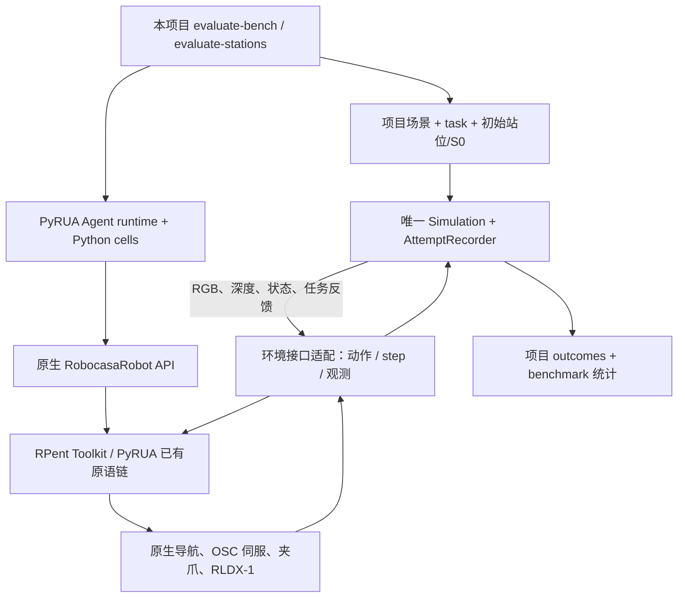

- 状态：implemented，实施与实测见 [交付](../delivery/01-implementation.md)
- 日期：2026-10-28
- 替代：本文件上一版“先复现 RoboCasa 原生任务”方案
- 关联：../../../README.md、../../../docs/architecture.md、../../../docs/data-format.md

# PyRUA 原生策略与原语接入本项目场景、benchmark

## 1. 目标与固定边界

**直接在 LastMileDataFlow 已有场景和 benchmark 上测试 PyRUA。** 保留 PyRUA 的 Agent、Python cells、机器人 API 和已有底层原语链，适配它们与本项目环境之间的接口。

不设置 RoboCasa Target50 / OpenDrawer 复现阶段，不生成另一套厨房场景，也不先做原生 benchmark 小批量试验。RoboCasa 在这里仅表示参考原语与控制协议的来源；测试场景、任务、S0 和验收标准来自本项目。

首版优先本项目的 PandaOmron 场景，因为参考仓库提供了相应原语链。RBY-1 需要独立的本体适配，不能只改机器人名称即认为兼容。

本项目的 A*、cuRobo、π0.5 和 MolmoBot 不替换 PyRUA 原语。原语中已有的导航、末端伺服、夹爪及 RLDX-1 调用按原有算法执行。首版以完整原语集合为计划；缺少权重时不自动改成无 VLA 的实验。

## 2. 工作区

- 工作区：`/data1/wenyifan/lmdf/LastMileDataFlow/.worktrees/pyrua-native`。
- 分支：`exp/pyrua-native`。
- 本方案、后续实现及报告均在该工作区维护，主工作区不保留重复方案。
- 主仓库 `reference_repos/PyRUA-Lean/` 是只读参考源码；实施时准备本工作区独立依赖，不借其他 worktree 的 Python 环境。
- 原始场景、标定和 benchmark 只读；新 run 输出到本工作区 `outputs/`，日志放其 `logs/`。

## 3. 接入链路



项目 workflow 管理 episode，PyRUA 管理决策和原语组合。一个 episode 只有一个活动 Simulation 和一次实际轨迹记录；原语内部的每个 step 都推进这个实例。

不直接调用会自行生成 RoboCasa 任务的原生 host `boot()`。复用其 Toolkit、机器人类、cells 和 Agent 实现，替换环境客户端/服务接入点以及必要的启动和 task-card 组装。RPent 的精确环境接口仍需读取配套源码后落实，不能仅凭 PyRUA wrapper 宣称可以零改动连接。

## 4. 保留什么，适配什么

| 部分 | 保留内容 | 必要适配 |
|---|---|---|
| Agent / cells | 上游模型调用、Python 执行、局部循环、图像反馈机制 | episode 启动与终止由本项目调度 |
| Prompt / API | 原生 API reference、操作知识和坐标/原语语义 | 换成本项目任务指令、初始观测；修正场景和任务判定相关描述 |
| 视觉原语 | `back_project_batch`、`query_world_map`、`floor_overlay` 的算法 | 将项目相机 RGB、深度、内外参组织为原生输入 |
| 导航原语 | 原生 `navigate_to`、`move_base`；没有 A* 的行为也保留 | 将原生底盘动作送入项目仿真 |
| 操作原语 | `move_to`、`move_delta`、`rotate_pitch`、夹爪和 scripted grasp | 状态字段、动作协议及控制时序对齐 |
| VLA 原语 | RLDX-1 权重调用、动作分块和帧历史规则 | 使用本项目任务指令和实时相机输入，动作仍执行于同一实例 |
| 场景与初态 | 本项目原始几何、对象、任务和 S0 | 只在初始化设置状态，不用 RoboCasa task seed 重新生成场景 |
| 成功判定 | 本项目 pick/open outcomes、恢复诊断和覆盖率 | 把当前项目判定投射为原生 `done`、success / task progress 接口 |
| 记录 | 本项目 recorder 与主 results/trials | 附加必要 cells、原语调用和模型交互信息，不复制物理轨迹 |

同名接口必须对应真实输入和结果。相机或任务反馈缺失时补齐接口或明确报告未支持，不能用常量、错位相机别名或虚构状态凑齐调用。

## 5. 实施前要核对的实际接口

### 5.1 RPent 原语与环境协议

PyRUA `RpentBackend.execute_tool()` 会直接调用 Toolkit；原生 RoboCasa host 支持 env endpoint，但其默认启动逻辑仍以 RoboCasa task 构建环境。实施第一步获取配套 RPent 源码，定位 Toolkit 的环境请求、state envelope、step、相机、接触反馈及成功检查。

优先在现有环境客户端协议处接本项目 Simulation。若原语还直接访问环境内部对象，则只抽取/迁移必要依赖和接口，保留算法，不重写成项目规划器。先选一条原语完整核对数据流，再补齐其他原语，避免预设一个庞大的通用桥接框架。

### 5.2 动作与控制

本项目已有 `runtime/control/panda_robocasa.py` 的 `PandaRoboCasaAdapter`，提供 `robocasa-v1` 12D 动作：末端增量、夹爪、底盘速度、躯干和模式。这是现有可复用的候选执行入口，**不等于已经证明与 RPent/RLDX-1 的版本完全一致**。

核对动作顺序、坐标系、归一化尺度、模式切换、夹爪符号、控制频率、OSC 增益与参考系。先用原语给出的短动作在一个项目场景上检查实际响应；不通过时在控制协议边界对齐到原生语义，必要时复用上游控制实现，不能用 cuRobo 运动替代。

`position-v1` 快照不能直接按另一 profile 执行。优先选择 profile 已兼容的项目输入；若需准备新 profile，则从项目来源构建独立输入并明确记录，原 benchmark 和标定不原地改写。正式困难 S0 评测仍要求与实际执行条件匹配的有效标定。

### 5.3 相机、深度与本体状态

参考接口使用 `agentview/navview/wrist`；项目现有 RoboCasa profile 使用左右 agentview 和腕部相机。不能把任意一张侧视图直接改名成 navview。需要核对原生相机安装位姿、视场、分辨率及翻转约定，并从项目实际渲染中生成对应输入。

深度反投影使用实际相机内外参；world map 来自图像深度，不通过任务目标 ID 读取位置作为视觉定位结果。base/EEF 的世界系与相对系、四元数顺序、夹爪开度按原生协议适配。

如果增加或调整相机，记录实际 sensor profile；输入条件变化不伪装成与既有 VLA 相同的纯 RGB 条件。

### 5.4 任务反馈与评测标签

任务指令来自项目 `task`。`robo.done` 由项目已有 outcomes 判定，不调用无关 RoboCasa task predicate，也不接受 Agent 自报成功。`success_criteria()` 和 `task_progress` 只映射本项目可公开的任务条件与真实反馈；保留何种反馈在运行配置中说明。

`oracle.json`、恢复区域、S1 成功点、历史站位成功率、参考路径只供 benchmark 评测端使用，不能进入 Agent、原语候选生成或 prompt。原生 task card 由显式允许字段构造，不直接序列化完整 episode/scene 记录。

### 5.5 连续执行与环境

每个 bench episode 初始化一次场景和 S0。原语重试、底盘调整、VLA 帧历史重置都不重置物理状态；仿真错误或终止后的原语不能继续运动。模型等待时间、原语动作和总墙钟分别记录，预算在内部循环中也生效。

项目宿主使用本 worktree 的 `.venv` 和现有 MuJoCo 版本；RLDX-1 若需要 Python 3.10，则放工作区独立模型/原语服务环境，通过实际所需协议通信。无需安装 RoboCasa365 场景库或下载 Target50 资产来完成项目场景试验；必要机器人、原语、模型依赖仍按源码需求准备。

## 6. 修改范围

| 位置 | 工作 |
|---|---|
| `policies/pyrua/` | 配置、上游 Agent/Toolkit 接入、task-card 和原语服务客户端；不重写原语算法 |
| `runtime/execution/agent.py` | 单 episode 编排及项目环境桥接，接现有 Simulation、物理监测与 recorder |
| `runtime/control/panda_robocasa.py` | 仅在实测协议差异需要时对齐控制；已有接口先核对再复用 |
| 现有 rendering/sensor 模块 | 输出原生所需 RGB、深度、相机参数与 state |
| `policies/config.py`、`runtime/execution_config.py` | 新增 pyrua 分支、profile 和 Agent/执行预算 |
| `workflows/lastmilebench.py` | 直接以本项目 benchmark 启动 PyRUA episode，复用当前汇总与恢复诊断 |
| `workflows/collection.py` | 接 `evaluate-stations`，用于项目站位的实际策略测试；连续采集语义暂不扩展 |
| `configs/policies/`、`configs/execution/` | 模型、原语服务、机器人、信息条件和预算的明确配置 |

只维护原有五个 CLI。Agent 不塞入 VLA 的单步 `policy.action()`；使用 episode 入口，并共享真实物理执行链。

## 7. 直接在本项目上的实施与验收

| 阶段 | 输入与工作 | 验收 |
|---|---|---|
| P0：接口落实 | 配套 RPent 源码 + 一个本项目 Panda 场景/bench episode | 明确所有原语实际依赖；确认动作、相机、状态及任务反馈映射 |
| P1：原语直连 | 同一项目场景，固定代码依次测试观测、底盘、末端、夹爪和 RLDX-1 | 真实步进、协议对齐、无重置、记录一次；只证明已执行的原语边界 |
| P2：单 episode Agent | 直接读取项目 benchmark 的一个有效 episode；无有效 bench 时只能显式做项目场景 smoke | 模型收到项目观测并生成 cells，原生原语完成真实闭环；任务成功/失败如实记录 |
| P3：项目 bench 小批量 | 相同 benchmark、固定模型/原语/信息条件，多个 episode/seed | 任务成功、恢复成功、coverage、Macro、错误与实际耗时/token |
| P4：扩展 | 项目逐点试验、更多任务或本体 | 每项单独验证，不把 Panda 结果推广成 RBY-1 能力 |

所有真实测试均来自本项目场景。P1 不要求先通过某个外部任务；P2/P3 不要求 PyRUA 在 RoboCasa 基准上复现论文成绩。没有合格困难 S0 时保留负结果，不造配对、不把普通场景 smoke 称为困难 benchmark。

先做关键局部软件检查，再跑仓库全套离线回归；模型调用、RLDX-1 推理、真实原语步进与完整 benchmark 分开报告。成功率提升不是接入验收的前提。

## 8. 入口、预算与输出

实现后直接使用现有入口，以下仅为拟用模板（pyrua 配置尚未创建）：

```bash
.venv/bin/lastmile-dataflow evaluate-bench \
  --benchmark <本项目已有且profile匹配的benchmark> \
  --policy-config configs/policies/pyrua_panda_omron.json \
  --output outputs/pyrua-bench/<新run> \
  --gpu <当前选择的GPU>
```

Agent 的 cell 次数与 bench 实际控制步 horizon 分开配置。正式比较沿用/显式声明 benchmark 总预算，不直接把上游两小时任务预算覆盖进现有评测，也不把 nominal max_episode_steps 当成已强制执行的物理步上限。

主结果仍为项目 `results.jsonl` / `trials.jsonl`，轨迹和视频来自同一次实际 rollout。cells、调用链及模型交互作为该 rollout 的策略信息保存；Toolkit 读取所需的观测可由共享观测存储提供，不再写第二套物理轨迹。Agent finish、执行终止和任务结果分开记录。

保持现有 coverage 和完整计划集合统计，基础设施故障保留 unknown，模型/GPU 共享故障停止当前批次。不新增文件指纹或发布清单。

## 9. 本轮纠正与执行总结

- 用户明确：复用 PyRUA 原生动作链，但测试对象直接是本项目场景和 bench。
- 已删除上一版的外部 RoboCasa 任务复现、Target50 资产准备、外部任务小批量和延后项目接入的步骤；首阶段即为项目环境接口接入。
- 核对了 PyRUA Backend/host、项目 Simulation stepping、Panda 12D controller 和 benchmark workflow，明确适配集中在环境协议，原语算法保留。
- 工作继续在 `.worktrees/pyrua-native`，同步更新报告入口；本轮仅修订方案与检查文档，没有安装环境、修改运行源码或执行真实测试。
- 配套 RPent 源码接口、上层模型访问、RLDX-1 权重和首批兼容输入仍待实施阶段落实；现有本地代码只足以确定候选接入边界，尚未证明动作/观测完全兼容。

参考：[PyRUA 原生机器人 API](../../../../../reference_repos/PyRUA-Lean/src/pyrualean/robocasa.py)、[RPent Backend](../../../../../reference_repos/PyRUA-Lean/src/pyrualean/hosts/common.py)、[PyRUA RoboCasa host](../../../../../reference_repos/PyRUA-Lean/src/pyrualean/hosts/rpent_robocasa.py)、[项目 Panda 控制器](../../../src/lastmile_dataflow/runtime/control/panda_robocasa.py)、[项目 bench workflow](../../../src/lastmile_dataflow/workflows/lastmilebench.py)。
