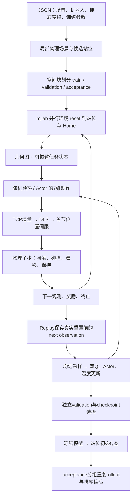

# Actor-Critic 算法设计与训练核心 Pipeline

- 状态：active
- 日期：2026-11-11
- 替代：无；汇总当前实现，不替代历史实验记录
- 关联：../requirement/01-fixed-base-sac.md、../plan/01-implementation.md、../delivery/05-training-handover.md、../analyze/06-actor-grasp-learning.md

## 1. 总体设计与范围

检查版本为 `.worktrees/actor-critic` 的 `3f2e235`。当前实现为 **图观测 + 连续 SAC 双 Q + mjlab 并行物理仿真 + DLS 控制**。同一个 Actor 覆盖不同初始站位，从统一 Home 学习接近、闭爪、抬升和稳定保持；Critic 同时为训练提供价值梯度，并生成站位质量代理图。

当前配置仅覆盖 val103 / Cup_30、Panda-Omron 单臂。底盘与升降保持初始站位，不学习导航。观测使用仿真几何、状态和接触真值，不接图像、语言或VLA特征。研究入口独立于五个主CLI的cuRobo / MolmoBot链路；这是标准SAC，不是多意图SAC-X，也没有按抓取阶段拆分的多个Actor。

**训练与评分软件链路已实现，但现有证据尚不能证明Actor学会抓取或Q图排序有效。** 本文参数以当前源码和JSON为准；历史实验只对应其冻结版本，本轮没有启动新训练。

## 2. 核心 Pipeline



站位是底盘初始 `(x,y,yaw)`，由reset选择；Actor每步输出手臂与夹爪动作，不输出底盘站位。

## 3. 场景、站位和任务定义

### 3.1 场景与数据分布

`prepare_rl_scene`从真实场景/机器人XML构造目标附近的局部物理模型，当前半径2 m。机器人作为mjlab entity，场景附着到同一物理模型；图表示与实际物理碰撞模型分开，策略通过图观察，碰撞由真实仿真求解。

候选站位在目标周围半径1 m圆盘内按0.1 m间距采样，每点16个yaw。准备阶段将物体稳定1 s并保存共同初态；每个站位只做地板支撑和Home初始碰撞检查，不按IK、FOV或脚本抓取成功预筛。因此合法站位不等于可完成任务。

按XY的0.3 m空间块，以seed42划分约70%训练、15%验证、15%验收；同一块的不同位置和yaw共用划分。训练reset从合法train站位均匀抽取，恢复同一物体初态、Home及张开夹爪；底盘位于抽取站位，升降初值0.2 m，运行中允许DLS通过物理伺服调整，不覆盖状态消除漂移。`debug_station_ids`非空时只缩小训练池，用于局部诊断。

### 3.2 严格成功、失败和碰撞

RL采用显式 `rl-pick-1cm-1s-v1`：双指有效法向承力、物体脱离支撑、相对回合初始世界高度抬升至少1 cm，连续保持1 s。不限制目标相对TCP滑移；接触、支撑或高度条件中断则清零。非RL的strict-pick-v3默认不变。

底盘平移漂移超过2 mm或yaw超过0.2°会控制失败；物体跌落至初始高度下方0.3 m也失败。成功、失败、基础设施故障或60 s超时结束回合。

普通非法碰撞只惩罚并统计，不直接结束回合。严格成功与全程无碰撞成功分开统计；成功本身不要求全程无非法碰撞。合法指尖抓取和正常底盘地板支撑不罚；自碰撞、非手指碰目标、机器人碰环境纳入非法碰撞。NaN或物理缓冲溢出属于基础设施故障，不作为正常任务失败数据学习。

## 4. 观测与图网络

Actor和Critic使用相同的 `GraphObservation(nodes, node_mask, arm_task_state)`。

| 输入 | 当前实现 |
|---|---|
| 节点类型 | Goal、Tabletop Obstacle、Ground Obstacle、Container；无额外Robot节点 |
| 节点粒度 | 一个目标节点，其他相关碰撞geom各一个节点，家具不压成整件实心外包围盒 |
| 每节点24维 | 类型4、Base Frame中心3、尺寸3、旋转6D、到目标距离1、底部高度1、线速度3、角速度3 |
| 边 | 每个非Goal节点指向Goal，各节点显式self-loop；5维边类别特征 |
| 机械臂任务状态75维 | 关节位置/速度、TCP位姿、夹爪宽度/速度、抓取位姿误差、目标速度、抬升高度、双指力、支撑、保持进度、相对滑移、剩余时间、固定关节漂移、上一步距离/角度和动作，另加升降位置/速度、TCP实测相对底座速度6维、接触奖励标记及最高进度 |

几何统一转入实测Base Frame，旋转用6D表示，抓取旋转误差用旋转向量。抓取目标为目标物体位姿乘以固定物体局部抓取变换；当前取NPZ第0行并附加roll=π/2、approach offset=-1 cm，随目标物体运动更新。节点集合初始化时选定，动态位姿/速度每次重读；不是每步沿用初始静态图。该输入是紧凑工程观测，不宣称包含完整物理Markov状态。

Actor、Q1、Q2各自有独立GraphEncoder，不共享参数；target Q是各自在线Q的副本：

- GraphEncoder：一层单head `GATConv(24→128, edge_dim=5)` + ReLU，读取Goal embedding后拼接75维状态，得到203维。
- Actor：203→256→256→14，输出7维μ和7维log_std，后者裁剪到[-5,2]。Gaussian重参数采样后tanh得到动作，logπ包含tanh修正；均值动作是`tanh(μ)`。
- 每个Critic：203维观测编码拼接7维动作，210→256→256→1，输出标量Q。

## 5. 动作与控制

| 动作分量 | 语义与当前尺度 |
|---|---|
| 0:3 | Base Frame下TCP每轴平移增量，±2 cm / policy step |
| 3:6 | Base Frame旋转向量每轴增量，±5° / policy step |
| 6 | 夹爪目标总宽度0–8 cm；-1闭合、+1张开 |

物理dt=0.002 s，decimation=25，即物理500 Hz、策略20 Hz；60 s回合最多1200个策略步。动作尺度是指令上限，不等于实际TCP位移。

实测底座旋转将动作变换到世界系；mjlab differential IK用GPU Jacobian与DLS求手臂关节位移，经位置/命令速度限幅，送关节位置伺服并执行真实物理子步。联合优化7个手臂关节和1个升降关节，夹爪独立控制；底盘不参与IK。升降命令限速0.05 m/s，按关节名匹配上游顺序。DLS不提供碰撞投影或轨迹预检，学习避障依赖观测、奖励与真实接触反馈。

## 6. 奖励与SAC优化

当前共享字段表保存13项加权分量：位置、姿态、碰撞、触限、控制失败、成功、张开、位姿保持、近距离低速、闭合、首次接触、抬升进度和持物。

全局改善为 `10×(d_prev-d_now)+0.5×(angle_prev-angle_now)`；碰撞 -2、控制失败 -5、成功 +100，触限权重0但保留控制约束。Approach 保持张开0.02/s；Pre-grasp及Grasp位姿质量0.05/s；仅Pre-grasp低速0.02/s；仅Grasp实际闭合0.05/s。双指承力优先进入LIFT。首次在1 cm／10°内建立双指承力奖励2分，每回合一次。抬升按相邻双指承力子步超出回合历史最高进度的部分给分，1 cm饱和且累计至多5分；离开支撑的持物速率0.5/s。具体门控和公式见[实施方案](../plan/02-staged-reward-and-lift.md)。

持续项按dt积分，事件与改善量不乘dt，环境继续 `scale_rewards_by_dt=False`。碰撞取25个子步OR；接触事件与峰值进度在子步更新，局部reset清零。启发式改善奖励不宣称折扣势函数策略不变性。旧混合grasp potential已移除。

一次更新依次为：

```text
a_next ~ π(·|s_next)
y = r + γ(1-done) [min(Q1_target,Q2_target)(s_next,a_next) - α logπ(a_next|s_next)]
L_Q = MSE(Q1(s,a),y) + MSE(Q2(s,a),y)
L_actor = mean[α logπ(a|s) - min(Q1,Q2)(s,a)]
L_alpha = -mean[logα × stop_gradient(logπ(a|s) + target_entropy)]
Q_target ← (1-τ) Q_target + τ Q_online
```

先更新双Q，再冻结Q参数更新Actor（仍通过Q对动作的梯度反传），然后更新自动温度α，最后软更新target Q。JSON当前γ=0.999、τ=0.005，Actor/Critic LR=3e-4、温度LR=1e-4、初始α=0.1、target_entropy=-7。`SACConfig`类兜底γ仍为0.995，研究入口以JSON显式参数为准。

## 7. 训练循环、Replay与预算

入口：`scripts/experiments/train_sac.py` → `workflows/rl_training.py::train`。

1. 设置seed，创建训练环境与独立验证环境；初始化SAC并保存initial.pt，或按resume恢复参数/优化器。
2. 创建同设备环形Replay，训练前先执行一次固定validation。
3. 新采集健康交互不足20000条时采均匀随机动作，之后使用Actor随机策略。
4. 执行向量环境，将健康transition的真实重置前next observation写入Replay；再只reset结束槽位，保留其他槽位历史。
5. 预热完成且Replay足够batch时，均匀有放回采样更新；每向量步做指定次数learner更新，无优先回放或示教混合。
6. 定期保存日志/权重/曲线并验证，结束补做最后一次验证。

| 配置项 | 当前JSON默认 |
|---|---:|
| 并行训练环境 |128|
| Replay容量 / batch |100000 / 256|
| warmup_min |20000条健康transition|
| updates_per_step |1次 / 向量步|
| max_transitions |200000条健康transition|
| log_every / eval_every |10000 / 100000条|
| validation |8站位，每点2次随机rollout|

向量步、transition、learner更新不能混用：健康128环境一步生成128条，默认更新率约1/128=0.0078125次/transition。无故障且从零训练，默认预算约1563个向量步、1407次更新；这是预算推算，不是已执行结果。u8对应0.0625次更新/transition，但不是当前默认。

预热已在`9af697c`解耦为直接读取warmup_min；旧报告正文“max(warmup_min, num_envs×episode_steps)”是历史行为，交接报告第8节已修正。代码仍有Twenty seconds旧注释，实际回合由60 s配置决定。

超时进入Replay前合并为terminated，不bootstrap，因为时间耗尽是任务边界。基础设施故障数据不进Replay；普通碰撞和任务失败会进。若全部槽位都基础设施故障则停止训练。

## 8. 验证、模型选择和站位图

### 8.1 训练中验证

固定seed从合法validation集合选8点，每点2次随机Actor rollout；同时为所有合法站位计算Q图，期间不更新模型。best按 `(validation成功率, 平均未折扣回报)` 字典序选择，先比成功率再比回报。零成功时best可能只是接近奖励较好，不能称为成功模型。

配置debug站位后，额外在训练点分别执行随机策略与`tanh(μ)`均值策略，记录接近位姿、双指接触、抬升1 cm、最长保持和新RL协议成功；不改变validation/best口径。阶段统计用于定位，不替代物理子步级严格判据；阶段计数也不应直接当作同一时刻完整抓取。

### 8.2 冻结评分与验收

`score_stations.py`将各合法站位reset到统一Home，从冻结Actor采样K=16个动作：

```text
station_score(s0) = mean_k min(Q1(s0,a_k),Q2(s0,a_k)), a_k ~ π(·|s0)
```

使用在线双Q而非target Q，评分不额外减当前步αlogπ；Q本身仍受后续熵收益与奖励尺度影响。K是动作样本数，不是完整rollout次数；另存动作间Q标准差和每XY的最佳yaw。该图是给定机器人/任务/策略/控制器下的价值代理，不能解释为成功概率或策略无关的物理可达图。

`evaluate_sac.py`在acceptance子集按冻结Q选择top4、middle4、low4、uniform8，去重分组，每点10次随机rollout；候选不足时按实际可用点补齐。统计严格成功、无碰撞成功、折扣回报，以及Q与成功率/回报的Spearman相关。可用initial.pt在同一选择上做未训练基线。

配置中的验收目标为top成功率≥0.5、无碰撞成功率≥0.4、top比uniform至少高0.1且成功率Spearman为正。当前evaluate只输出统计，没有自动应用acceptance阈值给出pass/fail，需要依据结果判断。

## 9. 产物与恢复

训练输出含initial.pt、latest.pt、best.pt、metrics.jsonl、analysis/validation-*.json、固定验证选择和views曲线/地图。checkpoint保存网络/target Q、优化器、logα、计数、随机数状态、有效配置、版本和站位表。

resume属于参数/优化器热恢复：环境状态和Replay不保存，重新初始化，随机预热重新累计；配置必须与checkpoint完全一致。交互计数沿用，max_transitions是累计终点而非额外追加量，不能视为逐步无缝恢复或修改动作尺度后直接续训。

## 10. 证据、未完成项与本轮结果

[交接报告](../delivery/05-training-handover.md)历史汇总：12组保存交互约511万条、12260个记录训练回合、896次重复validation rollout均无成功。本轮没有重新逐条统计；这些数字不代表当前新参数的训练结果。

新尺度脚本128次中严格成功43次、无非法碰撞成功35次，说明控制链具备成功能力，不能证明Actor已学会。最近记录的短流程冒烟使用16环境、临时2 s回合，3008条交互/252次更新，验证预热解耦和debug随机/均值评估代码路径，不证明60 s任务学习有效。

尚未完成Actor从Home独立稳定成功、完整站位池推广、Q排序独立验收，以及成功模型和有效质量图交付。四阶段奖励已于2026-11-11实施，短验证见[交付记录](../delivery/07-staged-reward-and-lift.md)。行为克隆、示教Replay混合、预抓取初态课程是[后续建议](../analyze/06-actor-grasp-learning.md)，当前训练器未实现。

本轮执行：核对worktree及干净初态，读取需求/方案/交接记录，沿入口检查场景、站位、观测、控制、奖励、Replay、SAC和评估；形成本文并补充阅读入口。未改算法配置，未运行GPU训练或rollout；验证范围为源码/文档交叉核对与新增链接检查。

## 11. 代码阅读入口

以下路径相对本worktree根目录。

| 文件 | 职责 |
|---|---|
| configs/rl/val103_cup30.json | 当前默认配置；实验以保存有效配置和启动参数为准 |
| src/lastmile_dataflow/workflows/rl_training.py | 训练循环、模型选择 |
| src/lastmile_dataflow/scenes/loading/rl_scene.py | 局部物理场景 |
| src/lastmile_dataflow/scenes/stations/rl.py | 候选站位、空间划分、合法性 |
| src/lastmile_dataflow/scenes/rl_observation.py | 节点、图边、状态字段 |
| src/lastmile_dataflow/runtime/rl/environment.py、terms.py | 环境组装、接触、奖励、终止 |
| src/lastmile_dataflow/runtime/control/dls.py | TCP到关节控制 |
| src/lastmile_dataflow/runtime/outcomes/pick_state.py | 成功阈值、稳定窗口 |
| src/lastmile_dataflow/policies/sac/networks.py、agent.py、replay.py | 网络、优化、经验回放 |
| src/lastmile_dataflow/workflows/rl_evaluation.py | 验证、评分、独立rollout |
| src/lastmile_dataflow/data/evaluation/station_q.py | Q采样、分组与统计 |

安装与运行命令见[运行指南](01-running.md)。
