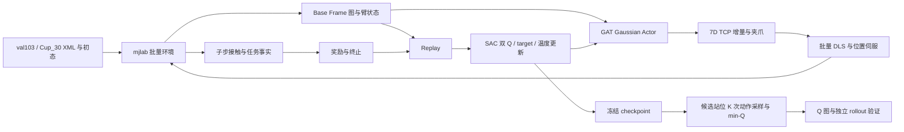

# mjlab 并行环境 + SAC 双 Q：构建方案与实施计划

- 状态：active
- 日期：2026-11-09
- 替代：本文件原 CPU / Mink 草案
- 关联：../requirement/01-fixed-base-sac.md、../delivery/03-mjlab-build-plan.md

## 1. 已确认目标与交付范围

采用 **mjlab GPU 并行环境 + 自定义 Continuous SAC 双 Q + 批量 DLS**，训练 Panda-Omron 固定底盘抓取策略，并用冻结 Actor / Critic 构建站位质量图。最终验收场景固定为 **val103-cup30，即 val103 / Cup_30**。

避障由场景观测、真实碰撞反馈和奖励学习。DLS 不做轨迹碰撞预检，不引入 Mink QP、cuRobo 轨迹过滤或动作安全投影。物理碰撞、自碰撞和接触力保持启用；关节范围、命令速度和执行器力限仍属于机器人控制约束。

交付包含：可安装的独立研究环境、val103-cup30 场景输入、7D 动作与 DLS 控制、共享任务判定、图观测、SAC / Replay、训练和评估入口、checkpoint、站位 Q 图、实际 rollout 与总结。原五个公开 CLI 保留；研究入口放在脚本中。首轮不扩展导航、其他机器人、开门或视觉策略。

简单桌面仅用于排查环境与算法；验收必须回到 val103-cup30。该场景内保留部分站位用于验证与验收，不把训练过的站位成功率当作独立验收，也不声称跨场景泛化。

本文为已选路线的实施方案。2026-11-09 已开始代码实现与依赖安装，实际进展和验证边界见 [实施记录](../delivery/04-implementation.md)；阶段是否完成以真实检查结果为准。

## 2. 总体架构与调用链

训练进程单卡起步，环境张量、DLS、Actor 和 learner 位于同一 GPU；不在每个环境创建 Python 仿真实例或 CPU IK solver。GPU 并行由 mjlab 提供，不重新编写 stepping 循环。共享一个 Actor，所有训练站位共同更新；Q1、Q2 各自独立编码。

采用 mjlab 的 `ManagerBasedRlEnv` 和 action / observation / reward / termination / metric 扩展点。现有 `Simulation` 继续负责主链执行、旧输入读取和准备；新训练后端属于 `runtime` 领域的研究能力，不复制一套 cuRobo / collection / recorder 链路。

## 3. 安装、版本与本地依赖

### 3.1 以用户指定的本地源码为准

本地 mjlab 位于：

`/home/wenyifan/wenyifan/lmdf/LastMileDataFlow/reference_repos/mjlab`

它不在 actor-critic 工作区的 `reference_repos/` 下，配置 `mjlab_source` 应显式填写上述路径。采用官方安装指南的“自有项目使用本地 editable 依赖”方式，不再默认另行下载正式 tag，也不修改参考仓库源码。

本轮读取的本地 `pyproject.toml` 与 main 文档一致，版本字段为 1.6.0，但依赖不同于同名发布 tag：

| 项目 | 本地源码要求 / 本方案选择 |
|---|---|
| Python | 上游 >=3.11,<3.15；研究环境选 3.11 |
| MuJoCo / MuJoCo Warp | 两者均 ~=3.16.0 |
| Warp | >=1.15.0 |
| PyTorch | >=2.14.0；按目标 GPU 选择对应 CUDA wheel |
| CUDA 路线 | 优先官方 cu130 / driver 580+；旧卡可按官方 cu126 路线，Blackwell 不用 cu126 |
| 图网络 | PyTorch Geometric GATConv；P0 解析兼容版本后固定 |
| 上游 RL 依赖 | mjlab 自带 RSL-RL，但本项目训练循环采用自定义 SAC |

依据：[用户提供的安装页](https://mujocolab.github.io/mjlab/main/source/installation.html)、本地 `docs/source/installation.rst`、本地 `pyproject.toml`。本地源码接口优先于滚动网页；正式实验同时记录本项目与 mjlab 的 Git revision、实际包版本和有效配置，不只记录“1.6.0”。

### 3.2 环境组织与安装步骤

研究环境使用 actor-critic 工作区自己的 `.venv`，不改主 checkout 的环境。新增 `[dependency-groups].rl`，只声明研究运行需要的依赖；通过 `.pth` 或 `PYTHONPATH` 使用本工作区 `src/`，不按根项目默认依赖安装整包，以免带入 MuJoCo 3.5.0、torch 2.7.1 和 cuRobo。

拟新增 `scripts/install_rl.sh`：读取本地 mjlab 路径与 CUDA 路线 → 创建 Python 3.11 环境 → 仅安装研究依赖组及本地 editable mjlab → 检查实际版本与 GPU → 执行最小环境 smoke。依赖统一留在项目 pyproject.toml；安装脚本传递上游 NVIDIA / PyTorch 包索引和 CUDA 选项，不能假设 editable 依赖会自动继承上游的 uv 索引配置。

安装与运行均使用明确解释器 / uv；运行时用 `uv run --no-sync` 避免自动将环境同步回根项目默认依赖。先用官方 demo 验证上游安装边界，再运行项目自己的 Panda smoke；demo 通过不表示 Cup_30 能抓取。脚本实际实现后再提供可执行命令，本轮不创建空脚本或伪运行入口。

用户已确认 CUDA 0–7 均可用。每次启动先查询 8 张卡的实时利用率、空闲显存与运行进程，优先选择低利用率且空闲显存足以容纳环境、模型和 Replay 的卡；从单卡起步，不固定卡号，不占满或干预其他进程。研究脚本显式接收 `--gpu <index>`，若用 CUDA_VISIBLE_DEVICES 隔离设备，则记录原始物理卡号与进程内逻辑卡号。

规划时默认执行权限未能访问驱动；实施时已通过完整主机权限访问 CUDA 0–7，并按实时负载选择 GPU 4。独立 `.venv` 已安装，实测 mjlab 1.6.0（本地 revision `936f7a125`）、MuJoCo / MuJoCo Warp 3.16.0、Warp 1.19.0、torch 2.14.0+cu130、PyG 2.7.0，151 包兼容检查通过。系统驱动未修改。

## 4. val103-cup30 场景、reset 与站位分布

### 4.1 输入和资产准备

建立 `configs/rl/val103_cup30.json`，明确 data_root、val103 来源、目标实例 Cup_30、Panda-Omron 位置伺服配置、抓取 TCP 变换、Home、底盘与升降保持值、场景 seed、站位 split 和任务时长。

现有 `configs/scene_datasets/panda_omron_val103.json` 可用作数据位置和目标入口；不能直接套用其增强 Case / 可移动底盘配置。`val103_cup30_minimal_v3.json` 指向 RBY-1，不能作为本方案的机器人配置。

用现有加载与资产准备逻辑恢复原始 val103 / Cup_30；首轮默认采用未新增障碍的原场景，现有家具作为真实障碍。若采用已有增强变体，必须显式指定输入并固定于该次实验，不能混称为同一场景。

跨 MuJoCo 版本通过 XML / MjSpec 重新编译，在新模型上按关节 / body 名迁移必要初态、ctrl 与目标姿态并重新 settling；不直接加载旧 MJB。核对 Cup_30 的碰撞形状、摩擦、质量、支撑面、Panda TCP 和执行器，禁止为了学习成功关闭物理接触或把杯子换成简单方块。

优先使用统一的目标局部场景，复用 `scenes/loading/local.py` 的任务局部模型规则，完整保留目标、支撑家具、相关障碍和所有候选站位的运动覆盖；所有站位使用同一模型，不按点删掉阻碍机械臂的家具。全房间作为参考输入保留。若局部模型与全房间的代表性 rollout 有差异，先定位裁剪差异，再决定最终验收输入，不能仅凭画面相似声称等价。

### 4.2 同构批处理和初态

首轮一套 val103-cup30 拓扑复制到 N 个 GPU 环境，仅改变底盘站位与合法的训练初态。跨 episode 不重新编译，不改变 body / joint 数量；后续其他场景按拓扑分组。异构网格功能不作为首轮前置工作。

reset 执行：恢复准备好的物体状态 → 设置底盘 (x,y,yaw) 和升降值 → Home、关节速度归零、夹爪打开 → 固定时间 settling → 检查实际初态 → 初始化任务与控制缓存。每个环境独立清零动作历史、保持计时、滑移参考和上一状态奖励量。非法初始化只重采该环境，不产生 replay 样本；记录采样数与有效率。

底盘和升降首先复用位置伺服保持，不在每个 tick 写 qpos 消除漂移。若实测无法满足既有漂移阈值，再采用显式物理锁定并将它固定为训练 / 评分 / 评估的同一协议。

候选区域为 Cup_30 周围半径 1 m 圆盘，XY 0.1 m、yaw 16 档起步。检查整个底盘占地、地面支撑、Home 初态穿插与固定部件状态；合法但操作困难的点保留。不使用 cuRobo、IK 可解、FOV 或人工难度排序过滤。

### 4.3 训练、验证与验收划分

在正式训练前对合法 (x,y,yaw) 候选固定 split：建议按 XY 空间块分为训练 70%、验证 15%、验收 15%，同一 XY 的所有 yaw 归于同一集合；小样本时以能形成明确空间块为准，保存实际数量。训练只采训练块，连续站位扰动也限于训练区域。

验证集合用于调奖励与选择 checkpoint；最终验收站位和随机 rollout seeds 独立保留。全图可以覆盖全部合法候选，但最终指标只用未参与调参的验收部分。val103-cup30 是单场景验收，结论限于该场景的站位分布；未来多场景结论另加源场景级拆分。

## 5. DLS、7D 动作与物理子步

| Actor 动作 | 环境含义 | 首轮尺度 |
|---|---|---|
| a[0:3] | Base Frame 下 TCP XYZ 增量 | 每轴 ±0.01 m / policy step |
| a[3:6] | Base Frame 下旋转向量增量 | 每轴 ±5° / policy step |
| a[6] | 连续夹爪宽度 | -1 闭、+1 开，映射机器人实际范围 |

每个 policy step 从实测 TCP 构造一次目标：`p_cmd = p_TCP + Δp_base`，`R_cmd = Exp(Δω_base) R_TCP`。将平移和旋转轴转到 world frame 后交给 mjlab DLS；训练样本必须覆盖不同底盘 yaw，避免将上游 world-frame 增量直接误作 Base Frame 增量。四元数内部统一 wxyz。

继承 / 组合上游 `DifferentialIKAction`，只增加坐标适配和关节命令约束，复用其 GPU Jacobian 与 DLS 求解。DLS 只选择 7 个工作臂关节，不包含底盘、升降、夹爪或物体自由度。每物理子步求解并跟踪同一个 TCP 目标，不在子步重复叠加 Actor 增量。夹爪单独用一个 action term 映射到两指目标，宽度语义按 Panda 实际传动验证。

DLS 初值 λ=0.05；开启关节限位软目标，关节位置命令裁剪到有效范围。实施中发现相对实测 q 每子步仅领先 `v_max×physics_dt` 会使位置伺服长期跟踪过慢，现将速度约束作用到**上一条关节命令到当前命令的变化量**，每子步不超过 `v_max×physics_dt`；DLS 单次求解步长按速度上限与 policy dt 固定，不沿用 0.5 rad/solve 默认值。reset 从实测 q 初始化命令。位置命令经原 Panda kp/kv、执行器力限与重力补偿进入真实 stepping。记录 TCP 跟踪误差、限幅率和关节速度；持续停滞先作为诊断，不把一次残差视为 IK 无解。

不加入障碍距离约束、预检轨迹、碰撞 QP、碰撞后动作回滚或规划器替换动作。Replay 保存 Actor 原始归一化 7D 动作，诊断记录实际 q_cmd / TCP 变化，不能用执行结果替换 replay action。

研究默认 physics_dt=0.002 s、decimation=25、policy=20 Hz、episode=20 s（400 步）；解决旧 0.004 s 对 20 Hz 无整数 decimation 的问题。必须重新验证接触与伺服，不能把旧 0.004 s 实验结论直接沿用。

## 6. 物理碰撞、任务成功与奖励

### 6.1 接触事实和统一判定

用 GPU 接触传感器取得“各指—Cup_30”“Cup_30—环境支撑”“机器人—环境”“自碰撞”的事实。指尖力取接触法向承力，不能以合力模长或非零 contact count 替代双指承力；正常底盘—地板、机器人内部固定连接等按现有规则排除。

每物理子步更新抬升、承力、支撑、相对位姿与滑移参考、保持时间、底盘/升降漂移；使用 mjlab per-substep 扩展点与张量状态，不每步搬到 CPU 生成 Python 接触列表。共享张量判定核心放在 `runtime/outcomes`，CPU 旧评估与 GPU 在线监测适配各自事实输入，保持旧接口和结论。用同一段事实序列做 CPU / GPU 对照，重点核对保持窗口重开和采样时间。

底层派生位姿 / 力有子步时序要求，按上游 step 的实际顺序取对应时刻数据，不能把刷新后的位姿和上一时刻接触力拼成假证据。success 与失败在子步锁存，策略步结束后不因瞬时恢复而丢失。

真实成功复用 strict-pick-v3：双指承力、目标离开支撑、抬升至少 5 cm、连续保持 2 s、相对平移滑移 <=1 cm / 旋转 <=5°，以及固定部件漂移要求。抓取成功只奖励一次并终止。

普通非法碰撞产生惩罚并继续，让策略学习退出碰撞与绕开障碍；不自动宣称其等于 strict-pick 失败。另记整个 episode 的 `collision_free`，最终同时报告抓取成功率和无非法碰撞抓取成功率。底盘/升降超阈值漂移、目标跌落到不可恢复区域及明确控制故障终止；仿真数值异常单列为基础设施失败，排除损坏 transition，不能作为普通失败训练。

### 6.2 首轮奖励定义

设置 `scale_rewards_by_dt=False`，下列均为每个策略步的离散奖励，避免终局奖励被隐式乘 0.05。碰撞事实先在子步聚合，一个策略步只按是否发生计罚；成功和故障一次性发放。

`r = w_p(d_prev-d_now) + w_R(θ_prev-θ_now) - w_c I_collision - w_l f_limit - w_f I_control_failure + w_s I_success`

| 分量 | 初值 | 定义 |
|---|---|---|
| TCP 接近进度 | w_p=10 | 到随物体运动的固定抓取 TCP 的距离差，单位 m |
| 姿态进度 | w_R=0.5 | SO(3) 测地角误差差，单位 rad |
| 非法碰撞 | w_c=2 | 任一物理子步发生非法接触；合法抓握、正常支撑不罚 |
| 关节限位 | w_l=0.1 | 命令触及位置/速度限制的关节比例 f_limit ∈ [0,1] |
| 明确控制失败 | w_f=5 | 有限但明确无法执行的控制故障并终止；不能用来掩盖程序错误 |
| 真实任务成功 | w_s=20 | 完成 strict-pick-v3，发放一次 |

先用六项奖励观察探索。若实际出现只接触不抬升，再针对该失败增加抬升进度项；不预先添加一串阶段奖励、示教初始化或复杂 curriculum。随机 warmup 本身没有抓取正例不构成环境故障，环境可抓取性由脚本动作先证明。

保存奖励各分量。进度奖励和熵会影响跨初态 Q 排序，初始距离不同的 raw Q 不直接等于成功率；后续需用独立 rollout 验证。如排序主要被塑形偏移主导，再比较终局任务回报 / 势函数调整，不在首版额外训练成功率网络。

## 7. 图观测与 GAT

图节点仍为 Goal、Tabletop Obstacle、Ground Obstacle、Container 四类，无独立 Robot 节点。以实际 base_site 为坐标原点，所有几何、速度及误差都转换到该坐标系，世界系仅用于资产和结果保存。

每节点建议 24D：类型 one-hot 4、中心 3、完整尺寸 3、rotation-6D 6、距目标 1、底部高度 1、线速度 3、角速度 3。静态物体速度为零；动态目标和被碰动物体每次观测更新。桌面与桌腿分几何块表达并归为 Container，不能用填满桌下空间的整桌外包围盒误表示可进入区域。

非 Goal 节点各自连向 Goal，边类型进入 attention；显式 self-loop 且关闭 GATConv 自动 self-loop。1 层、1 head、输出 128D、外接 ReLU；读取每张图真实 Goal 索引。Actor、Q1、Q2 的 GAT 和 MLP 参数独立，两个 target encoder 随各自 Critic 软更新。

环境侧使用 `GraphObservation` dataclass：nodes、node_mask、arm_task_state。批量容量 Nmax 在 P1 根据 val103-cup30 相关几何实际确定并固定，不预设最多 16 个节点后静默截断；训练 / Replay 使用相同容量，PyG batch 时移除 padding，按实际图索引读 Goal。capacity 不改变物理场景内容。

arm_task_state 包括：q / qdot、TCP 位置和 rotation-6D、夹爪宽度/速度、目标抓取 TCP 的相对位置/旋转误差、目标线/角速度、抬升高度、双指力/支撑状态、保持时间、距滑移参考的相对位姿变化、剩余时间、上一动作。任务监测缓存中会影响下次转移的参考量需显式入观测；具体维数由字段定义产生。Actor/Critic 使用同样的字段。

连续量使用配置中的固定物理尺度归一化，力可用固定 log1p 尺度；首版不维护在线变化的 RunningMeanStd，避免 replay 样本与出图归一化版本漂移。不把 type/mask 当连续数归一化。

## 8. 自定义 SAC、Replay 与采样更新比

### 8.1 网络和目标

Actor：`MLP(GAT(G) || arm_task_state) -> mu, log_std`，隐藏层 256×2；`log_std` 初始裁剪 [-5,2]。`u=mu+std*eps`，`a=tanh(u)`，logπ 包含 tanh Jacobian 修正。Q1/Q2 输入观测编码与原始 7D 动作，各输出标量。

`y = r + γ b [min(Q1_target(s_next,a_next), Q2_target(s_next,a_next)) - α logπ(a_next|s_next)]`

`L_Qi = mean((Qi(s,a)-stop_grad(y))²)`

`L_actor = mean(α logπ(a|s) - min(Q1(s,a),Q2(s,a)))`

优化 logα，目标熵 -7；α 初值 0.1。Critic 更新使用 detach target，Actor 更新保留通过 action 回传的梯度，target 每个 learner step 做 Polyak 更新。无需额外 V 网络或 PPO runner。

| 参数 | 首轮建议 |
|---|---|
| Actor / Critic / α LR | 3e-4 / 3e-4 / 1e-4 |
| γ / τ | 0.995 / 0.005；20 s 时域下 γ^400 约 0.135 |
| batch / Replay | 256 / 100,000 transitions |
| 环境数 | 1 验证 → 32 测量 → 128 首轮训练，256 按吞吐和显存决定 |
| warmup | 显式 `warmup_min` 条有效 transition（2026-11-10 起 20,000，与回合长度解耦；原为 max(5,000, N×400)） |
| 更新频率 | warmup 后每次 vector step 1 个 learner step，Actor/Q/α 同步更新 |
| 梯度/新 transition | 1/N；样本重用量约 batch/N，N=128 时 2 |

先以 γ=0.995 覆盖较长抓取与保持过程，相比旧草案 0.99 显式调整并写入配置。改变 N 时报告更新比；不能只扩大环境数却默认得到相同学习强度。初始训练预算为 2e5 有效 transitions 的管线检查，再到 1e6、必要时 5e6；这些是阶段观察预算，不是成功承诺。失败先看控制/奖励/探索记录，不盲目加卡。

### 8.2 Replay 和 reset 顺序

Replay 保存 detached、独立拷贝的 `(obs, action, reward, next_obs, terminated, truncated)`，附奖励分量、场景/站位标识供统计。不能存会被环境下一步原地改写的张量引用。100,000 条约容纳 `2×capacity×(24×Nmax+state_dim)×4` 字节观测，另加动作与标志；P1 据实际 Nmax 估算并测显存。先用同卡 float32，显存实际不足再选择 pinned CPU，不同时实现多套缓存后端。

环境设置 `auto_reset=False`、`is_finite_horizon=True`，明确注册 20 s timeout。每步顺序：

1. 当前 obs 采样动作，执行 mjlab step，得到真实 next_obs 和终止事实。
2. 将有限时域超时合并为任务 terminated；成功/任务失败同样不 bootstrap。只有外部人为截断且有真实 next_obs 才 bootstrap，b=0 当 terminated，否则 b=1。
3. 将健康环境 transition 写入 Replay；记录结束 episode 统计和必要状态。
4. 对结束环境执行局部 reset，仅替换这些环境的下一轮 obs，未结束环境保持返回状态。不可用一次 reset 返回值覆盖整批的有效历史。
5. 满足 warmup / batch 条件后按既定次数更新 SAC。

基础设施错误的环境先保存简要失败信息，再隔离并重置；不把 NaN 放入 Replay。全环境都无法产出有效样本时停止本次实验并定位真实错误，不重复空转。

## 9. 拟改模块、配置与研究入口

以下是目标文件职责；核心环境、SAC 和研究入口已创建，实际状态见交付记录，不因文件存在就视为完成真实验收。

| 位置（相对 src/lastmile_dataflow） | 职责 |
|---|---|
| scenes/loading/rl_scene.py | 准备同一 val103-cup30 MJCF、初态与命名映射，复用现有 loader/local model |
| scenes/rl_observation.py | 静态几何映射、Base Frame 动态图和 GraphObservation |
| runtime/rl/environment.py、terms.py | mjlab 环境配置、reset、奖励、终止与子步监测接入 |
| runtime/control/dls.py | 在上游 DLS 上组合 Base Frame 适配、关节命令限幅和连续夹爪 |
| runtime/outcomes/pick.py / pick_state.py | 按实际拆分需要提取共享在线成功判定，旧 evaluate_pick 接口保留 |
| policies/sac/networks.py、replay.py、agent.py | 图 Actor / 双 Q、Replay、SAC 更新与 checkpoint |
| workflows/rl_training.py、rl_evaluation.py | 训练、恢复、评分与独立 rollout 薄编排 |
| data/evaluation/station_q.py | 原始 Q、实测回报、成功率与排序统计 |
| data/visualization/ | 复用现有绘图，增加明确 yaw 语义和 invalid mask |

根目录拟新增 `configs/rl/val103_cup30.json` 与 `scripts/install_rl.sh`；研究入口为 `scripts/experiments/train_sac.py`、`evaluate_sac.py`、`score_stations.py`。脚本仅解析参数、加载配置并调用 workflow，统一接收 config / gpu / output；训练另接 seed / resume / max-transitions，评估与出图接 checkpoint。

研究配置明确保存：data_root、mjlab_source、robot/scene/target、Home、抓取变换、物理与策略频率、DLS 与伺服参数、图字段/归一化、奖励、SAC、Replay、站位 split、评估采样与记录频率。路径解析遵循仓库规则；配置相对仓库根，资产相对 data_root，CLI 路径按调用工作目录。

首轮评分走研究入口，不同时修改 evaluate-stations 的公开参数。评分有效后如需接入再增显式 Q 模式，Q 数据不写成已有 cuRobo trial success，不据此自动构建已验证 S0/S1。

## 10. val103-cup30 站位图与最终验收

### 10.1 冻结出图

冻结 checkpoint、归一化尺度、控制器、奖励、Home、场景物体与剩余时间。逐合法站位恢复统一初态并检查，再采 K=16 个 Actor 动作，纯网络计算：

`q_k = min(Q1(s_i,a_k),Q2(s_i,a_k))`

`q_mean = mean(q_k)`，`q_std = sqrt(mean((q_k-q_mean)²))`。

评分使用在线 Q1/Q2，不混用 target Q；固定 eval 模式和采样 seed。K 是动作采样数，不是抓取次数。目标、障碍物不因评分改变；每站位可以批量准备，不能用一处站位的观测仅改 XY 数字冒充其他站位状态。

输出每点 `(x,y,yaw), split, valid, invalid_reason, q_mean, q_std, K` 与元数据。绘制选定 yaw 切片和 max_yaw 图，后者保存最佳 yaw；invalid 掩码单独显示。原始 Q 保留，固定色标用于对照，图内归一化不标成功率。q_std 表示动作评分离散程度，不解释为实际稳定性或模型置信度。

### 10.2 实测协议和指标

在验收 split 中取冻结 Q 最高的 Top-4、从中分区与低分区各抽 4 个站位，再从其余候选均匀抽 8 个不同站位，共 20 个 `(x,y,yaw)`，每站位 10 个随机 Actor rollout，合计 200 条；不足 20 个则使用全部候选并报告数量。采样列表、seed 在查看 rollout 结果前保存。Q 推理与实测采用同一 stochastic Actor；确定性 tanh(mu) 若展示，单列统计。

同时以相同站位和 seeds 运行未训练初始化 Actor 的最低成本基线。统一保存 strict-pick 成功率、无非法碰撞成功率、episode 碰撞率与碰撞接触时长、最大漂移、失败原因、折扣任务回报。记录初态非法率和基础设施失败率；损坏 trial 单列，不隐瞒分母。

对 Q 图报告：按站位聚合的 Q—成功率 / 实测回报 Spearman 相关、Top-4 与均匀 8 点的成功率、合法点覆盖率和不同 yaw 的变化；置信区间按站位重复 rollout 计算。另报告软回报估计的对照口径时，显式计入 SAC 熵项，不把普通任务回报当成同一个 soft-Q 目标。

建议首轮工程验收目标（P0 固定后不按结果下调）：

| 层次 | 条件 |
|---|---|
| 环境 / 控制 | val103-cup30 脚本动作真实完成抓取、5 cm 抬升及 2 s 保持；多 yaw 语义、连续夹爪与固定部件符合协议 |
| SAC 软件 | 双 Q / target / α / logπ / mask 更新正确，Replay 结束状态与局部 reset 对齐 |
| 学会抓取 | 验收 Top-4 站位合计 40 次 rollout，strict-pick 成功率建议 >=50%；随机初始化 Actor 的任务表现单列 |
| 学习避障 | 同组 Top-4 的无非法碰撞成功率建议 >=40%，同时报告碰撞率/接触时长与初始化 Actor 对照；若抓取提高但碰撞未改善，不宣称学会避障 |
| 地图有效性 | Q—站位成功率相关为正，Top-4 成功率建议高于均匀组至少 10 个百分点；报告有限样本的不确定性，未达则记为代理假设未通过 |
| 可复核产物 | 同一 checkpoint 能重算 Q；保留实际成功、失败和碰撞视频及对应动作/初态 |

这些数值是第一轮可操作目标，不是用户已指定的最终性能或结果承诺。若均匀组本身接近满分、任务全失败或得分近常量，按实测说明地图鉴别力不足，不靠换色标通过验收。

最终抓取、避障和 Q 排序结论首先针对 mjlab val103-cup30 后端。若宣称可用于现有 CPU 主链，再单独验证同一 DLS / 伺服 / 动作协议在 CPU 链的代表性成功与失败 rollout；本轮不以旧 cuRobo 视频替代新策略验收。

## 11. 分阶段实施计划

依赖顺序：`P0 → P1 → P2 → P3 → P4 → P5 → P6`。下表为单人实施估算，合计约 7–13 个工程工作日，不包含资源等待和不可预估的 GPU 训练时间；按实测吞吐估算训练时长，不预先承诺几小时收敛。P0 的安装 / 上游及项目 stepping 边界已通过；P1 的 32 环境局部 reset 和 P3 的真实采样到 SAC 更新已通过，P2 抓取闭环、训练监控和后续学习验收继续推进。

| 阶段 | 工作与交付 | 完成标准 | 估算 |
|---|---|---|---|
| P0 环境与配置 | 接本地 mjlab、研究依赖组和安装脚本；确认 GPU/driver；固定动作/奖励/split/验收配置 | 上游 demo + 项目最小 stepping 可运行，实际版本清楚，原环境未被混装 | 0.5–1 日 |
| P1 val103-cup30 环境 | 资产重建、统一局部模型、Panda 伺服、reset、初态与接触命名映射 | 单环境真实 stepping，合法/非法初始化分开，32 环境局部 reset 不串状态 | 1–2 日 |
| P2 DLS 与任务闭环 | 7D 动作、关节约束、子步接触、共享 strict-pick 判定、六项奖励 | Cup_30 脚本抓取抬升保持成功，固定底盘达标，多 yaw 可用；碰撞反馈真实存在 | 1–2 日 |
| P3 图与 SAC | 图字段/GAT、独立双 Q 与 target、Replay、更新、checkpoint 与恢复 | 关键局部测试通过；真实环境采样到 learner 更新闭环；新旧任务判定对照一致 | 1–2 日 |
| P4 学习与并行测量 | 简单桌面调试，val103-cup30 训练块学习；32/128/256 环境吞吐比较 | 有学习得到的真实成功；报告学习曲线/碰撞/更新比/吞吐；选验证 checkpoint | 2–3 日 + 训练 |
| P5 Q 图与独立验收 | 冻结出图、验收 split 200 条 Actor rollout 与初始化基线、统计及视频 | 按第 10 节逐项给出通过/未通过，抓取、避障、Q 排序分别下结论 | 1–2 日 + rollout |
| P6 整理交付 | 完善安装/运行说明、配置、局部与全套软件回归、实验总结 | 提供可运行步骤、checkpoint/图/结果位置与实际限制；清理任务内无用临时文件 | 0.5–1 日 |

P0 若当前会话无法查询 GPU，切换到有设备访问的训练会话再按 CUDA 0–7 实时负载选卡；P2 无脚本抓取正例，先排控制与接触，暂不长训；P4 无学习正例，先定位奖励/探索/控制，再决定下一段预算；P5 Q 图不相关，保留策略结果并如实判定地图未通过，不自动加成功率网络。

## 12. 验证、日志与运行产物

局部测试覆盖实际关键约定：Base Frame yaw 变换、policy 目标不在子步累加、连续夹爪、双指法向承力与滑移保持、padding 与 Goal 索引、SAC logπ/target/mask、Replay 拷贝与部分 reset。相关旧测试包括 tests/runtime/test_outcomes.py、test_contacts.py、test_native_control.py 和 tests/scenes/test_graph.py；按改动选择增量测试，再跑全套离线回归，不穷举边缘组合。

真实验证使用研究环境的显式 smoke，与 unittest 分开；新增 GPU 测试按依赖要求显式运行，旧软件回归仍用原环境。若修改参考 mjlab 源码，遵循其 AGENTS.md 的 uv run / 检查要求；首版优先在本项目扩展，不修改上游。

采样吞吐在 JIT/首次编译后计时，分别报告环境 stepping、DLS、采样、learner、reset、显存和有效 transitions/s；训练时不每步渲染视频。日志按固定 transition 间隔写聚合统计，episode 结束写简明结果。

checkpoint 保存 Actor、双 Q、target、优化器、logα、有效配置、字段/尺度定义、计数器和 RNG 状态。首版 resume 为参数/优化器热恢复，环境重新 reset、Replay 重新 warmup，明确不承诺逐步精确续跑；不默认把全部 replay 和仿真内存封存。val103 验收与出图只需冻结模型和必要元数据。

按用户新增要求，训练监控固定为 Actor Loss、Critic Loss、Entropy、Evaluation Success Rate、Episode Return、Value-Success Correlation 六项，并输出 Loss、探索、训练效果、Critic Value Map + Value-Success Scatter 四组图。周期评估用 8 个 validation 站位、每点 2 次 stochastic rollout 和固定 seeds，间隔 100,000 条有效 transition，开始与结束也评估；最终 acceptance 站位不参与调参。Loss / Entropy 按日志间隔取更新均值，相关性采用原始 Q 与真实站位成功率的 Spearman；常量结果不可计算时记 null。数据源与字段见需求第 10 节和运行指南。监控实现和真实结果须分别记录，不将空曲线或占位图算作交付。

产物放 `outputs/experiments/val103-cup30-sac-YYYYMMDD/`，批量训练 seed 再按需要使用 campaign；直接子目录仅用 src/inputs/runs/replays/views/analysis/logs。README 记录用途、状态、源码 revision、输入与对应报告；正式运行按仓库规则使用冻结源码，并固定本地 mjlab revision，训练期间不修改 editable 源码。每层直接子目录遵循不超过 20 个的更严格约束。

保留有效配置、seed、输入引用、checkpoint、训练统计、站位图、验收 trial、必要动作与回放数据；复用现有记录和可视化能力，训练阶段不逐子步保存全房间轨迹。最终验收 trial 保留可回放的关节/物体状态、动作与初态；少量成功、失败、碰撞代表视频放 views。报告放本主题 delivery，不生成额外文件指纹或重复索引。

## 13. 本轮规划结果

已将 CPU / Mink 方案改为用户确认的 mjlab / DLS / SAC 双 Q，明确学习避障语义、独立研究环境、本地上游依赖、val103-cup30 验收和 P0–P6 交付顺序。实施已启动，详见 [实施记录](../delivery/04-implementation.md)；尚无 GPU 训练或新策略抓取成功结论。
