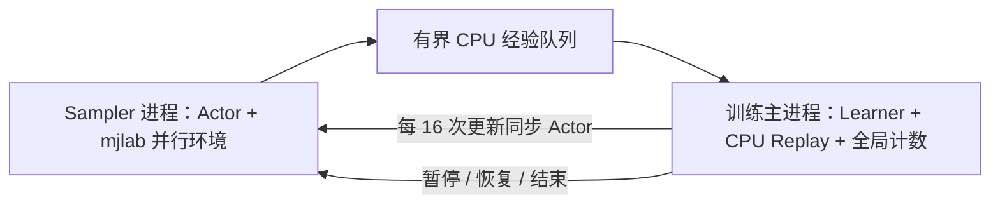

# SAC 分布式采样与集中式学习：最小实施方案

- 状态：active
- 日期：2026-11-11
- 替代：本文件前版的 Learner 独占卡与单卡单进程布局，以及独立 Supervisor / Evaluator、动态 GPU 调度、Learner 迁移和复杂传输设计；01-implementation.md 中按 vector step 更新的设计
- 关联：../requirement/01-fixed-base-sac.md、01-implementation.md、02-staged-reward-and-lift.md、../docs/02-algorithm-training-pipeline.md

## 1. 范围与当前状态

按用户确认的简化路线，只保留一个 Central Learner、多个 Sampler、集中 CPU Replay、全局更新计数、有界 CPU 经验队列和 Actor 参数同步。单机支持选择任意 1–8 张 GPU，每张 GPU 默认一个 Sampler，Learner 与其中的 S0 共享一张卡；N 张 GPU 对应一个 Learner 和 N 个 Sampler。启动时固定分配，运行期间不改变布局。

代码已实施：主进程 Learner、每卡独立 Sampler、CPU Replay、全局 H/U、有界 CPU 队列及 Actor 最新快照已接通。单卡、2 卡、4 卡真实短程、周期固定子集验证和最终 best 全图已运行；1/2/4 卡等预算扩展性与正式学习效果尚未验收，因此方案状态保持 active。详见[交付记录](../delivery/09-distributed-sampling.md)。

保留现有 SAC 更新公式、Actor / 双 Q / α / Target Q、GAT、7D 动作、2 cm / 5°、四阶段奖励、升降 DLS、固定底盘和 `rl-pick-1cm-1s-v1`。不改变 gamma、tau、学习率、熵目标等现有有效配置。

## 2. 保留、删除与暂缓

| 模块 | 处理 |
|---|---|
| Central Learner、多 Sampler | 保留，统一学习、并行采样 |
| 全局健康 Transition 计数与更新额度 | 保留，所有 GPU 数量使用相同 UTD |
| CPU Replay、有界 CPU 经验队列 | 保留，集中汇总，队列阻塞提供背压 |
| Actor 参数同步 | 保留，每 16 次更新发布完整参数 |
| 独立 Supervisor 进程 | 删除，由训练主进程直接管理 Sampler |
| 独立 Evaluator 进程 | 暂缓，暂停采样后同步验证 |
| 运行中 GPU 扩缩容 | 暂缓，启动时固定布局 |
| Learner GPU 在线迁移 | 删除 |
| 共享内存块池、pinned staging 优化 | 暂缓，先用普通 CPU 队列 |
| 64/32 欠账阈值和动态额度调度 | 删除，用逐批更新和有界队列背压 |
| 多级负载监控、自动调整 | 删除，仅记录必要吞吐、耗时和学习指标 |

CPU 队列指普通 multiprocessing 队列接口，不自行管理共享内存块池；底层库如何搬运 CPU Tensor 不作为本轮额外工程。

## 3. 最终架构与 GPU 分配



训练主进程就是 Learner，负责子进程生命周期、Replay、SAC 更新、日志、checkpoint 和同步验证。Sampler 只做环境交互和无梯度 Actor 推理，不持有 Critic / 优化器，不更新网络。

| GPU 数量 | 池内 GPU 0 | 池内 GPU 1 | 池内 GPU 2 | 池内 GPU 3 |
|---|---|---|---|---|
| 1 | Learner + S0 | — | — | — |
| 2 | Learner + S0 | S1 | — | — |
| 3 | Learner + S0 | S1 | S2 | — |
| 4 | Learner + S0 | S1 | S2 | S3 |

5–8 卡同样扩展，每增加一张卡增加一个 Sampler，共 5–8 个 Sampler；Learner 始终与 S0 共享。启动前根据实时利用率和空闲显存选择具体设备并记录映射。表中的 GPU 0 是所选设备池第一张卡，不是硬编码物理 GPU 0。Sampler 环境数启动时配置，不自动调整。

共享的是 GPU，进程职责仍独立：Learner 位于训练主进程，S0 与其他 Sampler 一样运行在独立子进程，通过 CPU 队列传经验。单卡也使用 Learner + S0 两个进程，以统一采样/更新异步流程；不再保留此前单卡单进程特例。共享卡需同时容纳 Learner 和 S0 的模型及环境内存，不承诺两个进程的 GPU 运算一定同时执行，性能在单卡基线中实测。

角色启动前设置各自设备可见性，进程内部使用 `cuda:0`。现有脚本最开始就按单卡隔离，需要先解析设备列表，再分别启动 Learner 和 Sampler，避免先把其余设备隐藏。GPU 子进程使用 `spawn`，入口在 torch / Warp / mjlab 导入前完成设备隔离。

## 4. 参数与全局更新逻辑

| 参数 | 设置 |
|---|---|
| Batch Size | 256 |
| Replay Capacity | 100,000 |
| Warmup | 全局 20,000 条健康入库经验 |
| UTD | Warmup 后每新增 128 条健康经验更新一次 |
| Actor 同步 | 每 16 次更新 |
| 周期验证 | 每 100,000 条健康入库经验 |

定义 H 为本次 Replay 生命周期累计健康入库数，U 为本次已完成更新数；Replay 满后循环覆盖，H 继续累计。目标更新数为：

```text
target_updates = floor(max(0, H - 20000) / 128)
```

单卡和多卡都采用同一主逻辑：

```text
从 Sampler 队列接收一批 CPU Transition（包括同卡 S0）
过滤不健康行，按剩余总预算截取，写入 Replay
H += 本批实际健康入库数
while U < floor(max(0, H - 20000) / 128):
    batch = replay.sample(256)，送入 Learner GPU
    SAC.update(batch)
    U += 1
    每 16 次更新向全部 Sampler 发布 Actor 参数（包括 S0）
处理日志、验证与结束条件，再接下一批
```

关键是每批数据带来的更新额度完成后才接下一批，不连续排空队列却推迟更新。Sampler 同时继续采样；队列满后阻塞，从而自动限制经验供给，不需要额外 64/32 调度器。每批条数有固定上限，避免单个消息无限变大。

例：H=20,000 时目标更新数为 0；H=20,128 为 1；H=100,000 为 625；H=200,000 为 1,406。未满 128 条的余数自然保留在 H 中。前 20,000 条预热经验不追补更新。

健康定义沿用 `~env.task.unhealthy`。NaN、物理缓冲溢出等基础设施故障不入库；正常碰撞、任务失败、超时属于正常训练数据。保持当前终止 mask 和 reset 前真实 next_obs，不跨 episode 错连。

Warmup 由集中侧 H 决定，不能每个 Sampler 各预热 20,000 条。达到全局阈值后发送切换 Actor 消息；此前已在队列中的随机动作经验继续正常入库，记录其随机行为来源，不为消除少量在途随机经验建立额度预留系统。

训练总预算也以集中侧健康入库数为准。最后一批超出预算时只无偏保留剩余允许的健康行，其余不入 Replay，记录生成但未使用条数；结束时完成已产生的全部更新额度，然后停止 Sampler。

## 5. CPU Replay、队列和 Actor 同步

CPU Replay 由主进程唯一读写，使用现有均匀环形采样；抽取 256 条后转到 Learner GPU。Sampler 把独立拷贝的 CPU Transition 放进队列，不能传环境会在下一步原地修改的张量引用，也不传 CUDA Tensor。

建议初始队列容量为 `2 × Sampler 数量` 个消息，每消息最多 256 条经验；先不做跨多个 step 凑包，少于 256 条可直接发送，超过则拆批。数据包含 obs/action/reward/next_obs/terminated/truncated、已有奖励分量和站位 ID，另带 worker 身份及行为 Actor 版本供日志使用。

每个 Sampler 使用不同采样 seed，共用相同场景、观测字段、站位表与 train/validation/acceptance split，避免重复随机流或本地 station_id 语义不一致。

Learner 每完成 16 次更新发布一次完整 CPU Actor 参数及版本。每 worker 参数通道只保留最新待应用快照，Sampler 在 step 边界完整加载并回报版本；不要求按旧版本逐个回放。首次启动和 Warmup 结束也发送当前 Actor。删除额外 0.5 s 定时发布与版本差自动停机阈值，仅记录版本差，出现实际滞后再处理。

普通 CPU 队列满时允许阻塞，但等待期间仍需处理暂停/结束和参数消息。主进程暂停 worker 时也继续接收其已完成数据，避免满队列导致双方等待；收到的数据按下节处理。只保留这些实际必需的进程收尾逻辑，不实现通用调度框架。

## 6. 同步验证与最终 Q 图

### 6.1 周期验证

每达到下一个 100,000 条健康入库经验的里程碑：

1. 请求所有 Sampler 在 step 边界暂停，等待期间继续收包。等待验证的数据暂存在有界的待处理批次中，不提前增加 H；同卡 S0 也通过相同暂停流程处理。
2. 当前已入库批次对应的更新全部完成，保持模型固定，在 Learner GPU 上同步执行验证；训练和验证环境互相独立，训练环境状态保留。
3. 验证结束，按成功率优先、回报次优选择 best.pt，保存 latest；处理暂存批次并恢复 Sampler。初始和训练结束也验证，重复边界只做一次。

以实际触发的 H 记录验证横轴，vector batch 跨过里程碑允许少量超出；下一里程碑仍按全局 100,000 的倍数推进，不按每个 worker 单独触发。无须为严格凑齐边界增加采样额度协议。

周期验证保留固定 8 个 validation 站位、每点 2 次 stochastic rollout、固定 seeds 和当前成功协议。记录成功率、回报、碰撞、奖励/阶段诊断及既有代表视频；验证经验不进 Replay，不增加 H，不更新网络。

**周期不再扫描全部合法站位，也不生成全站位 Q 图。** 如当前六指标中的 Value-Success Correlation，直接只对这 8 个固定验证点计算 Q，与其 rollout 结果对应，常量结果记 null；保留小样本相关性与 scatter，不把它当最终地图验收。实施时为评分函数增加显式站位子集输入，不能先算全图再筛出 8 点。

### 6.2 最终只算一次全合法站位 Q 图

训练结束后先完成末次轻量验证，再按整个训练期间的 validation 结果确定 best.pt。加载该 checkpoint 的 Actor 和双 Q，冻结后对全部合法站位计算一次完整 Q 图；非法站位保留 mask，不评分。继续使用现有 K=16 个策略动作的 `mean(min(Q1,Q2))`、q_std 及 yaw 语义。

“最优模型”指 validation 选出的 best checkpoint，不宣称找到全局最优策略或所有站位的物理最优动作；不能拼接各 checkpoint 的逐点最大 Q 作为同一张地图。最终 acceptance rollout 使用独立集合，检验该图的排序，不参与 best 选择，也不要求重新计算第二张全图。

周期不再输出全图，训练初始也不输出全图；末次周期验证和全图生成是两个明确阶段。已有视频要求继续保留，后续若实测视频耗时过大再针对性调整。

## 7. 最小改动范围与三个阶段

| 位置 | 改动 |
|---|---|
| `scripts/experiments/train_sac.py`、`gpu.py` | 解析多卡列表、启动前按角色隔离；单卡保持原入口习惯 |
| `workflows/rl_training.py` | 全局 H/U、逐批更新、Sampler 生命周期、同步验证与最终 best 出图 |
| `workflows/rl_sampling.py`（按需新增） | Sampler 的环境 step、CPU 队列传输及参数接收 |
| `policies/sac/replay.py` | CPU 存储和 minibatch 送 GPU，保留现有均匀采样语义 |
| `workflows/rl_evaluation.py` | 周期固定子集 Q / rollout，最终完整 Q 图 |
| 配置、测试和运行指南 | `transitions_per_update=128` 替换 `updates_per_step`，记录设备分配和新验证规则 |

不另建 Supervisor、Evaluator、调度模块或传输后端。1–8 卡使用相同进程与队列流程、CPU Replay 和 H/U 口径；研究入口的具体参数在实施时同步运行指南，不提供当前不可执行的命令。

1. **单卡基线**：Learner 与 S0 两进程共享一张 GPU，接通 CPU 队列和 Actor 同步，统一全局健康计数和更新额度；周期固定点验证，最终 best 才计算完整 Q 图，SAC 更新公式不变。
2. **多卡采样**：其余每张卡增加一个 Sampler，复用单卡已有的有界 CPU 队列和每 16 次更新的 Actor 同步；主进程直接管理全部 Sampler 的暂停/恢复/结束。
3. **扩展性测试**：先测试 1、2、4 张 GPU，以相同经验预算、配置、split 和评估口径比较训练耗时及抓取成功率；5–8 卡沿用同一结构，有资源再测，如实标注未测规模。

必要验证覆盖健康比例变化下的 H/U、128 余数跨批、总预算尾部、reset 前 next_obs、队列满时暂停与退出、Actor 完整参数同步，以及周期只计算固定点/最终仅生成一次 best 全图。先相关测试，再按仓库要求离线回归；真实 GPU 训练与软件测试分别报告。

仅记录有效经验/s、更新次数、训练/验证耗时、队列阻塞时间、Actor 版本差、显存/RAM 和已有学习指标。不增加自动负载均衡。普通 checkpoint 继续参数/优化器热恢复、重建环境与 Replay、重新全局预热；日志保留历史累计横轴，新 Replay 的 H/U 重新计数，不支持 Learner 在线迁移。

## 8. 本次修订执行与结果

已按用户简化意见重写本方案，并同步需求、旧方案覆盖说明、算法现状说明和报告入口。删除独立管理/评估进程、动态扩缩容与迁移、共享内存池/pinned 优化、64/32 动态调度和自动监控；明确逐批完成更新后再收下一批，以普通有界队列实现背压。周期固定点验证与最终 best 全图分开，保留原有学习与视频需求。按最新设备布局要求，将 Learner 改为与 S0 共享卡，每张卡一个 Sampler；同步移除单卡单进程特例，1–8 卡统一独立采样进程和队列流程。

本次仅修改 Markdown 文档，检查文档差异格式、新增本地链接和更新计数示例；未改训练代码，未启动 GPU 或多进程实验。方案确认不代表多卡吞吐或 Actor 抓取学习已通过验收。


## 9. 实施进展（2026-11-11）

阶段 1、2 的代码已完成，单卡、2 卡、4 卡真实短程验证通过；阶段 3 的 1/2/4 卡正式预算对照尚未运行。短程调整了 episode、预热及预算，仅验证进程、更新、验证、视频和评分链路，不等同正式学习结果。此前第 8 节是方案修订时的历史记录；当前实现、测试与未完成项以[交付记录](../delivery/09-distributed-sampling.md)为准。
