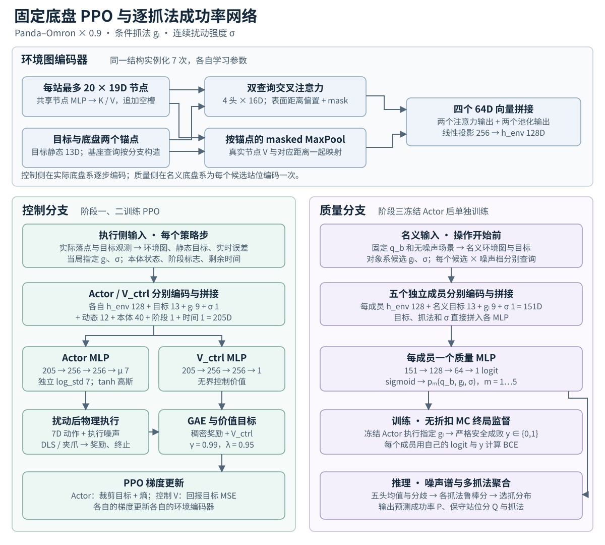

# 从头训练固定底盘 PPO 与多抓法站位质量图

- 状态：draft
- 日期：2026-11-23
- 时间戳：2026-11-23T00:31:53+08:00
- 替代：本文件先前的基线复评与增量迁移方案
- 关联：[Panda–Omron 尺寸](../../../configs/robots/panda_omron.yaml)、[采样参数解析](../../../src/lastmile_dataflow/station_map/rl/config.py)、[现有仿真与控制接口](../../../src/lastmile_dataflow/station_map/rl/env/environment.py)

## 1. 任务与交付

机器人采用相对原始资产缩放为 **0.9 的 Panda–Omron**，首个任务为 val103 / Cup_30。底盘在每次操作中锁定，七轴臂与升降由 DLS 协同，夹爪可控。Actor、控制 Critic、环境编码器及归一化统计从头初始化；质量网络在 Actor 冻结后独立随机初始化。场景、机器人模型、与 0.9 夹爪匹配的抓法库及底层仿真接口作为输入资产。

交付顺序为三个可单独验收的结果：① 零噪声下能完成严格抓取的新 Actor；② 全谱扰动下仍能完成任务的条件策略；③ 对名义站位、指定抓法及噪声强度输出校准概率的五头模型，以及实际选站选抓的成功率。PPO 的控制价值只供 GAE 使用。

**用户确认的决策（2026-11-23T00:50+08:00）**

- 策略无关性暂作近似：用“足够强的冻结策略 + 多抓法取 Max”估计物理可行性；验收时另训一个独立种子的 PPO，报告 Q 与它实测成功率的秩相关。是否进一步做多策略标签待成功率和价值输出出来后再定。
- 定义层输出两张图，决策层再合用：物理鲁棒图 $Q_{\text{phys}}$ 只用 σ 积分（$r_l=\sum_k w_k\mu_{lk}$，再按选抓规则聚合）；不确定度图 $U$ 由各档 σ 下五头标准差 $s_{lk}$ 按同样的 $w_k$、$\alpha$ 加权聚合，只表示模型对预测的可信度。选站排序用 $S_{\text{rank}}=Q_{\text{phys}}-\beta U$，或先用 $U$ 阈值把不可信点标为未知区、不参加最优站位竞选。第 8 节按此执行，先前的 $c=\mathrm{clip}(\mu-\beta s)$ 合成定义作废。
- 壁面过载规则推迟到有壁场景再做；Cup_30 首版只实施接触白名单、关节超限、掉落、超时与仿真异常判定。
- 控制扰动、目标观测微扰、停靠抖动三类噪声首版都做；五头集成保留。
- **实施偏离（2026-11-23，用户同意）**：阶段一先用历史分级碰撞惩罚与 stuck 终止学会抓取（仅关节越限严格终止），再以同一策略接续到严格终止训练；不改变“阶段一即启用严格终止”之外的任何约定，质量标签、校准与验收仍全部按严格终止。原因见交付记录第 3 节（严格终止截断学习期擦碰路径，策略停在预抓取位）。
- **只用正对朝向（2026-11-23T15:00+08:00，用户决定）**：以后所有实验（训练、标签采集、拟合、出图、验证）只考虑正对目标的 0° 航向，±30°、±60° 等其他航向不再采样。已有的五档航向结果保留作记录；进行中的采集只保留 0° 回合，质量图和对比均按 0° 子集。第 2 节关于拓展航向的建议暂停执行。

## 2. 站位、朝向和抓法

| 量 | 定义 | 本次取值 |
|---|---|---|
| 模型比例 | 原始机器人资产的线性缩放，训练、评分与独立评估一致 | scene.robot_scale = 0.9 |
| 站位圆盘半径 | R = 1.2 L，L 取本体配置的有效工作臂展 0.8469596623 m | stations.radius_scale = 1.2，R = **1.016351595 m** |
| XY 网格间距 | Δ = 1.2 Δ₀，Δ₀ = 本体配置底盘半径 0.3944629260 m / 4 | stations.spacing_scale = 1.2，Δ = **0.118338878 m** |

按仓库约定，这两个尺寸字段以实际米数保存。0.9 在加载模型时应用一次，规划网格直接读取有效尺寸。圆心是静置目标碰撞几何中心的 XY 投影。按现有方格与圆盘相交的生成规则，上述参数给出 **233 个原始 XY 点**，其中圆心无目标朝向。两项都扩大 1.2 倍保留了网格索引数量，但每个非中心点的世界位置发生变化，需在新场景重新判断合法性。[尺寸约定](../../../configs/README.md) · [网格与航向](../../../src/lastmile_dataflow/station_map/rl/env/stations.py)

- 基础训练先用正对目标的朝向；（2026-11-23 起按用户决定只用 0°，以下拓展暂停）在零噪声已能抓取后拓展航向，建议先用相对正对方向的 0°、±30°、±60°。五档对应 1,160 个有朝向的名义位姿，再做物理筛选。若目标是全角度地图，训练、校准和独立测试需补齐其余航向，地图同时标识已测范围。半径与间距在各阶段一致。
- 用 0.9 模型实际底盘足迹、障碍物高度和地面支撑做名义硬门控；记录拒绝原因并置 Q=0。某个 home 臂姿碰撞单列，不能推断底盘放不下。对合法站位按明确的合法初始臂姿分布采样，建议从 home 邻域小幅关节偏移起步，按真实关节范围和完整几何剔除非法臂姿。新场景统计每个站位可用初态；找不到合法样本时报告覆盖缺口。名义合法后遇实际停靠失败按第 3 节记账。
- 每任务预选 L_g ≤16 个抓法，随回合指定一条并固定。三条学习分支显式接收同一候选的对象系平移 3D、旋转前两列 6D。候选按静态几何输入，行号仅用于追踪。对称物体可沿用明确的等价对齐规则：静态输入取原始候选，利用初始 TCP 选择的实际变体只供控制目标及日志使用。
- 在训练前按 XY 空间块划分训练、课程验证、最终测试。同一 XY 的各 yaw、抓法、噪声和重复试验归同一块。课程验证中预先固定有独立成功见证的可行站位子集，记录见证使用的臂姿与抓法；在它们上仍按约定分布抽初态、抓法。见证仅证明至少一条可行路径。全体合法站位和边界站位另列，防止只展示容易样本。

## 3. 一个回合的时序与严格标签

1. 从操作前无扰动场景快照、名义站位 q_b、候选 g_l 及本回合 σ 构造质量输入。σ 表示扰动分布的强度；抽样实现尚未发生。目标、环境节点、节点筛选和锚点距离全在名义底盘系计算。训练数据构造和离线评分共用此入口。
2. 独立抽取执行随机量，得到实际停靠位姿 q̃_b，执行地面与穿透检查。合法时写入实际 mocap 位姿，以实际落点为固定参考，按约定设置初始臂姿；非法落点直接终局 y=0 并计入分母。首动作前的失败不生成虚构的 PPO 动作或 log-prob。
3. 控制器每 50 ms 根据实际执行侧观测选择 6D TCP 增量与 1D 增量夹爪。默认物理子步 2 ms，25 个子步/动作，操作上限 20 s、400 步。物理真值决定接触、安全、致动和奖励；观测偏差只进入控制端的感知量。
4. 每个物理子步先检查安全违规，再检查抓取完成；锁存首个终局及其时间。同子步冲突以失败优先。已结束环境停止积累奖励和成功计时，向量环境在控制步边界返回 done。回合只对实际执行的一个 g_l 形成一条起点 MC 标签。阶段一、二只保留控制训练和监控需要的数据。

| 判定 | 信号与处理 |
|---|---|
| 抓取成功 y=1 | 两侧指垫法向力各 >0.5 N，目标最低碰撞点高于原支撑面至少 1 cm，目标无支撑接触，三条件连续保持 0.25 s，且此前无安全违规。 |
| 非法碰撞 y=0 | 按接触对固定白名单，如指垫/指内侧与目标、物体与支撑、底盘与地面。明确外指/掌/其他臂连杆碰目标、臂或夹爪碰桌、禁止的自碰等规则，列入非法的配对首个子步终止。按机器人实际模型排除设计内的相邻接触。 |
| 壁面过载 y=0 | 对协议允许轻触的壁面，按面累计同一子步所有相关接触的压缩法向力（N），覆盖夹爪直接施力与物体被推挤压。超过该面限值立即失败；直接禁止的连杆–壁接触仍按前项处理。实施前用正常轻触、挤压两组物理样例确认受力方向、聚合和阈值；指垫 0.5 N 是抓持下限。 |
| 关节超限 y=0 | 对有限位的臂、升降和夹爪逐项比较实测 qpos 与模型上下限，弧度/米分别设数值容差。容差以正常运动和静置的求解器波动确定。动作饱和单独统计。 |
| 其他结局 | 掉落、底盘失稳、任务超时均为有效失败。数值溢出或 NaN 单列为仿真异常，报告总尝试、有效尝试、异常数。质量目标以完整有效回合为分母，并报告全尝试完成率。 |

首次发布质量数据前固定接触对、受力限值及越限容差。Cup_30 开敞场景用来验证基础抓取；壁面规则需另用有壁几何进行真实仿真触发测试。为识别环境编码收益，安排相同目标、站位、抓法下改变侧壁或障碍位置的留出场景。单场景成绩只支持单场景结论。

## 4. 环境图编码

编码器回答两个几何问题：目标周围的空间是否允许夹爪伸入，底盘附近的空间是否允许机械臂展开。图由两枚查询锚点和至多 20 个实体节点构成。每个锚点查询所有有效实体，两者分别聚合；首版无需构建实体间的两两邻接矩阵。

### 4.1 同一编码规则，两种几何输入

| 分支 | 几何来源 | 构造时机与复用 |
|---|---|---|
| Actor、控制 V | 在实际停靠底盘系中表达当前可观测的目标与实体。目标观测有偏差时，目标查询、相对目标偏移和目标锚点距离都用同一观测。 | 每个策略步按当前观测构造一组输入张量，Actor 和控制 V 分别用自己的参数编码。 |
| 五个质量成员 | 扰动前的静态场景快照与候选名义位姿 q_b。全程使用名义目标和环境 OBB，包括筛选时的距离、排序和掩码。 | 每个候选站位构造一次。成员分别编码；同一成员的几何表示可以广播到该站全部抓法与噪声档。 |

坐标原点取底盘参考点；目标锚点取目标碰撞包围盒中心。对部件 i，在底盘系中令中心为 cᵢ、朝向为 Rᵢ、局部半尺寸为 hᵢ。中心和朝向由同一刚体逆变换得到，半尺寸保留部件局部系的真实米数。目标与机器人自身不占环境实体槽；目标另有 13D 直连，本体走控制分支。

### 4.2 节点选择、特征与掩码

| 实体 | 选择依据 | 配额 |
|---|---|---:|
| 支撑面、容器壁或顶板 | 两种语义分别编码。优先目标的直接支撑面，再取靠近目标或伸入通道的侧壁、顶板；按有物理意义的板件构建 OBB，保留容器开口。 | 合计 ≤6 |
| 桌面障碍物 | 建议按目标中心到障碍 OBB 的最近距离 ≤0.8 m 筛选，按障碍到基座–目标线段的最近距离排序。 | ≤10 |
| 地面障碍物 | 在水平面上取离底盘中心 ≤底盘半径 +0.7 m 的邻近障碍（用障碍外形计算最近距离），再按障碍外缘到候选足迹外缘的距离排序。 | ≤4 |

每个节点为 **19D**：语义 one-hot 4（支撑、壁/顶板、桌面障碍、地面障碍），中心位置 3，Rᵢ 前两列 6，局部半尺寸 3，相对目标中心偏移 cᵢ−c_goal 共 3。上限约束只作用于网络观测；物理接触、过载判定和足迹门控使用完整相关几何。相同距离以稳定实体 ID 排序，记录各类截断数。

批量输入为节点 **[B,20,19]** 和有效掩码 **[B,20]**。空位补零并屏蔽；使用 key_padding_mask 时 True 表示该位置被屏蔽。追加一个永久有效、可学习的空环境槽后，注意力序列长 21。虚拟槽和 padding 都不参加物理距离池化。

### 4.3 双查询、距离偏置与双路汇聚

1. **投影。** 对所有实体使用同一个节点 MLP，将 19D 映射到 d=64，再分别投影为 K 和 V。目标查询由目标静态 13D 投影。控制侧基座查询可用当步臂与升降关节位置 8D 摘要；质量侧基座查询取固定机器人和名义原点对应的学习向量。双查询形状为 **[B,2,64]**。
2. **几何距离。** 对锚点 a（目标中心或底盘原点）与节点 i，先转入 OBB 局部系，u=Rᵢᵀ(a−cᵢ)，再取外部距离 Dₐᵢ=‖max(|u|−hᵢ,0)‖₂，单位米。点在盒内或表面时为零。这里使用三维点到盒距离；地面节点选择使用二维足迹距离。
3. **注意力路径。** 建议一层四头，每头 16D。每头对锚点和节点计算 logit = q·k/√16 − softplus(λ_raw)·Dₐᵢ，空槽无距离惩罚。屏蔽 padding 后沿 21 个槽做 softmax，再对 V 加权。拼回四头，每个锚点输出 64D。即使没有实体，查询也能落到空槽。
4. **邻近风险路径。** 对同一锚点和每个真实有效节点，将 [vᵢ 64D, Dₐᵢ 1D] 经共享小 MLP 映射到 64D，再沿节点维逐通道取最大值。全空时返回零向量。该路径能保留单个节点的强响应；哪一类响应对应高风险由训练学得。
5. **输出与直连。** 将目标注意力、目标池化、基座注意力、基座池化四个 64D 向量拼成 256D，再投影到 **h_env 128D**。目标静态 13D、对象系候选抓法 9D、σ 1D 绕过聚合，直接进入各分支 MLP。σ 与抓法均在几何编码之后加入，因而不会妨碍质量侧复用同一个名义几何表示。

验收用四组输入：全空时输出有限；只改变 padding 内容时输出相同；固定名义输入只改变实际停靠或扰动 seed 时，质量特征逐字段相同；在同一站位和抓法下增删一片近壁，核对入选节点、两个锚点的距离和物理 rollout 成功率。最后一项用实测结果判断编码对选站的贡献。

## 5. 完整网络架构

| 分支 | 拼接后输入（建议首版） | 输出、优化目标 |
|---|---|---|
| Actor | 205D：环境 128 + 目标静态 13 + 抓法 9 + σ 1 + 动态 12 + 本体 40 + 预抓取阶段标志 1 + 剩余时间比例 1 | MLP 205→256→256→7 输出均值，配 7 个状态无关的可学习 log_std；高斯采样后取 tanh。PPO 裁剪目标与熵正则更新 Actor 和它自己的编码器。 |
| 控制 V | 同布局 205D，独立环境编码器 | MLP 205→256→256→1 输出无界 V_ctrl，经 GAE 回报目标做 MSE。价值梯度只更新控制 V 分支。 |
| 质量成员 m，m=1…5 | 151D：名义环境 128 + 名义目标 13 + 抓法 9 + σ 1 | 建议 MLP 151→128→64→1 输出 logit，使用 BCEWithLogitsLoss。阶段三冻结 Actor 后，实际执行指定抓法取得终局标签 y；推理时取 sigmoid。五个成员的编码器、MLP 和初始化各自独立。 |

控制动态 12D 包括实时位姿误差 6 和物体线/角速度各 3。本体 40D 包括臂与升降关节位置/速度 16、TCP 位置/朝向 9、TCP 线/角速度 6、夹爪开度/速度 2、上一控制指令 7。具体宽度用于本轮构建核对。数据库里实际落点与对齐变体仅用于诊断；固定的名义输入和被执行的原始候选才进入质量网络。五头输出先按每个站位、抓法、σ 计算概率均值与分歧，再按第 8 节得到选抓分布、预测成功率 P 和保守站位分 Q。

## 6. PPO 控制训练与三类噪声

**起步奖励。** 预抓取→接近→合拢→抬升→保持。位置/朝向用阶段内误差下降量，初值权重 20/5；阶段切换重设势差基线。建议以抓取位后退 10 cm 定义预抓取，达到 2 cm/10° 后锁存切换。进入抓取位 1 cm/10° 后奖励有效闭爪进度（3），首次对齐双指接触事件（3），持物抬升的历史峰值增量（8），成功一次（30）。增量夹爪每步最大 20% 行程。安全终止建议一次 −10 起步，屏蔽同事件的其他惩罚及正向事件，防止重复结算。掉落等失败单列；按阶段转化率调奖励，每项修改单独比较。

**PPO 初值。** γ_ctrl=0.99、GAE λ=0.95、clip=0.2、熵系数 0.005、目标 KL=0.01 自适应 Actor 学习率（起始 3e−4），V_ctrl 学习率 1e−3、MSE。同步采样，每环境 32 步/轮，5 epochs，minibatch 4096（小批短测可调）；有效样本全局归一化 advantage。严格终止清除 bootstrap；本设计将 20 s 定为任务时限，控制输入含剩余时限，时间耗尽按任务终止，单纯采样切片边界才 bootstrap。Actor 先采原始动作并保存旧 log-prob，外部执行扰动不进入 PPO 概率比。

| 统一强度 σ | 建议满量程与重采频率 | 生效位置 |
|---|---|---|
| 控制扰动 | 各归一化动作维独立 U(−0.1,0.1)，每控制步重采 | a_exec = clip(tanh(u) + σ ε_a, −1, 1)，按动作尺度转换并送 DLS/夹爪 |
| 目标观测微扰 | 目标平移各轴 U(−5 mm,5 mm)，首版每回合抽一次并保持 | p_obs = p_true + σ ε_p，一致更新控制侧目标位置、底部高度、抓取误差、环境相对偏移和距离。该项测感知偏差；物体真实初态仍由仿真给定 |
| 停靠抖动 | 每回合抽一次，底盘局部 XY 在半径 5 cm 圆盘内均匀，yaw 在 ±5° 内均匀 | 在名义 SE(2) 位姿上合成 σ 缩放后的偏差，再固定实际底盘。几何硬门控和扰动后失败分别记录 |

以上幅度为实验起点。三路共用一次 episode σ，各自随机流独立。部署时控制端接收已知工况强度；对强度未知的部署，须另外规定可提供的工况估计，并在同样条件下采标签和验收。每档都保留零噪声锚点验证，同时抽少量单噪声诊断试验，以分解失败原因。

## 7. 三阶段课程与资源预算

下列数值是建议预算和晋级条件。正式启动前以本轮新观测和图编码做短采样，实测显存、有效 transitions/s、更新吞吐，根据当时可用 GPU 确定并行度。每 30 s 汇总训练；独立面板每约 100 万有效 transition 或阶段候选 checkpoint 运行一次。固定评估单次并行最多 20 环境，试验使用互不重叠的逐回合随机流。

| 阶段 | 训练内容 | 晋级与失败诊断 |
|---|---|---|
| 一、σ=0 学会抓取 | 从随机参数训练 PPO，已启用严格终止、环境编码、静态抓法条件和小范围合法臂姿随机化。初期用训练域可行站位、正对目标，均衡采候选；成功事件稳定出现后扩大到全部训练站位和计划航向。质量头关闭。 | 建议在锁定的可行验证面板每轮 20 站 × 5 次（不足 20 站时报告实际站数并增加独立重复），近三轮按站等权严格成功率均值 ≥80%，同时给出逐轮分子/分母。记录全合法域表现。首段预算 500 万有效 transition，若持续零成功，按预抓到位→闭爪→双指→离桌→保持检查第一个失效环节及首碰视频，再调整训练。 |
| 二、扩大噪声上限 | 每个新 episode 独立抽 σ∼U(0,σ_cur)，上限按 0.10、0.25、0.50、0.75、1.00 扩展。持续更新同一条件 PPO；对质量训练仍不保存弱策略标签。 | 建议每档先给 100 万有效 transition 作检查预算；零噪面板 ≥80%、当前最高四分位的独立面板 ≥75% 再扩档。上限为 1 后报告五档曲线；全谱面板达标且连续三次变动 ≤5 个百分点，复核最新候选后冻结 Actor、归一化及动作采样模式。 |
| 三、冻结策略，校准五头 | 清空早期质量 FIFO（前两阶段关闭时直接建新集）。对全部可查询合法域分层采样，覆盖远近、航向、所有候选抓法与 σ∼U(0,1)，另采端点用于校验。每回合一条名义输入、一条严格终局标签，五个成员独立按回合自助采样，BCEWithLogitsLoss，γ_eval=1，输出 sigmoid。 | 例：80 个合法位姿 × 16 抓法 × 5 个等宽噪声分层 × 2 次=12,800 个回合，每层内连续均匀抽样。实际按各站候选数计算。每格两次用于覆盖训练，校准与最终测试另做独立重复，按区间宽度扩充。失败保留在分母。若强化边界/失败采样，按部署分布重加权或单设代表性校准集。 |

训练中监控严格成功、各类首错和超时、各阶段到达率、各奖励分项、各 σ 档与抓法覆盖、KL/熵/clip fraction/解释方差及吞吐。选模用独立的严格成功率，单列训练窗口。保存阶段与上限，只有新 reset 的回合接受扩档。策略数据与质量数据有独立用途，质量的起点概率用无折扣终局 MC；中途控制价值继续使用 PPO 的折扣回报。

## 8. 批量评分与独立验收

1. 给候选站位做硬门控，保存非法原因。合法点的名义目标、环境 OBB 和抓法批量变换。对 N 个位姿、各站至多 16 条模态、K=5 个噪声点 {0,0.25,0.5,0.75,1} 批量计算五头预测；可按显存分块，几何编码按站位复用。
2. 每个 (站,抓法,σ) 分别记录五头概率的均值 μ 和总体标准差 s。定义层分开输出：每条抓法的物理鲁棒分 r_l=Σ_k w_k μ_lk，不确定度 u_l=Σ_k w_k s_lk。均匀连续谱可用梯形权重 (1,2,2,2,1)/8，已知离散工况按部署频率赋权。若选抓前已知本局 σ，可逐档选抓。两种协议明确记录。
3. 按 r_l 定义一次选抓的分布 α。Max 执行最高分一条（首版默认，作为物理可行性的近似）；Top-m 在前 m 条均匀抽一条；Softmax 以 exp(r_l/τ) 归一化抽一条，建议 τ=0.1 起试。所有头共享同一选抓规则。输出两张图：**物理鲁棒图 Q_phys=Σ_l α_l r_l**（即预测成功率）和 **不确定度图 U=Σ_l α_l u_l**。决策层排序用 **S_rank=Q_phys−βU**（β=0 为基线，β=1 为候选，仅用校准集定参），或以 U 阈值把不可信点标为未知区、不参加最优站位竞选。保留实际候选 ID/概率以便物理执行。模型分歧本身没有统计置信覆盖保证。多模态扩展的是固定策略与候选集下的一次操作能力，成功轨迹可作可行见证。
4. 留出空间块检验四件事：① 冻结 Actor 在各噪声档的严格成功率；② 逐候选 μ 和选抓后 P 的 Brier、NLL、分箱可靠性及分箱 k/n；③ 选站选抓收益；④ 策略无关性近似：独立种子 PPO 冻结后在同一组站位实测成功率，报告它与 Q_phys 的 Spearman 秩相关及按站重采样区间。固定站位比较均匀选抓与 Max/Top-m/Softmax，再固定选抓规则比较 Q 选站与均匀选站。预先规定组别和试验数，例如每组 8 站 × 20 回合；组间可配对相同初态和扰动，跨重复使用独立 seed。输出差值和按站重采样的区间，并对比平均成功率基线。若所有有效点饱和或差值区间跨零，报告排序证据不足。硬拒绝点单列，地图按 yaw 分层。

## 9. 实施落点与验收产物

| 增量 | 工程落点 | 可验证的交付 |
|---|---|---|
| 环境与任务合同 | [站位](../../../src/lastmile_dataflow/station_map/rl/env/stations.py)、[物理事件/reset](../../../src/lastmile_dataflow/station_map/rl/env/terms.py)、[仿真](../../../src/lastmile_dataflow/station_map/rl/env/environment.py) | 0.9 模型、新网格合法性清单、合法抓取和三类严格失败各自的子步证据、候选与实际停靠分离 |
| 从头训练控制策略 | [观测](../../../src/lastmile_dataflow/station_map/rl/env/observation.py)、[网络](../../../src/lastmile_dataflow/station_map/rl/networks.py)、[PPO](../../../src/lastmile_dataflow/station_map/rl/ppo/training.py) | 新观测和掩码可批处理，短跑有有效采样与更新，阶段一独立成功率达标；阶段二给出五档曲线、失败分解与冻结 checkpoint |
| 校准与出图 | 在现有 RL 包和 [评估入口](../../../src/lastmile_dataflow/station_map/rl/evaluation.py) 接入冻结 Actor 采集、独立监督拟合与批量查询 | 同一名义记录在线/离线特征一致，五个质量成员、条件概率表、分 yaw 的 P/Q 图、留出校准表、实际选站选抓对照和代表性视频 |

配置、seed、协议、站位划分和采样分布随 run 保存，原始日志/权重/视频归 runs，跨 run 曲线与统计归 analysis，结论归 reports。当前交付是构建方案。网格尺寸与未筛选点数已核算；合法站位数、壁面过载阈值、实际训练吞吐及成功率须在实施阶段取得。
