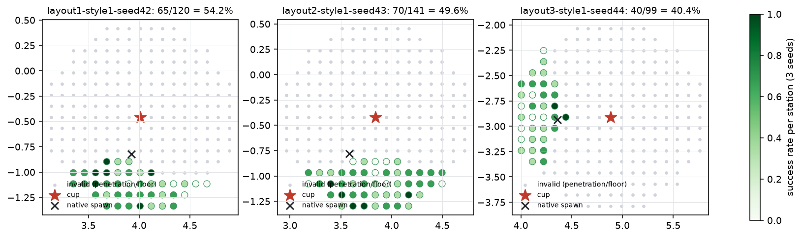

# RoboCasa365 三个厨房上的 π0.5 抓取实验

- 状态：active
- 日期：2026-11-13
- 替代：无
- 关联：01-native-pick.md、running.md、../../pi05/delivery/06-val103-cup30-inference.md

## 结论

同一组 360 回合（3 个厨房 × 120 个合法站位 × seed 42/43/44），`robocasa-pick-1cm-1s-v1`：

| 预算 | 布局 1 | 布局 2 | 布局 3 | 合计 | 无碰撞成功 | 有过成功的站位 |
|---|---|---|---|---|---|---|
| 20 s（400 步） | 6/120（5.0%） | 8/141（5.7%） | 18/99（18.2%） | **32/360（8.9%）** | 30 | 24/120 |
| 50 s（1000 步） | 65/120（54.2%） | 70/141（49.6%） | 40/99（40.4%） | **175/360（48.6%）** | 133 | 71/120 |

原生放置任务两轮均 0/360（提示词只要求拿起），设施错误均为 0。20 s 预算明显截断了策略：50 s 运行中成功步数的四分位为 403 / 544 / 664 步，累计成功在 400、600、800、1000 步时分别为 37、127、150、175，到 1000 步仍在增长。

同一回合在两次运行中**不能逐条复现**：20 s 的 32 次成功里只有 19 次在 50 s 运行中于同一步成功，另有 12 个 20 s 失败的回合在 50 s 运行的前 400 步内成功。RoboCasa 运行接口在相同动作下逐步一致（见 01 号交付），差异来自 π0.5 在 GPU 上的推理不完全确定，seed 只固定了采样噪声的起点。因此两轮只做汇总比较；50 s 运行截在 400 步时为 37/360（10.3%），与 20 s 运行的 32/360 相当。

## 设置

| 项 | 内容 |
|---|---|
| 场景 | `20261113-scenes-r01` 的三个冻结实例（`PickPlaceCounterToCabinet` 布局 1/2/3，style 1，目标杯子） |
| 运行 | 原生 RoboCasa Environment（`RoboCasaRuntime`），官方 PandaOmron，比例 1.0，默认控制器，20 Hz |
| 权重 | `pi05_pretrain_human300/multitask_learning/75000`，mean/std 归一化，每 5 步重新推理，10 步去噪 |
| 提示词 | `Pick up the cup.` |
| 观测 | 三路 256×256 正立图像（base=agentview_left，left_wrist=eye_in_hand，right_wrist=agentview_right）；16D 状态取原生观测 `base_to_eef_pos/quat、base_pos/quat、gripper_qpos` |
| 动作 | 反归一化 12D 直接送 `env.step()`；夹爪与模式按 RoboCasa gym 映射，≥ 0.5 → +1，否则 −1 |
| 站位 | val103 的 RL 网格规则：以杯子碰撞包围盒中心为圆心，半径 = 臂展 0.941 m，间距 = 底盘半径/4 = 0.110 m，只取正对朝向；合法 = 冻结初始手臂/升降姿态下无接触，且底盘外接圆在地面内；不做 IK、视野、可达筛选 |
| 回合 | `set_station` 从冻结初态开始，最多 400 步（20 s）或 1000 步（50 s），成功即停；三个 seed 的物理初态相同，只改变策略采样噪声 |
| 判定 | 每控制步：原生双指抓握 + 无环境支撑 + 抬升 ≥ 1 cm，连续 ≥ 1 s；机器人与环境（不含目标）接触单独计步 |

站位候选：每个厨房 233 个；合法 40 / 47 / 33，其余几乎都是初始姿态与柜台穿插（布局 3 另有 7 个落地检查不通过）。底盘外接圆按 geom 包围盒角点估为 0.60 m，比配置的 0.44 m 偏大，落地检查偏保守。

## 结果

### 50 s（`full-50s-20261113-r01`）

| 站位到杯子中心距离 (m) | 成功/回合 |
|---|---|
| 0.4–0.5 | 7/24 |
| 0.5–0.6 | 26/42 |
| 0.6–0.7 | 24/57 |
| 0.7–0.8 | 53/99 |
| 0.8–0.9 | 45/87 |
| 0.9–1.0 | 20/51 |

- 每站位 3 次中成功 0 / 1 / 2 / 3 次的站位数：布局 1 为 5 / 11 / 18 / 6，布局 2 为 7 / 15 / 20 / 5，布局 3 为 7 / 14 / 10 / 2。
- 按 seed：42 成功 56、43 成功 43、44 成功 76。
- 过程量：有过原生抓握 245/360，出现机器人–环境接触 105/360，保持 ≥ 0.5 s 但未成功 17。
- 预算放宽后距离影响变弱，0.7–0.9 m 的站位也有约一半成功；布局 3 反而最低。

### 20 s（`full-20261113-r01`）

| 站位到杯子中心距离 (m) | 成功/回合 |
|---|---|
| 0.4–0.5 | 4/24 |
| 0.5–0.6 | 12/42 |
| 0.6–0.7 | 3/57 |
| 0.7–0.8 | 8/99 |
| 0.8–0.9 | 4/87 |
| 0.9–1.0 | 1/51 |

- 每站位成功次数：布局 1 为 0 次 34 站、1 次 6 站；布局 2 为 0 次 39 站、1 次 8 站；布局 3 为 0 次 21 站、1 次 7 站、2 次 4 站、3 次 1 站。
- 按 seed：42 成功 12、43 成功 3、44 成功 17。32 次成功中 29 次发生在 300 步之后；28 个回合保持 ≥ 0.5 s 后被预算截断。
- 过程量：有过原生抓握 150/360，抬起 ≥ 1 cm 116/360，出现机器人–环境接触 94/360。

## 时间线（UTC+8）

| 时间 | 事项 |
|---|---|
| 2026-11-13 19:1x | 试跑 `pilot-20261113-r01` 因日志目录未建在启动 π0.5 服务时退出（站位已算出），修复后 `pilot-20261113-r02`：每厨房离原生出生点最近 1 站 × 3 seed，3/9 成功；检查录像，图像方向、夹爪与底盘行为正常 |
| 19:28 | 提交 `e965101` 后在 GPU 0–3 启动全量 `full-20261113-r01`（GPU 4–7 被其他用户占用） |
| 19:33 | 站位规则重构为共享函数（`f723ef6`），核对与本次运行所用站位一致；运行中的进程已在修改前加载 `e965101` |
| 20:01 | 20 s 全量完成，360/360，无设施错误 |
| 20:28–21:28 | 提交 `c5c104f` 上以 1000 步预算重跑全量 `full-50s-20261113-r01`（GPU 0–3），360/360，无设施错误 |

## 与 val103（ProcTHOR）的差异

本实验与 [val103 多站位推理](../../pi05/delivery/06-val103-cup30-inference.md) 用同一站位规则和同一权重，但成功率不可直接比较：val103 为 LMDF 运行、机器人比例 0.9、RL Home（升降 0.2 m）、逐物理步判定 `rl-pick-1cm-1s-v1`；本实验为 RoboCasa 原生运行、比例 1.0、RoboCasa 冻结初始姿态、逐控制步判定 `robocasa-pick-1cm-1s-v1`。

## 产物

`outputs/experiments/robocasa-pi05-pick/`（不进 Git）：`runs/full-20261113-r01/`、`runs/full-50s-20261113-r01/`（`config.json`、`plan.json`、`stations/`、`episodes.jsonl`、`summary.json`、每回合录像 `videos/`、π0.5 服务日志 `logs/`），`analysis/station-success.png`、`analysis/50s/station-success.png`；试跑 `runs/pilot-20261113-r0{1,2}`。

## 限制与后续

- 50 s 时累计成功仍在增长，更长预算可能还有提升。
- π0.5 推理在 GPU 上不完全确定，单个回合不可逐条复现；结论以汇总统计为准。
- 只有一个提示词；没有与原生任务语言对照。
- 站位合法性只看初始静态接触与落地，离杯子最近的一圈因为初始手臂姿态与柜台穿插被排除。
