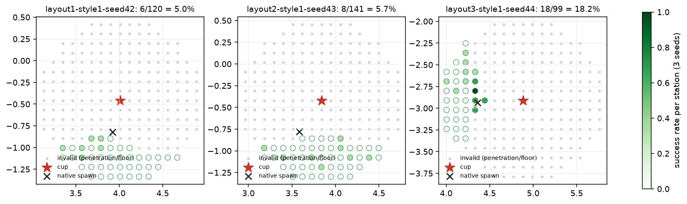

# RoboCasa365 三个厨房上的 π0.5 抓取实验

- 状态：active
- 日期：2026-11-13
- 替代：无
- 关联：01-native-pick.md、running.md、../../pi05/delivery/06-val103-cup30-inference.md

## 结论

360 回合（3 个厨房 × 120 个合法站位 × seed 42/43/44），`robocasa-pick-1cm-1s-v1` 成功 32 次，**8.9%**；其中无碰撞成功 30 次。各厨房：布局 1 6/120（5.0%）、布局 2 8/141（5.7%）、布局 3 18/99（18.2%）。有过成功的站位 24/120。原生放置任务 0/360（提示词只要求拿起）。设施错误 0。

20 秒预算明显偏紧：32 次成功里 29 次发生在第 300 步（15 s）之后，最晚恰在第 400 步；另有 28 个回合已经保持 ≥ 0.5 s 但没到 1 s 就到了预算，84 个回合曾抬起 ≥ 1 cm 却未成功。

## 设置

| 项 | 内容 |
|---|---|
| 场景 | `20261113-scenes-r01` 的三个冻结实例（`PickPlaceCounterToCabinet` 布局 1/2/3，style 1，目标杯子） |
| 运行 | 原生 RoboCasa Environment（`RoboCasaRuntime`），官方 PandaOmron，比例 1.0，默认控制器，20 Hz |
| 权重 | `pi05_pretrain_human300/multitask_learning/75000`，mean/std 归一化，每 5 步重新推理，10 步去噪 |
| 提示词 | `Pick up the cup.` |
| 观测 | 三路 256×256 正立图像（base=agentview_left，left_wrist=eye_in_hand，right_wrist=agentview_right）；16D 状态取原生观测 `base_to_eef_pos/quat、base_pos/quat、gripper_qpos` |
| 动作 | 反归一化 12D 直接送 `env.step()`；夹爪与模式按 RoboCasa gym 映射，≥ 0.5 → +1，否则 −1 |
| 站位 | val103 的 RL 网格规则：以杯子碰撞包围盒中心为圆心，半径 = 臂展 0.941 m，间距 = 底盘半径/4 = 0.110 m，只取正对朝向；合法 = 冻结初始手臂/升降姿态下无接触，且底盘外接圆在地面内；不做 IK、视野、可达筛选 |
| 回合 | `set_station` 从冻结初态开始，最多 400 步（20 s），成功即停；三个 seed 的物理初态相同，只改变策略采样噪声 |
| 判定 | 每控制步：原生双指抓握 + 无环境支撑 + 抬升 ≥ 1 cm，连续 ≥ 1 s；机器人与环境（不含目标）接触单独计步 |

站位候选：每个厨房 233 个；合法 40 / 47 / 33，其余几乎都是初始姿态与柜台穿插（布局 3 另有 7 个落地检查不通过）。底盘外接圆按 geom 包围盒角点估为 0.60 m，比配置的 0.44 m 偏大，落地检查偏保守。

## 结果

| 站位到杯子中心距离 (m) | 成功/回合 |
|---|---|
| 0.4–0.5 | 4/24 |
| 0.5–0.6 | 12/42 |
| 0.6–0.7 | 3/57 |
| 0.7–0.8 | 8/99 |
| 0.8–0.9 | 4/87 |
| 0.9–1.0 | 1/51 |

- 每站位 3 次中的成功数：布局 1 为 0 次 34 站、1 次 6 站；布局 2 为 0 次 39 站、1 次 8 站；布局 3 为 0 次 21 站、1 次 7 站、2 次 4 站、3 次 1 站。
- 按 seed：42 成功 12、43 成功 3、44 成功 17。
- 过程量：有过原生抓握 150/360，抬起 ≥ 1 cm 116/360，出现机器人–环境接触 94/360；成功时间中位数 17.5 s；平均每回合 20.9 s（墙钟）。

## 时间线（UTC+8）

| 时间 | 事项 |
|---|---|
| 2026-11-13 19:1x | 试跑 `pilot-20261113-r01` 因日志目录未建在启动 π0.5 服务时退出（站位已算出），修复后 `pilot-20261113-r02`：每厨房离原生出生点最近 1 站 × 3 seed，3/9 成功；检查录像，图像方向、夹爪与底盘行为正常 |
| 19:28 | 提交 `e965101` 后在 GPU 0–3 启动全量 `full-20261113-r01`（GPU 4–7 被其他用户占用） |
| 19:33 | 站位规则重构为共享函数（`f723ef6`），核对与本次运行所用站位一致；运行中的进程已在修改前加载 `e965101` |
| 20:01 | 全量完成，360/360，无设施错误 |

## 与 val103（ProcTHOR）的差异

本实验与 [val103 多站位推理](../../pi05/delivery/06-val103-cup30-inference.md) 用同一站位规则和同一权重，但成功率不可直接比较：val103 为 LMDF 运行、机器人比例 0.9、RL Home（升降 0.2 m）、逐物理步判定 `rl-pick-1cm-1s-v1`；本实验为 RoboCasa 原生运行、比例 1.0、RoboCasa 冻结初始姿态、逐控制步判定 `robocasa-pick-1cm-1s-v1`。

## 产物

`outputs/experiments/robocasa-pi05-pick/`（不进 Git）：`runs/full-20261113-r01/`（`config.json`、`plan.json`、`stations/`、`episodes.jsonl`、`summary.json`、每回合录像 `videos/`、π0.5 服务日志 `logs/`），`analysis/station-success.png`；试跑 `runs/pilot-20261113-r0{1,2}`。

## 限制与后续

- 20 s 预算下大量成功集中在末尾，预算本身压低了成功率；可按 val103 的做法再跑 1200 步（60 s）。
- 只有一个提示词；没有与原生任务语言对照。
- 站位合法性只看初始静态接触与落地，离杯子最近的一圈因为初始手臂姿态与柜台穿插被排除。
