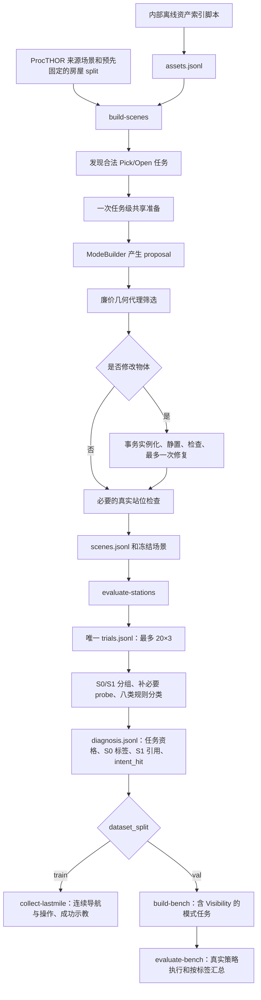

# 任务模式构建、诊断与分类实施方案

- 状态：active
- 日期：2026-10-26
- 替代：无；落实已确认需求，本轮按用户最新要求交付至标定完成
- 关联：[任务模式需求与已确定口径](../requirement/01-task-mode-construction.md)、[构建计划表](02-build-schedule.md)、[当前架构](../../../docs/architecture.md)、[资产资料](../../raw_asserts/)、[cuRobo 加速方案](../../curobo-time-optimization/plan/01-panda-omron-time-optimization.md)

## 1. 交付目标和固定边界

把现有 Case1/2/3 场景增强改成“候选构建 → 实测标定 → 诊断 → 多标签分类”，并使训练采集与 benchmark 消费同一套结果。

用户于 2026-10-26 将本轮范围收敛为“流程到标定完成即可，后续任务先不用做”。本轮交付 P0–P4（含 S0/S1 与诊断结果）；P5/P6 后续任务暂不推进，已有实现和实验产物保留，不回滚。当前结果见[标定交付](../delivery/02-calibration-delivery.md)。 P0–P4 的构建、完整标定与诊断已完成；六类有真实标签正例，Orientation/Visibility 尚无正例。历史实施方案保留，第 20 节仍为方案编写阶段记录。

固定采用以下口径：

| 项目 | 实施约定 |
|---|---|
| 研究本体 | PandaOmron，`robocasa-v1`；本轮不增加 RBY-1 实验任务 |
| 操作 | Pick/Open；八类模式均实现候选构造与分类接口；Close 暂不实现 |
| 底盘 | S0/S1 标定和诊断允许现有底盘联合规划，不切换固定底盘 |
| 站位 | task anchor 为圆心，半径 1 m、XY lattice 间距 0.25 m；最多 20 个有效 `(x,y,yaw)` 姿态，每姿态 3 次 |
| 成功率 | S0 优先 0/3、候补 1/3；S1 优先 3/3，无满足当前标签条件的 3/3 时再用 2/3 |
| Visibility | 全部三相机参与；低可见 S0 不要求操作低成功率；S1 同时高可见、高操作成功率且导航可达 |
| 分类 | 几何与阶段规则多标签，存在一个合格 S1 即可；不强制唯一主因或因果排他证明 |
| Articulated | S0 真实失败/低率即可，不要求抓住把手后才失败；S1 必须完成完整任务 |
| 编辑 | 天然/无编辑优先，定向最小编辑；最多一次局部 Repair；原始输入只读 |
| CLI | 保持五个公开命令；资产索引为内部离线脚本，诊断内置于 `evaluate-stations` |
| 代码质量 | 整洁、简洁、清晰、可读；合理重构当前职责和重复逻辑，不叠加平行实现或通用框架 |

build-scenes 的 accepted 仅表示合法候选构建完成。真正的模式命中、成功示教和下游资格，由 evaluate-stations 的真实数据决定。所有示例配置和文件路径中标明“拟新增”的内容，实施后才可运行。

## 2. 命令职责和完整数据流



### 2.1 build-scenes

消费来源场景、任务选择、资产 profile 和构造配置。完成任务发现、共享准备、proposal 筛选、必要物理构建、最终站位检查与冻结。输出 `proposal_intent` 和真实编辑信息，不写 `final_labels` 或布尔 `intent_hit`。

### 2.2 evaluate-stations

先完成现有 cuRobo 标定，再执行诊断与分类。CPU 准备/GPU 规划/CPU 执行沿用现有调度，不在 Builder 中加入 cuRobo 成功率测量。诊断作为标定之后的一个阶段，复用进程资源，不在并行 worker 中各自启动另一套 GPU 服务。

### 2.3 collect-lastmile

只消费 train 的有效分类结果。直接复用原始成功标定轨迹和分类引用的 S0/S1 关系，沿现有真实执行链完成 `S0→S1→操作`。无路径保留负结果；不恢复快照或瞬移到 S1。

未传既有标定时，命令内部仍可按现有能力先标定一次，再调用同一诊断函数。不得保留“内部标定一套规则，外部 evaluate-stations 另一套规则”。

### 2.4 build-bench / evaluate-bench

build-bench 只消费 val 的匹配标定和分类结果，不重新标定，不从热图颜色推导标签。Visibility 可以从 cuRobo 操作高率但低可见的初始点生成 episode，必须绕过旧 `select_starts()` 的低操作成功率限制。

evaluate-bench 对同一个 episode 执行一次策略，按多个标签分别统计；不能因一个 episode 有两个标签而运行两次或在总体分母重复计数。oracle、S1、模式证据只供评测使用，不发给策略。

## 3. 代码结构与重构边界

### 3.1 目标目录

下列为实施后的职责结构，不要求为每个名词增加文件。已有加载、图像、几何、运行时模块继续复用。

```text
scripts/
└── build_asset_index.py                 # 离线索引入口，参数/调用/日志

src/lastmile_dataflow/
├── cli.py                              # 仍只分发五个公开命令
├── scenes/
│   ├── dataset_config.py               # 新配方、固定站位规则、split 配置
│   ├── dataset.py                      # 场景记录读取与站位覆盖选择
│   ├── loading/
│   │   ├── asset_profiles.py           # AssetProfile、离线测量与索引读写
│   │   ├── asset_library.py            # role Selector，替换在线目录检索
│   │   └── assets.py                   # RuntimeGeometryCache、适配后的真实几何
│   ├── build/
│   │   ├── context.py                 # BuildContext 与任务级共享准备
│   │   ├── proposal.py                # BuildProposal、SceneEdit、BasePoseEdit
│   │   ├── builder.py                 # 构造算法：提案→代理→事务→站位→结果
│   │   ├── validation.py              # 共用廉价代理和构建后检查组合
│   │   └── repair.py                  # 一次有界修复规则
│   ├── modes/
│   │   ├── base.py                    # ModeBuilder 和简单注册映射
│   │   ├── reachability.py
│   │   ├── ground_obstacle.py
│   │   ├── visibility.py
│   │   ├── arm_path.py
│   │   ├── approach.py
│   │   ├── narrow_space.py
│   │   ├── orientation.py
│   │   └── articulated.py
│   ├── stations/
│   │   ├── sampling.py                # lattice、yaw、粗筛后真实初始化
│   │   └── initialization.py          # 现有底盘/地面/初始化物理检查
│   └── augmentation/
│       ├── checks.py                 # 复用通用碰撞、支撑、源场景影响检查
│       ├── regions.py                # 复用支撑面和 placement 几何
│       └── sampling.py               # 只保留通用 placement，不留旧 Case 配方
├── planning/
│   ├── astar.py                       # 原始占据、inflation、clearance、直线与 A*
│   ├── curobo_v2.py                   # 原生求解、明确阶段/lane 证据、有界 IK probe
│   └── pool.py                        # 复用常驻 GPU 服务，增加必要 probe 请求
├── runtime/
│   ├── construction/session.py        # 统一 SceneEdit 的实际应用、模型缓存和释放
│   ├── construction/preparation.py    # 现有静置与构建准备
│   ├── execution_config.py            # 操作工作区、诊断配置及有效 profile
│   ├── execution/                     # 现有连续导航/操作/worker/协议
│   └── outcomes/                      # 现有真实物理任务判定
├── data/
│   ├── evaluation/
│   │   ├── selection.py               # 唯一原始计数与优先池选择
│   │   ├── diagnosis.py               # probe 调度、八类判定、任务模式结果
│   │   ├── recovery.py                # 既有区域与恢复指标
│   │   └── benchmark.py               # 完整计划集合、按标签统计
│   └── rendering/head_views.py        # 从单 camera 扩展到三相机可见性
└── workflows/
    ├── scene_datasets.py              # 房屋/任务调度，父进程唯一写主记录
    ├── station_calibration.py         # 现有标定调度，返回原始 trials
    ├── collection.py                  # 标定→诊断、或复用→连续采集
    └── lastmilebench.py               # 消费分类结果构建/评测 benchmark
```

`scenes/build/builder.py` 接替当前 `scenes/augmentation/builder.py` 的构建职责；是算法整理，不在 workflow 外再套一个同名执行器。当前 `workflows/obstacle_augmentation.py` 的公共准备移入 context，variant 循环归任务级调度，迁移完删除无职责的旧包装。

### 3.2 允许和需要的重构

1. 删除旧 Case 强制数量、Chair 硬编码、与新 Pick 资格冲突的类别限制，以及仅为这些规则存在的配置字段和分支。
2. 合并原始 trial 计数、S0/S1 优先选择和下游重复筛选；标签判断以诊断结果为准。
3. 将原先每 variant 的加载、静置、栅格、资产准备提到目标级作用域；已有缓存调整作用域，避免再加同职责缓存。
4. 拆开采样范围、导航范围、操作工作区的参数传递；不借配置兼容层继续复制错误关系。
5. 迁移完成后删除旧内部入口和相应测试，当前配置、测试、文档统一改用新语义；旧实验结果只读保留，不强行转换成新模式数据。

不进行与任务无关的控制器重写、目录全量搬迁、模型推理框架改造或历史格式兼容。旧文档中仍适用的操作知识提取后保留，过时 Case 构建说明归档。

### 3.3 单文件组织与接口原则

每个文件按“模块职责说明 → 导入与常量 → 数据类型/公共接口 → 实现方法 → 私有辅助函数”组织。类内按初始化、公共操作、内部计算、关闭资源排列；相关计算放在相邻位置，不按 case 复制整段流程。

只有 ModeBuilder、SceneEdit 需要明确抽象接口。Selector、Cache、Classifier 使用普通类或函数；不增加插件系统、依赖注入容器、通用校验框架或多层无职责包装。

函数名直接表示动作或数据，例如 `prepare_context`、`select_assets`、`evaluate_proposal`、`classify_start`。数据类型使用带明确字段的 dataclass；metadata 只存模式专有构造信息，不代替所有正式字段。

只有重复且有独立含义的计算才提取 helper；短小模式可以共用几何函数，不为减少单文件行数拆散本来连贯的流程。注释解释坐标、物理约束、阶段映射和选择原因，避免逐行翻译代码。

## 4. 核心数据对象与接口

以下为接口草图，字段可随现有类型整合；不要求逐字复制为一组新文件。

```python
@dataclass(frozen=True)
class AssetProfile:
    asset_id: str
    source_xml: str
    category: str
    width_m: float
    depth_m: float
    height_m: float
    footprint_m2: float
    movable: bool
    loadable: bool
    support_kind: str
    compatible_supports: frozenset[str]
    compatible_rooms: frozenset[str]
    roles: frozenset[str]

@dataclass
class BuildContext:
    baseline: Simulation
    task: TaskSpec
    stations: list[StationCandidate]
    geometry: SceneGeometry
    occupancy: OccupancyMap
    clearance_field: np.ndarray
    supports: list[SupportInfo]
    cameras: CameraGeometry
    asset_selector: AssetSelector
    asset_cache: RuntimeGeometryCache

@dataclass
class BuildProposal:
    proposal_id: str
    proposal_intent: str
    station_hints: list[str]
    edits: list[SceneEdit]
    pose_edits: list[BasePoseEdit]
    metadata: dict

class ModeBuilder(ABC):
    @abstractmethod
    def propose(self, ctx, rng) -> BuildProposal | None:
        ...

    @abstractmethod
    def cheap_validate(self, ctx, proposal) -> ProbeResult:
        ...

class SceneEdit(ABC):
    @abstractmethod
    def apply(self, session) -> None:
        ...
```

`TaskSpec` 在现有 task 字段基础上整理，保留稳定 task ID、operation、target body/asset/category、anchor、instruction、support 和 articulated joint 信息。识别使用实际实例名和资产 ID，不使用重新 compile 后可能变化的数字 body ID 作跨模型身份。

`StationCandidate` 必须区分 XY lattice 点和 `(XY,yaw)` 初始化姿态，保存 `xy_id`、独立 `station_id`、yaw 来源、真实 `base/initial` 与初始有效性。Orientation 的同 XY 不同 yaw 不能共享 station ID。

`SceneGeometry`、`CameraGeometry` 等名称表示已有几何结果的集合，可直接使用现有结构组合；不为示意图中的每个类型新建空壳类。BuildContext 不持久化大型 model/data，只在任务 worker 内使用。

`ProbeResult` 采用 `status=pass/fail/unknown`、`reason`、`metrics`。构建 unknown 不视为通过；最终分类中未测到、测量失败与明确不满足分别表示。

SceneEdit 初版具体实现为 AddObject、MoveTargetOnSupport。BasePoseEdit 改的是未开始仿真的机器人初始 pose，不进入物体静置链。最终执行由现有构建 session 承担，不允许 edit 自行 stepping 或操作已 begin 的 Simulation。

## 5. 资产离线准备和运行期选择

### 5.1 离线索引

内部脚本遍历实际 THOR Prefabs，包括嵌套 RoboTHOR 目录；按源 XML 的资产身份去重，统一类别别名，显式适配 y-up→z-up。只在离线阶段允许扫描全库和必要 compile。

每资产处理：读取来源 → 判断可作为 rigid/free-root 障碍物适配 → 必要 compile → 提取碰撞局部 bounds/footprint → 写 AssetProfile。不能适配的资产记录 `loadable=false` 和简短原因，不因一个不支持的关节资产中断整个离线任务。

`loadable=true` 表示能进入当前障碍物编辑链，不能只表示源 XML 可解析。`movable` 采用资产语义与当前适配能力，不能把原场景中某个实例的静态状态直接作为该资产的全局属性。role/support/room 的缺失元数据由一份集中类别规则补充，后续由测量几何过滤。

输出一份 `assets.jsonl`，源 XML 仍只读。转换后的适配资源若需要落盘，放索引对应的缓存目录，由该记录引用；不为每 variant 生成一份资产副本。JSONL 即唯一查询来源，不再维护并行 Parquet、CSV 或逐文件清单。

### 5.2 AssetSelector

输入 `AssetRequest(role, size_bounds, support, room, excluded_categories, limit)`，依次过滤：

1. 本地可适配、语义 compatible、当前 target 同类排除。
2. role 满足 Builder 请求；role 可以多值。
3. 已测宽深高、footprint 和支撑高度满足约束。
4. 旋转矩形/投影 bounds 能放入 proposal 区域，保留摆放余量。
5. 在满足条件的候选中优先使用本任务/本批次较少使用的类别与资产，再按 seed 抽取最多 5 个。

类别映射集中在资产选择模块，ModeBuilder 不写 Chair/Stool 等硬类别。候选为空记 `asset_pool_empty`，不退回全库在线扫描。

多样性初版用内存计数即可；独立 task worker 内按确定的 seed 派生子种子，不为跨 worker 完全均衡增加共享数据库或同步服务。

### 5.3 RuntimeGeometryCache

由现有 EditAssetCatalog 的加载缓存和 `asset_geometry()` 合并形成，返回 profile、局部碰撞点、模型/data、body 和可复制 spec。避免现有“catalog 测量 compile 后又为同资产 compile 一遍”的重复工作。

缓存作用域为 task worker/资产加载器实例；可以保留有界 LRU，默认最多 16 个孤立资产真实几何。完整编辑场景仍复用构建 session 的最多 4 个资产组合模型缓存，位姿调整不触发拓扑 compile。

淘汰时只释放不再被活动候选使用的条目；一次候选结束后保留最近几何，任务结束统一 close。缓存键使用 asset ID 与显式适配版本/本体配置引用，不生成文件指纹。

## 6. Task Discovery 与共享 BuildContext

### 6.1 按房屋发现、按任务构建

来源房屋先确定 split，再从真实加载模型发现任务。Pick 必须有有效数据抓取、自由目标、可用尺寸、合法支撑和基本周边空间。无效/空 grasp 不用 bbox pinch 补成正式 Pick。Open 沿用已有有效关节与把手定义，不加入 Close。

同一房屋可共享来源加载与静态几何抽取；选中的每个 task 进入一个构建 job，在该 job 内完成全部 intent×variant。worker 不再接收 `(target, case, variant)` 作为互相独立的重准备任务。

发现阶段只做 task 资格和轻量预筛；不先给全部目标做完整站位仿真，再在构建准备中重复做一次。已有 discovery 的必要已检查站位结果可复用，前提是同一准备状态和 profile。

### 6.2 共享准备顺序

```text
加载/恢复任务基线
    → 机器人初始化到合法停车位
    → 基线准备与必要静置（一次）
    → 建 target/support/collision 几何
    → 生成 49 个 XY lattice 点及默认 yaw
    → 建原始占据、导航 inflation、clearance field
    → 生成粗 workspace、nominal arm/approach 代理
    → 加载轻量资产索引与 Selector
    → 对所有模式/variant 复用该 BuildContext
```

BuildContext 的 baseline 始终为未开始执行的准备状态。构建阶段的静置使用现有 construction API；不是任务 Simulation.begin() 后恢复初态。

初版不在跨进程间传递 MjModel/MjData 或活跃 Simulation；task worker 拥有自己上下文，父进程只收小型结果并顺序写 `scenes.jsonl`。构建 worker 数继续受现有配置控制，不在任务内部再嵌套进程池。

### 6.3 缓存有效范围

| 结果 | 复用范围 | 何时重算 |
|---|---|---|
| 来源静态几何/房间边界 | house | 切换来源模型 |
| target/support/lattice/nominal corridor | task + baseline + robot profile | 移动 target、支撑改变 |
| 原始 occupancy/clearance | frozen geometry + 高度/支撑规则 | 物体编辑或静置后位置改变 |
| inflated occupancy | 原始 occupancy + footprint + margin | footprint、held pose 或 margin 改变 |
| 初始化物理结果 | 同模型/状态 + station pose + profile | 编辑、目标/机器人初始状态改变 |
| 相机可见性 | 同场景/target/相机姿态/分辨率 | yaw、臂姿态、遮挡或目标位置改变 |
| 真实资产几何 | asset + 适配规则 | 资产输入或适配约定改变 |

初版采用“编辑后按需整体重算小栅格”的简单实现，先获得任务级共享收益；不预先实现复杂局部 distance-field 更新。

## 7. 几何共用层与范围解耦

### 7.1 三种范围分别配置

| 范围 | 所属配置 | 行为 |
|---|---|---|
| 初始站位采样 | scene recipe `station_config.radius_m/spacing_m` | 固定 1.0 / 0.25，不从本体尺寸派生 |
| 操作工作区 | execution `radius_m`、`local_base_radius_m` | 沿用当前任务执行语义，底盘可联合规划；具体值保存到有效配置 |
| 恢复导航区域 | 以实际源房间地面边界生成的 grid extent | 可离开 1 m 圆，不因采样域裁掉合法绕行路径 |

当前 `_prepare_run()` 会把 dataset geometry 中的 `radius_m` 拷入 ExecutionConfig，必须取消这项耦合。cuRobo 的 workspace、任务 monitor、可视化说明改为使用明确的操作范围；场景采样不再反向覆盖它。

当前 Panda 规划器还用 `local_base_radius_m` 约束单次移动范围；保持该机制，不能把“不固定底盘”解释成无限制移动。首次真正实验沿用选定 Panda 执行配置，记录其工作区和局部移动范围，不暗中改动扩大成功率。

导航阶段按导航 grid 和碰撞/跟踪约束执行，操作阶段开始时才应用操作工作区；核对 monitor 的启用阶段，避免对合法圈外绕行报 `base_outside_workspace`。

### 7.2 occupancy 与 clearance

复用 `scene_grid()` 的实际 per-geom 地面障碍和 support 保守占据规则，将“几何栅格化”与“圆形区域裁剪”拆开。原始 `occupied` 不含 robot inflation，地图外与无地面区域不可通行。

由原始占据计算距最近障碍物的米制距离 `D(x,y)`；可复用项目 Panda 环境已有 SciPy 的距离变换。若将其放入所有环境都要导入的模块，需同步依赖声明，不能依赖某台机器碰巧安装。

首版底盘余量采用现有实际底盘/轮廓外接圆近似：

```text
clearance_base(x,y) = D(x,y) - chassis_radius
nav_free(x,y) = D(x,y) >= navigation_radius + navigation_margin
```

`navigation_radius` 可为 held whole-body 外接圆，和底盘 clearance 的 `chassis_radius` 分开。clearance 已按物理轮廓扣除一次，不能再次扣 navigation margin。记录栅格分辨率和轮廓方法，阈值精度不高于该近似能支持的尺度。

路径最小 clearance 是补充指标，不替换 Narrow 的站位 clearance。`planning.astar.distance_field()` 仍表示起点路程场，和障碍距离场分别命名、分别使用。

### 7.3 直线、A* 与端点

Ground/Visibility 以及下游采集使用同一份导航格和 held-body 约定。`segment_free` 负责 S0→S1 直线、真实站位→栅格中心连接段；A* 复用禁止斜向穿角规则。

路径长度按实际发送给跟踪器的折线重新累计，包含端点连接，不直接照搬仅栅格内部的代价值。Ground 的 detour ratio=`path_length/direct_length`，仅非零平移时定义；Orientation 的同 XY/yaw 恢复不计算该比值。

若启用 task-local model，裁剪必须保留导航区域全部相关障碍、target/articulated 完整子树和物理支撑。第一轮正确性验证关闭局部裁剪；随后按实际导航 envelope 扩大保留范围，不能用已被删掉的家具区域证明可绕行。

## 8. 三相机观测与 Visibility 测量

统一三相机：`robot0_agentview_left`、`robot0_agentview_right`、`robot0_eye_in_hand`。分别核对编译后的 parent、pos/quat、fovy 和观测预处理；不以名称相同代替外参一致。左右绑定 `mobilebase0_support`，腕部绑定实际 `robot0_right_hand`。

可见性在相同初始 arm/lift/base pose 下测量。腕相机跟随手臂，不能用一个固定世界相机代替。scene 中保存真实初始控制状态，三路都在该状态渲染。

### 8.1 Cheap Probe

缓存相机内外参和 target/把手表面采样点，对三路作视锥和分组 ray 测试；新增 blocker 用低成本旋转 bounds/凸代理检验。计算每路粗可见比例，并取最大值作为候选代理。

VisibilityBuilder 必须考虑另外两路是否仍可清楚观察；只挡住 left 而 right/wrist 清楚时，不应判为构造代理命中。单个高物体放不下或无法改善三路聚合指标，可以 rejected，不为命中盲目增加遮挡物。

### 8.2 最终观测

对最终少量站位三路渲染，记录实际目标 segmentation 像素数 `n_obs`；在同相机同姿态的临时渲染场景中仅保留 ROI 可视几何，得到无遮挡参考投影像素数 `n_ref`。操作临时渲染对象，不改 MjModel 碰撞、物体状态、冻结输入或策略图像。

Pick ROI 为 target 实例及其可视子几何；Open ROI 为把手/交互区域，不以整个冰箱都可见代替把手可见。初版参考投影与观察图使用相同相机内参和分辨率。

```text
v_c = n_obs / n_ref                   # 参考投影足够测量时
V = max(v_left, v_right, v_wrist)
```

完全出视野、且相机姿态/ROI 投影计算正常时 `v_c=0`；渲染异常为 unknown。参考投影过小且无法稳定测比值时记录 `insufficient_projection`，不把 unknown 当作已遮挡。`min_reference_pixels` 随分辨率显式配置，数值由小规模观测固定。

低可见 S0 需要三路均有效且 `V<τ_vis`。高可见 S1 只需一条有效相机满足 `v_c>τ_good`；其余未知时仍有已知高可见下界，可据此判定。S1 的已知高可见值相对 S0 的最大可见性还必须提升 `>Δτ_vis`。

渲染结果保存在 scene station 的 `visibility` 中供最终分类复用；如标定准备产生了不同的初始 settle 状态，以实际标定准备状态为准补测一次并引用它，不沿用不匹配的 build 值。

## 9. 八个 ModeBuilder 的具体方案

Builder 的 operation 支持范围用简单映射定义，返回不支持/无合法候选的真实原因。每个 mode 只实现本模式特有的候选几何与代理，资产筛选、物理验证和站位保存均走公共构建器。

### 9.1 ReachabilityBuilder

按 target 相对默认底盘朝向的位置、距离和横向偏置，对 lattice 点计算粗 workspace margin；优先边缘点作为 station hint。代理考虑当前允许的局部底盘位移，不按固定机械臂模型直接宣称不可达。

默认 no-edit。若所有合法点都处于粗 workspace 内部，可在同一 support 上向操作空间边缘移动 target；只选少量合法位移，更新 task anchor 后重新生成该 variant lattice。MoveTargetOnSupport 必须经过物理重建与静置，不在已冻结源场景上改 qpos。

最终标签仍依赖 S0 的 IK 可行比例和实际高率 S1 的相对目标位移。代理选点本身不构成标签。

### 9.2 GroundObstacleBuilder

从边缘候选 S0 到几何操作区域选择 corridor；这里的操作区域是初始化合法/粗可操作区域，不是提前知道的成功 S1。Selector 请求一个 floor_obstacle，在 corridor 少量中心/偏移位置搜索。

将 footprint 投入临时占据图，要求直线被挡、到至少一个候选操作位置有 A* 路径，并达到构造 detour 门槛。候选 proxy 通过后才加载真实资产、实例化与静置。

最终对已知 S1 重新算 segment/A*。若直线未挡，向 corridor 中心微调；若绕行全堵，向边缘微调；最多一次 repair。

### 9.3 VisibilityBuilder

取一个聚合低可见性潜力较大的 S0，求三相机→ROI 的 ray band 与合法 support 相交区域，选择一个 visual_occluder。优先天然已遮挡结构；需要增加资产时仍以一个为初版上限。

粗检要求 S0 聚合可见性降低，且存在另一个候选站位的聚合可见性明显更好并可导航到达。build 不要求 S0 操作成功率低。静置后必须重测，遮挡不足时在 support 上沿 ray/band 有限微调。

### 9.4 ArmPathCollisionBuilder

用 Panda 初始连杆几何、肩/肘/腕关键点和少量有效 grasp 的接近方向，构造名义臂通道的 capsule/采样包络。已有本体 nominal 关节姿态可通过轻量 FK 扫描补充包络；没有参考关节解时仅使用几何通道代理，不把末端直线插值冒充真实连杆轨迹，也不在 Cheap Probe 隐式调用 IK/TrajOpt。无真实成功 S1 时不称其为已验证参考轨迹。

请求 arm_obstacle，优先在 proxy 与合法 support 的交集放一个。若一物体不足，递增为两个、最多三个；每次先作便宜几何重叠与 target/support 可用性检查，满足代理即停止增加。

真实资产加载/实例化只用于该级筛出的少量候选；不能每放一个物体都跑完整 station lattice。修复时向 swept-volume 内外微调，避免从“挡手臂”变成“完全埋住目标”。

### 9.5 ApproachBuilder

从有效 grasp 数据生成 pregrasp→grasp 的末端接近 corridor，优先寻找被天然墙/家具限制的站位。天然不足时请求一个 approach_obstacle，在 corridor 附近合法 support 上放置。

代理要求 corridor 有实质限制，同时至少一组其他站位/接近方向仍可用；不在 build 阶段为此调用完整 TrajOpt。最终按 goalset 已过、pregrasp/grasp IK 或 TrajOpt 失败的日志规则分类。

### 9.6 NarrowSpaceBuilder

从 clearance field 找 `0<clearance_base<τ_clear` 的天然低余量站位，且其他候选点有较大余量。天然结构满足时 no-edit。

否则请求一个 floor_obstacle，沿原墙/桌边形成局部窄区；必要时两个。proxy 要求提示站位仍合法、仍有导航通路及更宽位置，不能只凭小 clearance 把碰撞点当狭窄站位。repair 只向外释放少量空间。

### 9.7 OrientationBuilder

在一个合法 XY 上保留默认 yaw 与 ±45° 候选，使用相同非底盘初始状态；真实初始化显式保留 yaw。至少保留一组可见、无底盘碰撞的对照，再用其他合法点填充预算。

每个 yaw 作为独立站位计入 20，总 trial 仍不超过 60。先确定候选，标定后再认定哪个 yaw 是 S1；实际 rollout 可移动底盘。如果所有 yaw 都成功或都失败，如实记不命中。

### 9.8 ArticulatedBuilder

只对合法 Open task 工作，不编辑资产。优先覆盖把手不同相对位置、关节打开侧与操作空间差异，保存普通合法站位。

最终只需低率 S0 和完整任务高率 S1。S0 可以在接近、规划或关节交互任一任务阶段失败；不增加建立把手接触的前置门槛。

## 10. 公共构建事务、Repair 与最终站位

### 10.1 构建主循环

```python
def build_task(ctx, builders, config, rng):
    for builder in builders:
        for variant_index in range(config.variants_per_intent):
            result = search_variant(ctx, builder, config, rng)
            yield result

def search_variant(ctx, builder, config, rng):
    for proposal in bounded_proposals(builder, ctx, config, rng):
        cheap = builder.cheap_validate(ctx, proposal)
        if cheap.status != "pass":
            continue
        candidate = materialize_if_needed(ctx, proposal)
        checks = validate_candidate(candidate, ctx, proposal)
        if not checks.valid and checks.repairable:
            candidate = repair_once(ctx, proposal, checks)
            checks = validate_candidate(candidate, ctx, proposal)
        if checks.valid:
            return sample_and_freeze(candidate, ctx, proposal)
    return rejected_result()
```

以上为流程示意；资源作用域使用现有 context manager，拒绝/异常路径释放候选，不新增 `bounded_proposals` 等无职责包装来机械复制伪代码。

### 10.2 物理与结构检查

物体编辑统一在 session 中应用；AddObject 改拓扑，MoveTargetOnSupport 在新候选状态中改目标位置。位姿应用发生在第一次 forward/settle 之前，不能在 step 过程中瞬移拉回。

复用已有逐 geom 碰撞、support rays、稳定窗口、源场景影响与 matched-control 逻辑。源场景影响对照在一个候选的实际 settle 时长上匹配；若延长静置，同步延长对照，不将基线自然运动算作新增障碍物的影响。

检查分成物理合法性和构造代理两部分：

- 物理：非法穿透、稳定、支撑、地面/表面边界、目标有效、原场景影响、数量上限。
- 结构：预期 floor/surface role 位置、target 与 instruction 对应、站位提示仍可用。
- 代理：静置后仍符合 corridor/occluder/swept-volume/clearance 等构造条件。

不做全库一致性审计，也不新增与模式无关的 case 组合检查。

### 10.3 Repair 边界

一次失败最多做一个 repair proposal，只允许：XY/yaw 小调、同 role 且尺寸接近资产替换、在同 support 上重新 placement。默认平移上限 0.05 m、yaw 上限 15°，替换尺寸各维不超过原值约 20%；数值作为初版实现默认，可在小规模定标时统一调整。

修复会创建新的未开始候选状态，重新 settle 与复查。不能在已进入执行的仿真恢复 baseline；不能把更换 target 类别、删原场景物体、扩大障碍数量上限当 repair。

### 10.4 Station Sampling / Freeze

依次做地面与占据粗筛、workspace/视锥代理，按 station hint、Orientation 对照和覆盖顺序选少量点做实际初始化。候选失败则从剩余排序中补选，直到得到最多 20 个有效姿态或耗尽候选。

避免把 conservative whole-body 圆的拒绝直接当精确碰撞结论：明确无地面/确定占据的点可直接过滤，外接圆近似不确定的点保留给真实初始化，防止窄区全部被过度剔除。

普通模式的不可见站位不因 visibility 过滤而删除；仅记录观测。Orientation 要求的可见性用于它的对照候选。最终所有保存的站位都经过真实机器人初始化与必要碰撞/支撑检查。

合法 no-edit variants 可引用同一 task baseline snapshot，分别保存 intent 与 station 子集；不重复 freeze 相同大场景。object-edit 每个 accepted variant 保存独立冻结状态。不默认保存完整 before/after 双份场景和全量预览图；必要构建对照数据沿现有检查引用保留，人工诊断视图按需生成。

## 11. 标定、阶段证据与有界 probe

### 11.1 复用现有标定调度

`station_calibration.calibrate_stations()` 继续拥有父进程唯一 trial writer、准备 worker、常驻 GPU planner 和 CPU rollout worker。每个站位三次使用真实 seed，trial 身份与执行数据不能因 GPU batch lane 被混淆。

station 初始准备状态只在未开始实例中初始化。一个真实 trial 对应新 Simulation/attempt；重复执行复用静态模型/solver，不复用已执行动态状态。保持现有 active-time 预算和共享故障停止机制。

当前 Panda 示例执行配置只启用 Pick；新模式配套执行配置显式启用 Pick/Open，而非将“代码支持 Open”当作实际配置已覆盖。head FOV、grasp roll、torso 等选项从选定 Panda 配置读取并保存，不在诊断中改另一套。

### 11.2 增强现有规划日志，而非后处理猜阶段

在 native solver 包装处记录当前 phase、solve 序号、batch lane/seed 与实际候选集合引用。归一化业务阶段：

| 归一化阶段 | 当前原生日志/调用 | 分类用途 |
|---|---|---|
| goalset | 首次 goalset IK/TrajOpt | Reachability、Arm-path |
| pregrasp | native plan 的 approach 轨迹，当前回调为 pregrasp | Approach |
| grasp | pregrasp→grasp 线性接近 | Approach |
| lift / articulated | 闭爪后的真实 lift/Open 调用及 verdict | 任务成功与执行原因 |

单站/批量输出共用同一个摘要函数；不再按 solver trace 行数或每三行一组推断阶段。完整日志仍引用已有 planning 目录，主 trial 只增加 `planning_ref` 或明确现有 query/lane 引用，不复制大型数组。

### 11.3 IK 可行比例

分母必须来自实际评估过的 `(grasp, IK seed)` 项；同时记录有效输入 grasp 数、requested seeds、observed evaluation count 和约束可行数。只保存最终获胜 IK 或 top-k seed 的结果时，不能宣称它代表全部 seed。

优先利用已有原生结果中可定位 lane/goal/seed 的 metrics；若日志不具备该覆盖，发一次独立 `diagnostic_ik` 请求。probe 沿用底盘可移动、相同局部范围、碰撞/FOV/关节约束及相同有效 grasp 集合，默认不超过 16 grasps×32 seeds，不做轨迹执行。

probe seed 与原 trial 身份分开保存，不能将额外 IK 次数记作真实 trial。有限 seed 无解只表明该预算下未找到，不代表数学不可达。

### 11.4 Probe 调度

CPU 完成原始 trial 分组、导航/clearance/相机测量；GPU 仅接收确实缺失的 IK 等必要请求。默认每个 S0 最多一个额外 IK probe，active budget 60 s，排队耗时另记；达到预算后记 unresolved，不自动降低条件。

初版不默认追加物理成功率 trial、约束开关反事实或第二轮 yaw 标定。需要真实物理操作的结果只来自已规划的三次 trial和后续采集，不将纯规划 probe 写成零步执行轨迹。

## 12. 最终多标签分类算法

### 12.1 任务资格与候选池

先按 scene/task/profile 绑定原始 trial，计算每姿态 3 次是否完整。共享服务错误、初始化/记录错误不凑成三次任务失败。对本轮模式样本，任务级完整性要求所有已计划站位均有完整可评估结果；`--max-trials` 的截断 run 只供 smoke，不产正式模式资格。

完整后计算：

```text
S0_primary   = successes == 0 of 3
S0_secondary = successes == 1 of 3
S1_primary   = successes == 3 of 3
S1_secondary = successes == 2 of 3
visibility_starts = 三相机均确认聚合低可见的全部有效姿态
```

S0 先处理 primary 再 secondary，两者结果均可保留。对于每个 S0、每个模式，先测试所有满足该模式关系的 3/3 S1；没有合格者时再测试 2/3。3/3 存在但几何条件不合格，不能阻止另一个合格 2/3 作为证据。

有多个合格 S1 时，确定性选一个 evidence S1（先优先池，再较短可行路径，最后 station ID），同时可保留同优先池的合格 ID 集合。选择一个证据不意味着只准生成一个训练 pair。

### 12.2 规则表

所有规则使用同一冻结 variant 和匹配准备状态；S1 率优先级适用于每行。

| 标签 | S0 条件 | 至少一个 S1 条件 |
|---|---|---|
| Reachability | 低率；有效 goalset 的诊断 IK feasible ratio≤`τ_ik` | 高率；相对目标靠近至少 `Δreach`，或目标坐标系侧向位置变化至少 `Δlateral` |
| Ground Obstacle | 低率；在统一导航 grid 上 S0→S1 直线不 free | 高率；A* 和精确端点连接有路径；最终标签不再强制构造 detour 门槛 |
| Visibility | 三相机均有效且最大可见性<`τ_vis`；不要求低操作率 | 高操作率；已知可见性>`τ_good`，提升>`Δτ_vis`；到该 S1 可导航 |
| Arm-path Collision | 低率；至少一条真实失败 trial 的 goalset IK 有解、同阶段 TrajOpt 最终失败 | 高率；失败阶段明确，非共享/基础设施错误 |
| Approach | 低率；至少一条真实失败 trial 的 goalset 通过、pregrasp/grasp IK 或 TrajOpt 失败 | 高率；保留具体 trial/lane/阶段，不把闭爪后 slip 算接近失败 |
| Narrow Space | 低率；底盘边界 clearance<`τ_clear` | 高率；clearance−clearance(S0)>`Δclear` |
| Orientation | 低率；与 S1 同 xy_id，初始 yaw 不同、仍可见且底盘无碰撞 | 高率；与 S0 相同非底盘初始设置，yaw 对照合法；实际成功率下降由高低池体现 |
| Articulated Interaction | Open 任务、低率；有真实任务失败，不要求接触阶段 | 高率；完整关节任务判定成功，不能只到达把手 |

Arm-path/Approach 按“存在真实失败 trial 支持阶段规则”判定，同时记录 `supporting_failures/failed_trials`，不强加多数票或唯一原因要求。若不同失败 trial 分别支持不同阶段，允许同时有两个标签。

除用户明确要求有路径的 Ground/Visibility 外，不为其他模式增加隐藏的“必须可导航”标签门槛；下游需要导航时另判 pair 可执行性，避免修改标签定义。

### 12.3 判定状态

每个 `(S0, label)` 返回 `matched/unmatched/unresolved/not_applicable` 和证据摘要。unresolved 用于缺测量、缺阶段映射、probe 超预算或不完整，不用于已经测得的几何不满足。

`final_labels` 只收 matched；expected/additional 从它与 proposal_intent 的交集/差集计算。不能只检查预期标签，否则无法发现 additional labels。

### 12.4 intent_hit 和任务资格

构建统计单位为请求的 `(task, intent, variant_index)`，一个单位内最多若干 cheap proposal；内部重试数只作耗时计数，不膨胀总体分母。

对于 station hint/候选集合：存在至少一个 S0 命中预期标签，则 `intent_hit=true`；全部相关规则明确不满足则 false；仍可能因未完成探测而命中时保留 null。其他站位偶然发现相同标签记录为 additional discovery，不冒充定向构造命中。

零成功、无高率 S1 是明确的任务资格负结果，分别记录原因；不伪装成 probe 故障。完整且零成功的任务无下游资格。至少一次成功但只有 1/3、没有 2/3 或 3/3 S1，可保留实际成功操作示教，但不进入模式恢复样本。

构造意图未命中，但另有合法模式标签和成功 S1 的 variant 可以按实际标签进入下游；不因与意图不一致丢弃有效任务。

## 13. 数据记录和输出结构

### 13.1 build-scenes

```text
outputs/scene_datasets/<build-run>/
├── config.json                         # 有效配方、来源引用、house split、seed/profile
├── scenes.jsonl                        # 每请求 variant 一行，accepted/rejected 都记录
├── summary.json                        # 汇总计数、阶段耗时、资源与拒绝原因
└── scene-files/
    ├── <task-baseline>/                 # no-edit 可共享的冻结场景
    └── <edited-variant>/                # object-edit 的独立冻结场景
```

accepted 记录保留现有 `scene_id/task/scene/stations` 核心字段，新增 `proposal_intent`、`station_hints`、`source_split/dataset_split`、`edits`、`build_metrics`；拒绝记录写明确 reason、预算耗尽位置与计数。build 不生成最终 mode 字段。

### 13.2 evaluate-stations

```text
outputs/<calibration-run>/
├── config.json                         # dataset 引用、有效执行/诊断配置、profiles
├── trials.jsonl                        # 唯一原始真实 trial
├── diagnosis.jsonl                     # 每 variant/task 一行，内含 S0 结果和任务资格
├── summary.json                        # 标定、任务资格、构造命中、性能汇总
├── planning/                           # 原有规划证据及必要 probe 日志
├── rollouts/                           # 原有真实执行记录
└── figures/                            # 仅展示，不参与选择
```

诊断阶段有独立主结果 `diagnosis.jsonl`，不新增 station_rates、second_trials、mode_trials 等重复表。每行形状示意如下：

```json
{
  "scene_id": "house-task-intent-v000",
  "task_id": "pick-object",
  "proposal_intent": "ground_obstacle",
  "dataset_split": "train",
  "calibration_complete": true,
  "task_eligibility": "eligible",
  "intent_hit": true,
  "s0_results": [{
    "s0": "S0012",
    "successes": 0,
    "trials": 3,
    "final_labels": ["ground_obstacle", "narrow_space"],
    "expected_labels": ["ground_obstacle"],
    "additional_labels": ["narrow_space"],
    "labels": {
      "ground_obstacle": {
        "status": "matched",
        "s1": "S0008",
        "s1_successes": 3,
        "metrics": {"segment_free": false, "path_exists": true}
      }
    }
  }]
}
```

示意对象只展示部分字段；实际规则状态、证据引用与未知原因均在该行中组织，原 trial、路径大数组、图像只引用，不整份复制。

### 13.3 collect 与 benchmark

继续使用已有 `pair_index.jsonl/train_index.jsonl` 和 `episodes.jsonl/oracle.json`。pair/episode 引用诊断来源、S0、实际标签和关联 S1；不新增第二套轨迹记录器。

运行配置记录 source dataset、calibration、profile、task、站位初始化和有效诊断配置的必要匹配条件，不扫描或生成文件指纹。复用不匹配就明确拒绝，不默默重新标定或改写标签。

新模式配置只用于新 run。旧结果保持原语义，不以 Case 自动生成标签，也不新增旧内部路径兼容壳。

## 14. 下游配对和 benchmark 的接入细节

### 14.1 train 连续采集

按实际 S0 结果选 train 任务，纳入一般低率链与 Visibility 链并去重。对每个 `(S0,label)`：若有合格 3/3 S1，使用所有该级合格 S1；否则使用合格 2/3 S1。跨标签合并同一个 `(scene,S0,S1)` pair，标签取其关联标签集合，不重复采集。

保持现有完整 pair 计划记录：对已选 tier 的关系生成计划，导航无路、跟踪失败和操作失败分别写结果。诊断只留一个 evidence S1 时，应同时提供可复用的同级合格 S1 ID 集合，不能让采集代码重新独立定义标签或成功率门槛。

已有成功标定轨迹按 rollout ID 去重进入直接操作示教；连续采集仅真实成功且记录/观测可用时进入训练示教。numeric 标定成功不等于完整 VLA 输入，按现有回放/物化链补三相机观测后再检查可用性。

### 14.2 val benchmark

同一 S0 无论有几个标签都只生成一个基础 episode，标签及多个支持 S1 放在隐藏 oracle。Visibility-only 样本明确记录其初始 cuRobo 操作成功率，不能在报告中笼统称为低操作成功率 S0。

RecoveryRegion 使用该 episode 合格 S1 的实测锚点构建，3/3 优先、需要时 2/3。不能用全 scene 的另一个无关 3/3 点覆盖此 episode 的可用 2/3 证据，或把所有 S1 无条件合成一个成功区域。

区域扩张仍是已有几何恢复定义，实测锚点才代表真实标定成功率；保存两者区别。若每 episode 的合格 S1 集合不同，oracle 中按 episode 关联区域，必要时复用相同集合，避免引入第二套 trial。

### 14.3 汇总指标

总体按唯一 episode 的完整计划集合报告 TSR、coverage、unknown/infra、恢复进入、执行终止与记录完整。按标签分别给出计划数、完成数、成功率和覆盖率；multi-label 分组可重叠，不把各组样本数相加当总体样本数。

标签 Macro 只在相应分组数据完整时计算，unknown 保持未知；Visibility 分组单独说明初始观测限制。构造 intent、实际 label、operation 和失败阶段是不同维度，不再用 Case 代表模式。

## 15. 配置、预算和阈值

### 15.1 场景配方（v2 解析已实现，调度待接入）

```json
{
  "schema_version": "scene-dataset-recipe-v2",
  "data_root": "/data1/wenyifan/lmdf/molmospaces_data",
  "dataset_dir": "assets/scenes/procthor-10k-val",
  "assets_dir": "assets",
  "asset_index": "indexes/thor/assets.jsonl",
  "robot_config": "configs/robots/panda_omron_robocasa.json",
  "mode_config": "configs/task_modes/mode_defaults.json",
  "houses": [103, 104],
  "operations": ["pick", "open"],
  "modes": ["reachability", "ground_obstacle", "visibility", "arm_path_collision", "approach", "narrow_space", "orientation", "articulated_interaction"],
  "variants_per_intent": 1,
  "station_config": {"radius_m": 1.0, "spacing_m": 0.25},
  "max_final_stations": 20,
  "split_seed": 42,
  "train_fraction": 0.8,
  "house_splits": {"103": "train", "104": "val"},
  "seed": 42
}
```

operations/modes 与 task 兼容性由映射决定，例如 Pick 不执行 ArticulatedBuilder。只有合法请求单位计入构建预算；明确不适用记录 task/mode 跳过汇总，不当资产构造失败。

split 优先显式 house→split；无既定划分时对完整来源房屋计划按 seed=42 分一次 80/20 并落入 config。后续子集 run 继承该划分，不对每个 smoke 子集重新洗牌分 split。

### 15.2 默认搜索预算

| 预算 | 初版值 | 说明 |
|---|---|---|
| variants_per_intent | 1 | 首批先控制样本量，可配置增加 |
| 单 variant cheap proposals | 32 | 包括 asset/pose 候选，达到上限记真实拒绝 |
| 单次 asset shortlist | 5 | 从轻量索引选，不先全部 compile |
| 单 variant 物理候选 | 3 | 与 cheap proposals 分开统计；Arm-path 可在三档数量内选择 |
| 每物理候选 repair | 1 | 一次微调/替换，不重新开始无限搜索 |
| variant active wall budget | 沿用现有上限，初版 1800 s | 配置保存，超时不补成功 |
| 站位数 / trials | ≤20 / 3 | yaw 单独占名额 |
| 额外诊断 IK | 每 S0≤1 次，16 grasps×32 seeds，60 s | 仅原日志不覆盖时使用 |
| 真实 trial 预算 | 沿用 Panda 300 s | 排队与准备另记，复用现有 TrialBudget |

### 15.3 初始几何阈值

以下为**开发起点，未经本任务真实验证**。实施的小规模 probe 阶段统一定标后写入 config；不得按每个 val 样本修改。成功率池是用户已确定规则，不参与该定标。

| 参数 | 开发起点 | 使用位置 |
|---|---|---|
| `ik_feasible_ratio_max` | 0.01 | Reachability：已实际测量的候选/seed 可行比例 |
| `reach_improvement_m` | 0.20 | S1 相对目标靠近 |
| `lateral_improvement_m` | 0.20 | S1 在目标参考坐标的侧向变化 |
| `visibility_low/good/gain` | 0.20 / 0.60 / 0.30 | 三相机聚合可见性与提升 |
| `clearance_low_m/gain_m` | 0.08 / 0.10 | 站位底盘边界余量及提升；结合 grid 0.05 m 精度检查 |
| `construction_detour_min` | 1.20 | Ground 构造代理，非最终标签额外门槛 |
| `orientation_delta_deg` | ±45 | 同 XY 初始对照 |
| `repair_translation_m/yaw_deg` | 0.05 / 15 | 一次修复上限 |

`min_reference_pixels` 和 arm/approach proxy 尺寸直接从固定观测分辨率、实际 link/gripper 几何与 grasp corridor 测出，不另设一组跨本体通用魔数。阈值定义与单位在一个配置对象内维护，不散落八个 Builder。

## 16. 加速方案与资源安排

优化首先针对可明确删除的重复工作：

| 现有开销 | 改动 | 计量方式 |
|---|---|---|
| target×case×variant 重载和静置 | 改为任务级 job，一次 context，循环全部 intent/variant | house/task 加载数、context 准备次数与耗时 |
| 在线类别检索与重复 compile | 离线 profile + Selector + 延迟真实几何 | 索引读取、shortlist、孤立资产 compile 次数 |
| 每个 cheap placement 都实例化 | footprint/raycast/workspace proxy 先筛 | cheap 总数、拒绝数、物理候选数 |
| 每候选全 lattice clone | hints+覆盖排序，小量真实检查并补选 | station 候选、精确初始化数、renderer 次数 |
| 编辑前后重复采样全场景 | 复用基线、不默认保存完整 before-scene | 采样/冻结耗时与产物体积 |
| 已有阶段证据还重跑诊断 | 统一 trace/lane 摘要，仅缺口发 probe | 证据复用率、额外 probe 数与 GPU 时间 |
| 下游再分类/再标定 | 消费 diagnosis 和原始 trial 引用 | 重复标定次数应为 0 |

“廉价筛掉约 90%”按真实提案计数报告，不作硬通过门槛，不通过重复无效 proposal 美化。性能对比至少同时报告接受数、有成功示教数和实际模式命中数，避免以拒绝所有任务取得加速。

构建以 CPU/MuJoCo 几何和少量 EGL 渲染为主；真实 cuRobo 和诊断共用现有 GPU pool。GPU 0–7 运行前查看利用率与空闲显存，显式传 --gpu，不在源码固定设备，不干预其他进程。

资源按 task/worker 作用域关闭：candidate→session→context；GPU 共享故障停止批次并保存已完成结果，普通放不下/无路径/无解只影响对应任务。维持现有故障隔离，不引入新的重试服务。

no-edit 共享 snapshot 首先减少构建与存储，不自动等价于已经复用标定：不同 station/yaw 集合仍是不同测量计划。只有任务、冻结状态、姿态、profile 和 trial 设置均匹配的已有标定，才能通过明确引用复用；初版不为跨 intent 的动态逐点去重再建一套测量索引或复杂调度。

## 17. 实施顺序与阶段交付

具体任务、涉及文件、前置依赖和执行状态统一维护在[构建计划表](02-build-schedule.md)，下表只保留阶段设计与完成标准。

| 阶段 | 实际改动 | 完成标准 |
|---|---|---|
| P0 参数与职责整理 | 固定新 recipe/profile，拆采样/操作/导航范围，明确 target/站位 ID，规划 Case 逻辑删除点 | 新配置字段有唯一语义，默认移动底盘不变，现有相关测试更新 |
| P1 资产与共用几何 | 离线 profile、role Selector、合并真实几何缓存、raw/inflated occupancy 和 clearance | representative role 真实加载通过；build 运行时不全库扫描，距离定义正确 |
| P2 构建骨架 | BuildContext、ModeBuilder/SceneEdit、任务级调度、一次 repair、站位 hint 与 yaw | no-edit/pose/object 三条路径可保存重载，基线不被候选污染 |
| P3 八模式构造 | 依次做 Reachability/Orientation/Articulated、Ground/Narrow、Visibility、Arm/Approach | 八类均能返回候选或明确负结果；不写 final labels；旧 Case 构建代码退出 |
| P4 标定后诊断 | phase/lane 日志、三相机测量、优先池、有界 IK、八规则与 diagnosis 输出 | 原始 3 次分母不变；0/3/1/3 与 3/3/2/3 优先级正确，几何阈值小规模固定 |
| P5 下游接入 | train split、Visibility 独立链、pair 去重、bench oracle/区域/多标签指标 | 同一分类结果贯穿采集与 benchmark，不重标定/不重复 episode |
| P6 真实验证与整理 | 最小真实样本、多模式正负例、性能对比、回放和当前文档同步 | 实际结果与未验证模式如实交付；相关测试后跑全回归，删除失去职责的旧文件 |

P3 的模式顺序用于降低集成难度，不减少八类最终交付范围。某模式真实无正例时保留实现与负结果，明确尚未验证，不用 mock 或改变判据填补。

每阶段在同主题 `delivery/` 更新必要结果；不为每个小步骤新建报告附件。阶段结果包含改动、验证、真实输入引用、耗时与限制，不生成封存/指纹清单。

## 18. 验证与验收

### 18.1 与改动相关的软件检查

| 范围 | 必须验证的真实职责 |
|---|---|
| 配置/范围 | 1 m / 0.25 m 与机器人解耦，dataset sampling 不覆盖执行 radius，圈外导航不误报操作越界 |
| Selector/Cache | target 同类排除、嵌套目录索引、只对选中资产加载、相同资产不重复 compile |
| Builder/Edit | proposal 不改 baseline，Add/Move/Pose 分流正确，静置后代理重验，一次 repair 后终止 |
| 站位 | hints 不丢、显式 yaw 不被改回、同 XY 不同 yaw 独立 ID、总姿态≤20、只保存真实合法初始化 |
| 多相机 | 单路遮挡而其他清楚时不是低可见；全部低才匹配；缺测量不冒充零；ROI 使用正确 |
| 阶段证据 | 单站/batch phase/lane 映射一致、实际 IK 分母、未运行后续阶段不伪造结果 |
| 分类 | S1 3/3 不合几何但 2/3 合格时可回退；Visibility 不要求 S0 低率；Articulated 不要求先抓把手；多标签允许重叠 |
| 数据语义 | 零成功/无 S1/incomplete 分开；probe 不入 trial 分母；分类引用真实证据，不按 intent 赋 label |
| 下游 | train/val 房屋不交叉，Visibility-only 可入 bench，pair/episode 跨标签去重，完整计划分母与 unknown 正确 |

只对新增算法与数据语义写必要测试，不测试文件移动或复制实现逻辑。改动相关领域先跑局部测试，通过后全套回归一次；只有出现新改动或实际失败才重复。

```bash
MUJOCO_GL=egl MPLCONFIGDIR=/tmp/lastmile-mpl \
  .venv/bin/python -m unittest discover -s tests/scenes -t . -v

MUJOCO_GL=egl MPLCONFIGDIR=/tmp/lastmile-mpl \
  .venv/bin/python -m unittest discover -s tests -t . -v
```

### 18.2 真实验证矩阵

1. 从少量来源房屋发现 Pick/Open；至少完成 no-edit、显式 yaw、AddObject、MoveTargetOnSupport 及一次 repair 的真实准备/冻结/重载。
2. 核对 Panda 三相机真实外参与底盘/腕部联动，在一个 frozen station 上得到三路 ROI 可见性，保留 unknown 情况的正确结果。
3. 完成至少一组最多 20×3 的真实 cuRobo 标定，确认移动底盘、原始任务成功与记录可用性；没有成功则该任务确实淘汰，不包装成主链成功。
4. 为每个最终宣称已验证的模式提供至少一个真实高率 S1、规则所需 S0/probe 和标签记录；Orientation 不强制成功率下降，Articulated 不以单纯规划成功代替完整 Open 成功。
5. 实际跑一个 train `S0→S1→操作` 连续样本及一个 val benchmark episode；完成动作和观测回放/读取。实际操作没成功时报告执行链已跑通和任务未成功，不合称成功采集。
6. 对照相同来源计划记录共享准备、提案拒绝、compile/初始化、标定和 probe 耗时，以及接受/命中/成功示教计数。只在同成功语义下报告加速结果。

无成功示教、无合法 S1、全 yaw 无差异、遮挡未命中、无绕行路径均为有效负结果。某条路径没有实际物理步，不生成执行行或演示视频。

## 19. 实施后的运行入口

以下说明计划中的调用关系，不表示拟新增脚本/配置已经存在。实施时同步写入当前运行指南，保持 README/手册直接给步骤和命令。

1. 使用本仓库 `.venv`，校正选定配置的 `data_root` 和资产路径；当前资料中存在旧的 `/data1/wenyifan/molmospaces_data` 引用，必须显式改为真实位置。
2. 运行内部 `scripts/build_asset_index.py` 生成单一 JSONL 索引；只在资产输入/适配规则改变时重建。
3. 新模式配方执行 `build-scenes --config ... --run-id ... --gpu <index>`，得到候选库。
4. `evaluate-stations --dataset ... --config ... --gpu <indices> --run-id ...`，得到 trials 和 diagnosis。
5. train 使用 `collect-lastmile --dataset ... --calibration ...`；val 使用 `build-bench --dataset ... --calibration ...`。两个命令消费同一分类结果并按 split 筛选，无需新增公开 diagnosis 命令。
6. `evaluate-bench` 继续消费 benchmark 与 policy config，报告唯一 episode 总体和多标签分组。

配置文件/解释器路径仍按仓库根目录解析，数据/索引/快照相对 data_root；CLI 路径按调用工作目录。所有新 run 使用新目录，不覆盖来源或既有实验。

## 20. 本轮方案编写结果

本轮先保留已有需求文档修改，阅读已确定口径及场景、标定、导航、规划日志、配对、benchmark 和执行配置。重点核对并在方案中处理：

- dataset geometry 对 execution radius 的覆盖及采样/导航/操作范围耦合。
- target×variant 的重复准备、已有资产/组合模型缓存，以及 clone 与 compile 的不同成本。
- 单站/batch 阶段证据、Visibility 非低操作率 S0、S1 优先级和下游独立筛选的冲突。
- 代码目录、抽象边界、单文件组织和必要重构，明确删除旧 Case 硬规则及无职责包装。

交付本文并更新需求与报告入口。相对链接、文档格式与需求一致性做静态检查；未修改源码/运行配置，未运行 unittest、资产索引、GPU rollout 或新标定。方案中的阈值和搜索预算是开发起点，实际模式命中、成功示教和性能结果在实施验证后填写。
